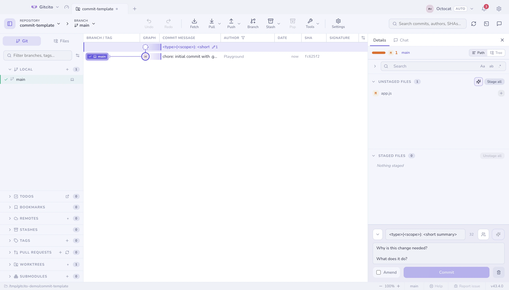

# Committen

## Nachrichtenstile

Wähle einen in den Einstellungen; der Editor passt sich daran an.

| Stil | Sieht so aus |
|---|---|
| **Conventional** | `feat(api)!: add rate limiting` — mit einer Typ-Auswahl |
| **Gitmoji** | `✨ add rate limiting` — mit einer Emoji-Auswahl |
| **Gitmoji + Conventional** | `✨ feat(api): add rate limiting` — Emoji-Auswahl *und* Typ-Dropdown |
| **Ticket** | `ABC-123: add rate limiting` — aus dem Branch-Namen vorbefüllt |
| **Plain** · **Auto** | Was immer du tippst; bei Auto entscheidet die KI über die Form |
| **Caveman** · **Haiku** | Genau das, wonach es klingt |

### Gitmoji

[Gitmoji](https://gitmoji.dev) stellt dem Betreff ein Emoji voran, damit sich
eine Historie auf einen Blick lesen lässt: 🐛 Fehlerbehebungen, ✨ Features,
🔥 Entfernungen. Bei beiden Gitmoji-Stilen sitzt die Emoji-Schaltfläche direkt
neben dem Betreff-Feld. Sie öffnet **alle 75 offiziellen Gitmoji**, durchsuchbar
nach Emoji, nach `:code:` (was gitmoji-cli-Nutzer tippen) oder nach Bedeutung in
deiner Sprache.

**Gitmoji + Conventional** hält Typ und Emoji im Gleichschritt. Wähle einen Typ,
und sein Emoji folgt; ändere den Typ, und es ändert sich mit — es sei denn, du
hast das Emoji selbst gewählt (etwa 🚑️ bei einem `fix`). Das wird nie überschrieben.

| Typ | Emoji | Typ | Emoji |
|---|---|---|---|
| `feat` | ✨ | `test` | ✅ |
| `fix` | 🐛 | `build` | 📦️ |
| `docs` | 📝 | `ci` | 👷 |
| `style` | 🎨 | `chore` | 🔧 |
| `refactor` | ♻️ | `revert` | ⏪️ |
| `perf` | ⚡️ | | |

Die KI schreibt in derselben Form. Vergisst ein Modell das Emoji oder antwortet
mit einem `:shortcode:`, wird der Betreff korrigiert, bevor er im Feld landet.

Commits, die andere Werkzeuge als `:sparkles: add login` geschrieben haben,
werden im Graphen, in den Commit-Details und in den Verlaufsansichten als
`✨ add login` **angezeigt**.

Grenzen:

- Die Auswahl schreibt immer das **Unicode**-Emoji, nie einen `:shortcode:`.
- Shortcodes werden nur für die Anzeige umgewandelt. Der Commit selbst wird
  nicht umgeschrieben, und die Suche im Verlauf findet den Text so, wie er
  committet wurde.
- Nur Gitmoji zählen: Ein Betreff, der mit einem anderen Emoji beginnt, bleibt unverändert.
- Ein Repository, dessen `commit-msg`-Hook commitlint mit dem Standard-Preset
  für Conventional ausführt, lehnt ein führendes Emoji ab. Das ist die Regel des
  Hooks, nicht von Gitcito — konfiguriere commitlint für Gitmoji oder nutze dort
  reines Conventional.

## Was der Editor für dich erledigt

- <kbd>↑</kbd> <kbd>↓</kbd> holt deine **letzten Nachrichten** zurück.
- Eine **Co-Autoren-Auswahl** fügt `Co-authored-by:`-Trailer aus den eigenen
  Mitwirkenden des Repositorys ein.
- `commit.template` / `.gitmessage` **befüllt** die Nachricht vor,
  Kommentarzeilen entfernt.
- Während eines Merge, Cherry-Pick oder Revert ist die Nachricht **vorbefüllt**,
  so wie git es täte.
- Entwürfe **bleiben** pro Repository erhalten, ein Tab-Wechsel verliert also
  nie eine Nachricht.

## Der Linter

Eine laufende, nicht blockierende Prüfung: Länge der Betreffzeile (mit
Zeichenzähler), ein Punkt am Ende, ein nicht-imperativer oder kleingeschriebener
Betreff, zu breite Zeilen im Textkörper. Hinweise, niemals eine Schranke — er
hält dich nicht vom Committen ab.

## Amend

Amend schreibt den letzten Commit mit dem um, was gerade gestaged ist. Gitcito
zeigt dir zuerst die vorhandene Nachricht, damit du sie bearbeitest, statt sie
neu zu tippen.

**Commit ändern…** auf einer Zeile des Graphen tut dasselbe für HEAD: Es lädt
die vollständige Nachricht, schaltet den Editor in den Amend-Modus und
fokussiert ihn. Ein bereits gepushter HEAD lässt sich weiterhin ändern, aber
Gitcito warnt, dass das Aktualisieren des Remotes einen Force-Push braucht.

**Commit rückgängig…** ist das Geschwister für einen ungepushten HEAD: Mixed
Reset auf den Eltern-Commit, die Änderungen im Arbeitsbaum bleiben erhalten,
die Nachricht kehrt in den Editor zurück. Der allererste Commit hat einen
eigenen Weg, der einen ungeborenen Branch hinterlässt, statt die Dateien zu
zerstören.

**Siehe auch:** [Staging](staging.md) · [Absorbieren](absorb.md) · [Changelog-Generator](changelog.md)
