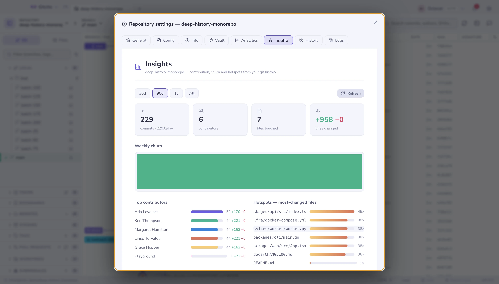

# Einstellungen pro Repository

Das Zahnrad neben den Werkzeugen in der Symbolleiste öffnet Einstellungen, die
zu **diesem** Repository gehören, nicht zur App.

| Tab | Was drinsteckt |
|---|---|
| **Allgemein** | Geschützte Branches (eine Mehrfachauswahl von Branches, in der git-Konfiguration gespeichert), Signieren, das Tab-Bild |
| **Config** | Die [Regeln, die dieses Repository mitbringt](repo-config.md), in `.gitcito.json` — und der Doctor, der sie prüft |
| **Info** | Freie Notizen und Felder zu diesem Repository, lokal gespeichert |
| **Tresor** | Die Einträge im [Tresor](vault.md) dieses Repositorys |
| **Einblicke** | Das [Historie-Dashboard](insights.md) |
| **Auswertung** | Was du in diesem Repository getan hast, lokal gezählt |
| **Historie** · **Protokolle** | Das Operationsprotokoll: jeder git-Befehl, den Gitcito ausgeführt hat, samt seiner Ausgabe |

Das Operationsprotokoll ist das ehrliche: Wenn sich etwas seltsam verhält, zeigt
es den exakten Befehl und den exakten Fehler — damit ein Fehlerbericht Fakten
transportieren kann statt Adjektive.

## Tab-Bild

Mit zehn offenen Tabs sind Namen, die gleich anfangen — `api`, `api-gateway`,
`api-docs` —, mühsam zu unterscheiden. Ein kleines Bild auf dem Tab findet man
schneller als einen Text.

Klicke unter **Allgemein** in das Bildfeld. Es listet die Bilder des Repositorys
selbst — PNG, JPEG, GIF, WebP, SVG, ICO, BMP und AVIF —, jedes mit Vorschaubild,
Dateien mit Namen wie Logo oder Icon zuerst. Tippe zum Eingrenzen (`logo dark`
findet `assets/logo-dark.png`), bewege dich mit den Pfeiltasten und wähle mit
Enter; oder gib einen Pfad von Hand ein. Der Pfad wird **relativ zum
Repository-Stamm** gespeichert, das Bild folgt dem Repository also, wo immer sein
Ordner liegt.

Was der Tab zeigt, ist eine App-weite Einstellung unter **Einstellungen →
Allgemein → Repository-Tabs zeigen**:

| Option | Der Tab zeigt |
|---|---|
| **Bild und Name** (Standard) | Das Bild anstelle des Ordnersymbols, dann den Namen |
| **Nur Name** | Ordnersymbol und Namen, als wäre kein Bild gesetzt |
| **Nur Bild** | Nur das Bild; der Name wandert in den Tooltip |

Grenzen, die man kennen sollte:

- Die Liste enthält die Dateien, die git sieht — versionierte und
  unversionierte, keine ignorierten — und höchstens 40 auf einmal; tippe, um
  den Rest zu erreichen. Ein ignoriertes Bild lässt sich trotzdem von Hand
  eintragen.
- Bilder über 1 MB oder unlesbare erscheinen ausgegraut und sind nicht
  wählbar: ein 20-Pixel-Symbol braucht nicht mehr.
- Ein Repository **ohne** Bild zeigt immer seinen Namen, egal welche Option
  gewählt ist — ein leerer Tab wäre nicht zu erkennen.
- Ist der Pfad **kaputt** — Datei gelöscht, umbenannt, kein Bild oder zu groß —,
  fällt der Tab still auf den Namen zurück, und diese Einstellungsseite zeigt
  unter dem Pfad eine Warnung. Sonst beschwert sich nichts.
- Das Bild wird einmal pro Sitzung gelesen. Ersetzt du die Datei unter gleichem
  Namen, öffne diese Einstellungsseite erneut, um es neu zu laden.
- Die Einstellung liegt in Gitcitos eigenen Einstellungen auf diesem Rechner,
  nicht im Repository; Teammitglieder erben sie also nicht.

**Siehe auch:** [Sicherheit & Geheimnisse](security.md) · [Einblicke](insights.md)
