# Diffs & previews

## Reading a diff

| Toggle | What it does |
|---|---|
| **Unified ↔ split** | Side-by-side when you want to compare, stacked when you want to read |
| **Word-level** | Highlights just the changed tokens inside an edited line — red on the old, green on the new |
| **Ignore whitespace** | Hides reindentation so the real change surfaces |
| **Moved code** (on by default) | Tints blocks that were only moved, not changed, in blue — shown when the diff has any |
| **Wrap** (split only) | Folds long lines inside their column instead of scrolling them |
| **Linked** (split, wrap off) | Scrolls both halves together, vertically and sideways — off, each column scrolls on its own |
| <kbd>⌘F</kbd> | Find inside the diff, with next/previous stepping |

Wrap is off by default, so one line stays on one row and the two sides remain
comparable row for row; each half carries its own sideways scrollbar. Turn
it on when you would rather read a long line than chase it — the cost is that a
line folding over three rows on one side no longer sits opposite its
counterpart. Every toggle remembers its state across files and sessions.

With wrap off the two halves scroll **linked** by default — vertically, which
keeps the rows facing each other, and sideways, so column 90 on the left sits
above column 90 on the right. Unlink them when the sides have drifted apart —
an indented block against an unindented one, a rename that shifted every line —
or when you want to compare two distant regions of the same file, and park each
half where its own content is.

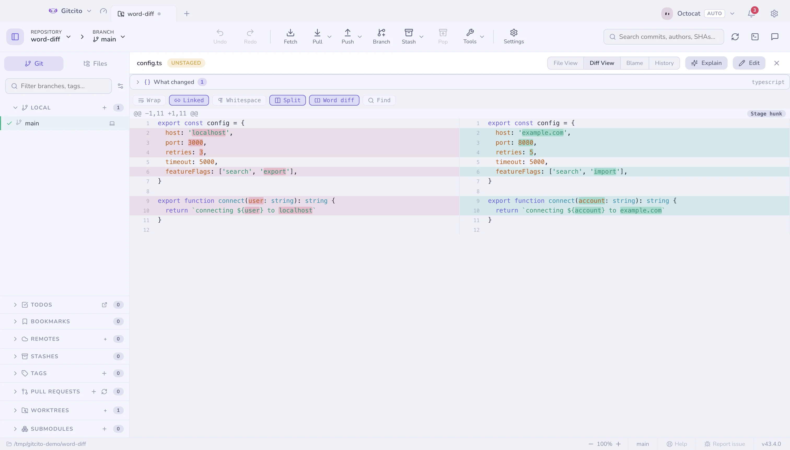

A diff you can act on — working changes, a commit, a stash — carries buttons
on each hunk and lets you select lines; see
[hunk and line actions](staging.md#hunk-and-line-actions) for what each does.

### Moved code

A block cut from one place and pasted in another shows up in a diff as a
deletion and an unrelated-looking addition, and nothing tells you the two are
the same code — you read it twice to find out nothing changed. **Moved code**
recognises the pair, after git's own `--color-moved`: a run of deleted lines
that reappears, line for line, as a run of added lines elsewhere in the same
file's diff. Both ends get a blue tint, and the margin shows an arrow pointing
at the other end — hover it for the line number. Neighbouring moved blocks
alternate between two shades of blue so you can tell where one ends. It works
in both the unified and the split view.

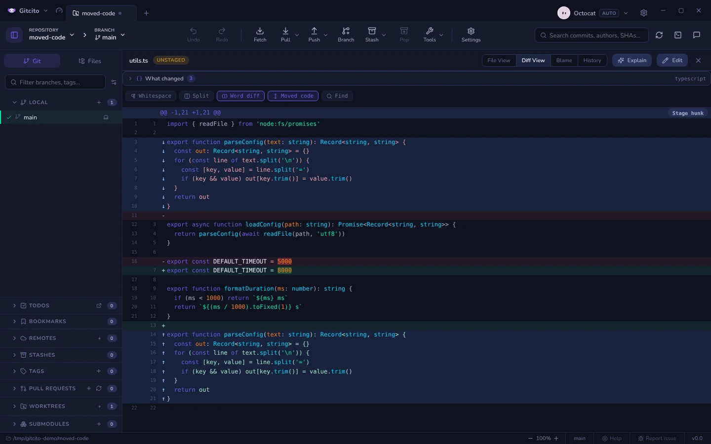

Lines are compared without their leading and trailing whitespace, so a block
moved into a deeper indent still counts. Moved lines skip word-level marks,
which would compare them with whatever line happens to sit opposite rather than
with the copy they moved from. Staging works as before: a moved line is still
an ordinary − or + line underneath.

Limits:

- like git, a block needs at least 20 letters and digits to count, so a
  shuffled `}` or `return` is not flagged;
- it only looks within one file, so code moved to another file is a deletion
  in one diff and an addition in the other;
- a block that was moved *and* edited is not marked — only the unchanged runs
  of lines around the edit are, if they are long enough;
- re-indenting lines in place is not a move, and blank lines are never
  matched.

The toggle appears only when the diff contains a move, and it remembers its
state like the others.

Above every diff sits the [semantic summary](semantic-diff.md) — what changed,
symbol by symbol, rather than line by line.

## When the file changes under you

A working-tree file stays open while something else works on it — a terminal,
an editor, or a coding agent you asked to commit. Its source was fixed when it
opened, so the pane used to go on diffing the side the file had left: staged
elsewhere, it said "No changes to display" under an **Unstaged** chip; committed,
it went blank. Now the viewer keeps up, and the chip in its header — Unstaged,
Staged, or a commit — says where the file is now:

| What happens outside Gitcito | What the open file does |
|------------------------------|-------------------------|
| The file is staged | Switches to the **Staged** diff |
| The file is unstaged | Switches back to the **Unstaged** diff |
| Part of the file is staged | Stays on the side you chose; both are real |
| The file is committed | Follows it into the new commit, so the diff stays on screen |
| The change is discarded or stashed | Closes, as there is nothing left to show |
| The commit you are reading is undone | Goes back to the **Staged** or **Unstaged** diff, wherever the change landed |
| …and its changes thrown away (`reset --hard`) | Closes — the change exists nowhere now, and the commit underneath is a different one |
| That commit was `HEAD` and is amended or reworded | Moves on to the rewritten commit |

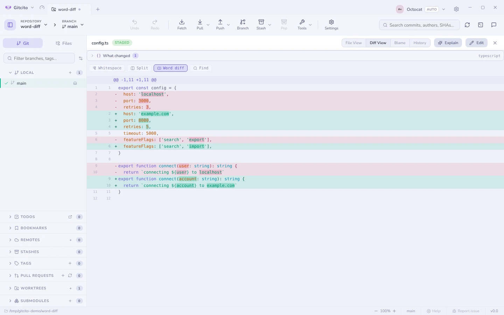

Committing from Gitcito's own composer still closes the file, as before: when
you commit, the result in the graph is what you want to see.

A commit that leaves history some other way — rebased away further back, say —
keeps its view: its content still exists, and guessing where it went would be
the surprise.

*Limits:* the viewer notices these changes when the repository is re-read — at
once with the file watcher, otherwise on the next refresh. While you are
editing the file in place it holds still, so an unsaved draft is never thrown
away. It only follows into the commit that `HEAD` now points at: if several
commits land at once and the file is not in the newest one, the view closes.
A conflicted file is left to the conflict resolver.

## Image diffs

Changed images get a real comparison: side by side, or a swipe handle to drag
between before and after.

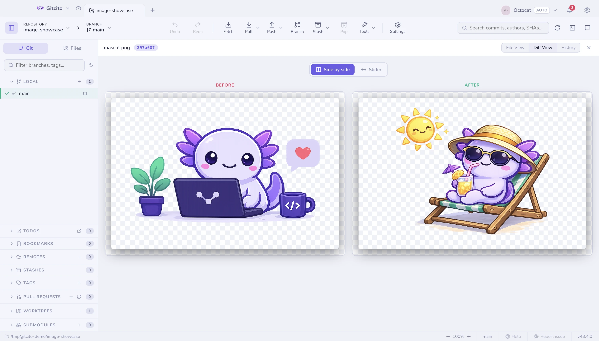

## Change gutter & minimap

The **File view** of a working-tree file — staged or not, tracked or brand new
— carries a colored bar next to every line touched since HEAD (or the index,
for staged files): green for an insertion, blue for a modification, a small
red wedge where lines were removed without replacement. Click a bar to see
that change without leaving the file — the popup shows the removed and added
lines, with next/previous to step through every change in the file.

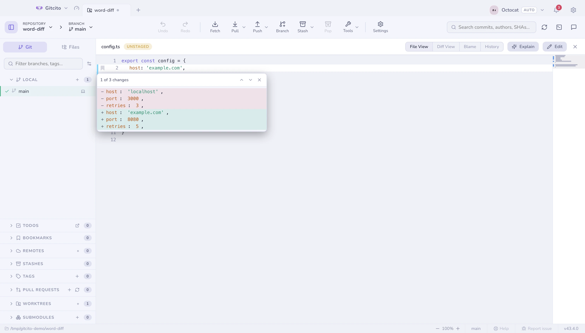

The **minimap**, off by default, adds a scaled overview of the whole file at
the right edge — click or drag it to jump around, the way a scrollbar would if
it could also show you the shape of the file. Both are per-machine toggles
under **Settings → General → File viewer**.

Neither reads history: switch to Diff, Blame or an older commit and the gutter
disappears — those views already show every change directly.

## Preview anything

The **Preview** mode renders the file instead of showing its source: Markdown,
Word (`.docx`), Excel (`.xlsx`), PDF, video, audio, images, and
syntax-highlighted code for everything else.

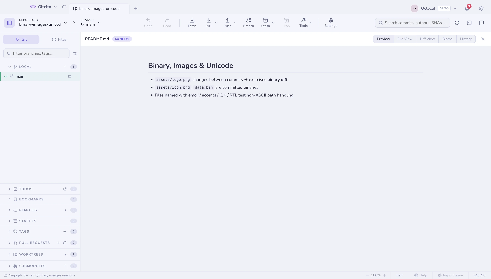

### Apple property lists

`Info.plist` and `*.entitlements` are XML, and XML is not what anyone is trying
to read. Preview shows the key/value outline instead — the shape Xcode's own
plist editor shows — with the nesting intact and each value's type beside it.

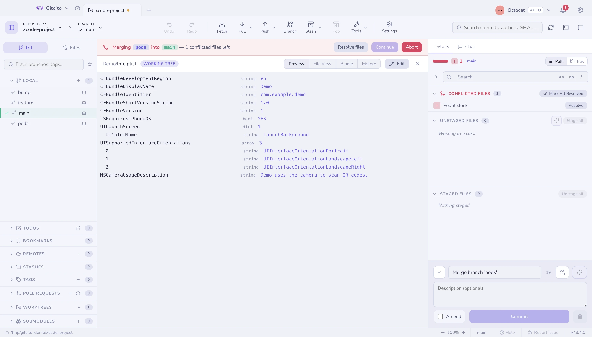

Two limits. A **binary** plist (`bplist00`) is recognised and named, not decoded
— run `plutil -convert xml1` on it if you want it here, though a binary plist in
a repository is usually a build artefact that should not be committed. And
`<data>` values are shown as a byte count rather than as base64: a blob tells
you nothing, and a provisioning profile rendered into a pane you might be
sharing tells everyone else too much.

### Xcode projects

A `project.pbxproj` is one flat dictionary of objects that point at each other
by id, so reading it in order tells you almost nothing about the project. The
preview walks those references and rebuilds the three things you actually came
for: the **targets** with their build phases, the **group tree** as the Xcode
navigator draws it, and the **build settings** per configuration.

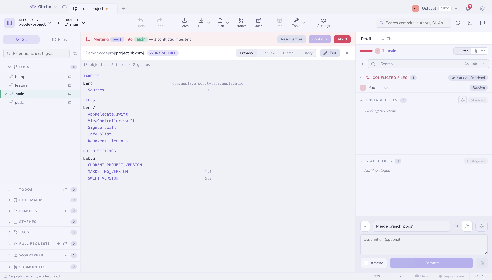

It is a reader, not an editor — nothing here writes to the project. For what
happens when two branches both edit one, see
[resolving conflicts](conflicts.md).

## Very large files

Previews and the file view load a file fully into memory, so both refuse files
past a size cap (32 MB for previews, 16 MB for text) and tell you how big the
file is instead. **Load anyway** overrides the cap for that one file — nothing
is off limits, big loads are just opt-in. Files and diffs past a few thousand
lines still render completely, but rows scrolled out of view are no longer
laid out and painted, so a giant lockfile diff stops costing a laptop's worth
of memory.

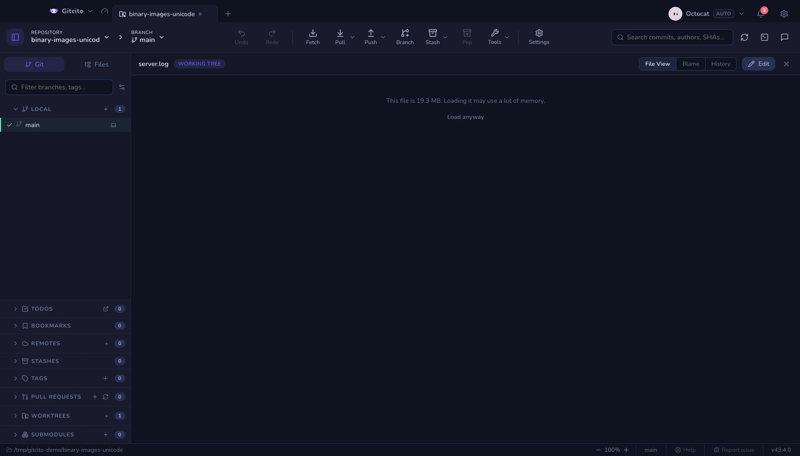

## Files tab

The left sidebar's **Files** tab browses the working tree itself, with status
badges on folders (added / modified / deleted) that aggregate what is inside
them.

The search box above it filters by file name or searches file contents. A
content search starts once you pause typing, and each new letter stops the
search before it, so typing stays smooth on a large repository. Plain text runs
through `git grep` over tracked and untracked files. *Limits:* a regex search
skips files over 4 MB, and results stop at 2,000 lines (100 per file).

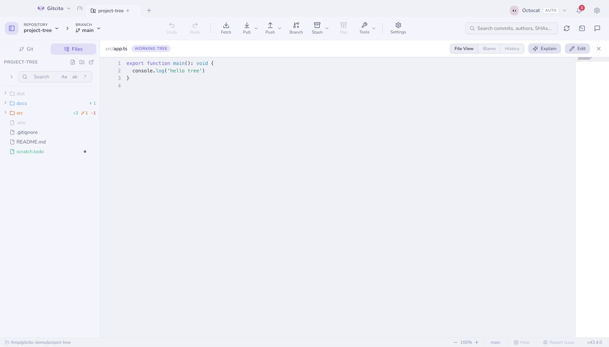

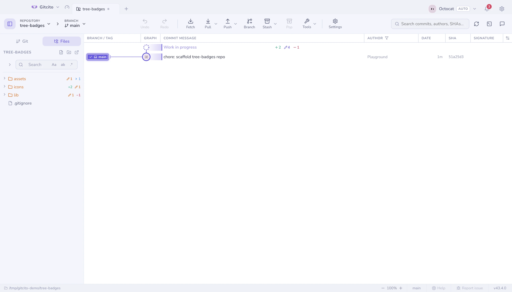

**See also:** [Semantic diff](semantic-diff.md) · [Staging](staging.md)
