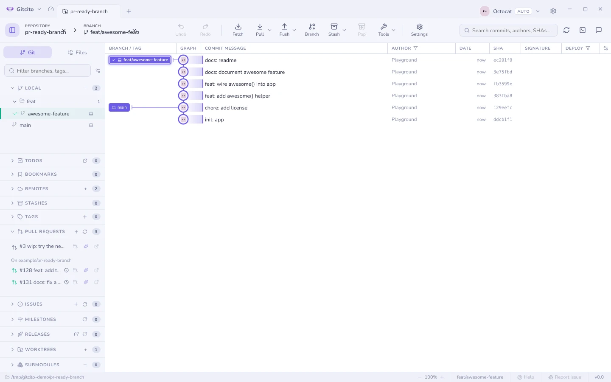

# Hosting y pull requests

## Crear

Crea un pull (o merge) request sin salir de la app: desplegables de ramas,
título y cuerpo rellenados a partir de los commits de la rama, un interruptor
de borrador y — en GitHub — revisores, etiquetas y asignados aplicados al
crearlo.

Funciona en **GitHub, GitLab, Bitbucket y Azure DevOps**. Los PR/MR abiertos de
los cuatro aparecen listados en la barra lateral.

Empieza uno desde la comparación de ramas, desde el grafo, desde el `+` del
panel de PRs, o desde una incidencia (lo que rellena `Closes #N`).

## Pilas en la lista

Los pull requests que se apoyan unos en otros se colapsan en una sola fila con
un icono de pila, la rama en la que aterriza la cadena y cuántos hay. Despliégala
para ver la cadena en orden de lectura —de la hoja hacia la base— con una
flechita bajo cada una que dice en qué se fusiona, así la dirección se ve en vez
de deducirse de cuatro ramas base.

Dos cosas forman ese grupo: el número de pila propio de GitHub, cuando los PR
pertenecen a una [pila nativa](stacks.md), y si no las propias refs: un pull
request cuya base es la cabeza de otro se apoya en él. Esa segunda regla es la
que hace que también funcione en GitLab, Bitbucket y Azure DevOps, y con cadenas
abiertas antes de que nada de esto existiera.

Cada fila lleva el estado de los **checks** de su cabeza —pasa el ratón para ver
las cuentas— y, en GitHub, también los niveles ya cerrados o fusionados, que una
lista de PR abiertos escondería. Un nivel por encima de uno **cerrado** se marca
como bloqueado: sus checks pueden estar en verde, pero la rama a la que apunta no
va a aterrizar nunca. Las acciones de la fila salen al pasar el ratón, para que
el título conserve el ancho.

Leer los checks cuesta una petición por pull request, y solo al refrescar la
lista.

## Tus pull requests en el repositorio original de un fork

En un fork, los pull requests que importan suelen ser los que abriste en el
repositorio del que hiciste el fork, y esos viven allí, no en tu fork. Por eso,
cuando un repositorio tiene un remoto `upstream` que apunta a un repositorio de
GitHub distinto de `origin`, la lista también le pide a `upstream` sus pull
requests abiertos y conserva **solo aquellos cuya rama viene de tu fork**.
Aparecen debajo de los de tu fork, bajo un título con el nombre del original,
**En owner/repo**. Un clic abre la misma vista de detalle, con sus checks y su
revisión, en el original.

*Límites:* solo GitHub, y solo un remoto llamado `upstream`. Los demás pull
requests del original se omiten a propósito: esa es la cola del original, no tu
trabajo. Las pilas y las búsquedas de ramas siguen usando solo la lista de
`origin`. Consultar el original cuesta una petición más por actualización.

## Revisar — GitHub y GitLab

Al hacer clic en un pull request se abre como **una página propia**. Va unida a
su repositorio como la wiki: un icono con el número del PR en la pestaña del
repositorio, o en su chip dentro de un grupo. Vuelve a hacer clic en el icono, o
en el nombre del repositorio, para regresar. **Abrir en una pestaña nueva** en el
menú contextual del PR le da en cambio una pestaña propia. Si el repositorio no
está abierto en ningún sitio, el PR se abre en una pestaña propia.

El trabajo ocurre en la columna principal, y la barra lateral dice qué *es* el
PR, sin tener que desplazarte. Con la IA activada, el botón ✨ de la cabecera
revisa el diff del PR tal como lo informa el host, así que funciona incluso con
una rama que nunca descargaste (un fork, la de otra persona).

La columna principal tiene tres secciones:

| Sección | Qué contiene |
|---|---|
| **Conversación** | La descripción, los comentarios y los hilos de revisión en línea (`archivo:línea`, con respuestas). Después, el cuadro de comentario con comentar / aprobar / pedir cambios, y el cuadro de merge (merge, squash o rebase) |
| **Archivos** | Cada archivo cambiado, y el diff del seleccionado junto a la lista, con resaltado de sintaxis y cambios a nivel de palabra (los archivos que parecen secretos se enmascaran si ese ajuste está activo). Una lista ✓ de "visto" recuerda tu avance. Un archivo del que el host no envía diff (binario o demasiado grande) enlaza al host |
| **Checks** | Check-runs de CI (GitHub), jobs de pipeline (GitLab), estados de commit (Forgejo) o estados del PR (Azure DevOps), con pasa/falla/en curso y enlaces a los logs |

La barra lateral muestra:

| Fila | Muestra |
|---|---|
| **Autor** | Quién lo abrió, y cuándo |
| **Estado** | Abierto, borrador, fusionado (por quién, cuándo) o cerrado; conflictos con el destino |
| **Revisores** | La última decisión de cada revisor (aprobado, cambios pedidos, comentado) y quién falta por revisar, equipos incluidos |
| **Asignados, etiquetas, hito** | Tal como están en el host, las etiquetas en sus propios colores |
| **Ramas** | Origen → destino, y el fork del que viene |
| **Cambios** | Archivos cambiados, commits, líneas añadidas y quitadas, con una barra |
| **Checks** | Pasados / fallidos / en curso, a un clic de la sección Checks |
| **Participantes** | Todos los que participaron |
| **Actividad** | Cuándo se abrió y cuándo se actualizó por última vez |

GitLab no informa los totales de líneas de un merge request; se suman desde la
lista de archivos cuando carga. Una fila que el host no informa se omite.

Si alguien hace force-push en mitad de la revisión, [qué cambió desde entonces](range-diff.md)
te muestra exactamente qué se movió.

Diferencias de GitLab, dichas sin rodeos: GitLab no tiene una única llamada de
"enviar revisión", así que **aprobar** usa su endpoint de aprobación y **pedir
cambios** retira tu aprobación y publica tu comentario. **Rebase-merge** no se
ofrece — GitLab decide entre commit de merge y fast-forward según los ajustes del
proyecto, así que el menú de merge muestra solo merge y squash. Los hilos en
línea muestran archivo y línea, pero no el fragmento de diff alrededor, que la
API de GitLab no devuelve. Revisar y fusionar funciona en gitlab.com y en un
[GitLab autogestionado](#gitlab-autogestionado). Bitbucket sigue abriéndose en el
navegador para revisar.

Diferencias de Forgejo: los hilos de comentarios en línea se muestran pero no se
pueden responder (Forgejo no tiene API para ello), y los checks son los estados
del commit de la cabeza — más en [Forgejo](#forgejo).

Diferencias de Azure DevOps: aprobar emite tu voto (*Approved*); **pedir
cambios** vota *Waiting for author*. Completar el PR admite merge, squash o
rebase. Azure lista los archivos cambiados de un PR pero no envía diff, así que
la app descarga las dos versiones de cada archivo y calcula el diff ella misma —
para los primeros 200 archivos; un archivo binario, o un cambio demasiado grande,
enlaza al host. Las personas aparecen con sus iniciales, porque las fotos de
perfil de Azure requieren un navegador con sesión iniciada.

La barra lateral también lista los **work items vinculados al PR** — número,
título, tipo y estado —, cada uno se abre en el navegador. Leerlos requiere un
token que pueda leer work items (*Work Items: Read*); sin él, la fila
simplemente no aparece.

## GitLab autogestionado

Un GitLab de empresa vive en su propia dirección. Indícasela a un perfil en
**Ajustes → Integraciones → GitLab → Dirección de GitLab**, por ejemplo
`git.example.org` o `https://example.net/gitlab` si está servido bajo una ruta.
Desde entonces, los remotos en ese host son GitLab: los merge requests se listan,
abren, revisan y fusionan, el explorador de clonado y *crear repositorio* hablan
con él, y push y fetch se autentican con el token de ese perfil.

**Un token de GitLab pertenece a una sola instancia.** El token de un perfil solo
se envía a la dirección que ese perfil indica. Si la dirección está vacía,
significa gitlab.com. Un token de gitlab.com nunca llega al servidor de la
empresa, y uno de la empresa nunca llega a gitlab.com. Si la cuenta del trabajo y
la personal están en instancias distintas, dale a cada una su perfil. Un
repositorio vinculado a un perfil usa la instancia de ese perfil.

**Crear token** abre la página de tokens de tu instancia con `api` y
`write_repository` preseleccionados. Un token de solo lectura conecta sin
problema y luego falla en el primer push.

Límites:

- **Solo https.** Una dirección `http://` se rechaza, porque el token cruzaría la
  red en claro.
- **Una instancia de GitLab por perfil.** Añade un segundo perfil para una
  segunda instancia.
- Por ssh se compara el host, no la ruta, así que dos instancias en un mismo host
  con rutas distintas no se distinguen en un remoto ssh.
- Los avatares de remotos solo se dibujan para gitlab.com y github.com. Un remoto
  autogestionado recibe el icono simple, para que los nombres de sus grupos nunca
  se envíen a un host público.

## Forgejo

Configura la dirección de la instancia antes de introducir su token. Cambiar la dirección borra el inicio de sesión anterior.

Forgejo — y Gitea, que comparte su API — siempre corre en una dirección elegida
por su dueño: tu propio servidor, o uno público como codeberg.org. Indícale esa
dirección a un perfil en **Ajustes → Integraciones → Forgejo**, junto con un token
de acceso. **Crear token** abre la página de tokens de ese servidor. Dale al token permiso de lectura y escritura en *repository*, *issue* y
*notification*, y de lectura en *user* y *organization*. Los permisos de un token
no se pueden cambiar después: uno creado sin *issue* o *notification* no lista
issues ni notificaciones, y la solución es crear uno nuevo.

Desde entonces, los remotos en ese servidor son Forgejo:

| Funciona | Cómo |
|----------|------|
| Push y fetch | Autenticados con el token del perfil |
| Pull requests abiertos | Listados en la barra lateral, y se abren en la [página del pull request](#revisar--github-y-gitlab): conversación, diff de cada archivo, checks (estados del commit, incluido Forgejo Actions), comentar, aprobar, pedir cambios y merge / squash / rebase |
| Crear un pull request | Desde la app; un borrador lleva el prefijo `WIP:` que usa Forgejo |
| Explorador de clonado, crear repositorio | En ese servidor, bajo tu cuenta o una organización |

Un check que es un job de **Forgejo Actions** muestra su log bajo la fila, con
colores, empezando por el final, donde está el fallo. Forgejo no tiene API para
logs de jobs, así que la app pide la misma página que descarga el visor de logs
de la web, y envía el token solo cuando el enlace es un job de este mismo
servidor; un estado de una CI externa nunca lo recibe. Un servidor que solo
entrega logs a un navegador con sesión responde con su página de inicio de
sesión, y la fila lo dice y ofrece el navegador. Los logs muy largos muestran sus
últimas miles de líneas.

Igual que con GitLab, **un token de Forgejo solo va al servidor que lo emitió**.
Un perfil sin dirección de Forgejo no tiene ninguna credencial de Forgejo. No hay
servidor por defecto al que recurrir.

Límites:

- Los hilos de comentarios en línea se muestran, pero no se pueden responder
  desde la app: Forgejo no tiene API para responder dentro de un hilo existente.
  Responde en el servidor.
- Solo https, un servidor de Forgejo por perfil.
- Las listas se detienen tras veinte peticiones: 1.000 pull requests o repositorios con el tamaño de página predeterminado del servidor.

## Issues, hitos, releases — GitHub y Forgejo

Explora las incidencias y abre una pestaña completa por incidencia: cuerpo,
comentarios, etiquetas, asignados, hito, campos de Projects v2, cerrar/reabrir,
y **crear una rama para esta incidencia** (con nombre generado por IA). Los
hitos muestran su progreso y sus incidencias. Los releases se pueden explorar
con su página de changelog.

En un servidor [Forgejo](#forgejo) funcionan las mismas listas y páginas, con
el token de Forgejo del perfil. Dos cosas son solo de GitHub y quedan vacías allí:
los campos de Projects v2 y los pull requests vinculados a una issue. Las
releases listan las más recientes, no todo el historial.

## Esperando tu revisión

En la lista de pull requests de la barra lateral, un 👁 marca los PRs en los que
**tú** eres revisor y aún no has respondido — en GitHub, GitLab y Forgejo por
igual. Quién eres «tú» se le pregunta al host con la credencial del perfil y se
recuerda diez minutos. Un token que no puede leer su propio usuario (sin
`read:user` en Forgejo, por ejemplo) no marca nada.

Con **Ajustes → Notificaciones del sistema** activado, un pull request de GitLab o
Forgejo que *empieza* a esperarte lanza una; hacer clic abre la página del PR. La
primera mirada a un repositorio solo toma nota de lo que ya espera, así que abrir
la app no repite el atraso. Las solicitudes de revisión de GitHub quedan para su
bandeja de notificaciones, más abajo, que ya las anuncia.

## Notificaciones — GitHub y Forgejo

Tu bandeja entera — peticiones de revisión, menciones, actividad de CI — de
todos los repositorios, con filtros de no leídas/todas y marcar como leída. La
campana de la barra lleva un contador de no leídas, y opcionalmente saltan
notificaciones de escritorio cuando te piden una revisión o cuando termina la
CI.

Si el perfil activo tiene un servidor Forgejo, sus notificaciones entran en la
misma lista, de las más nuevas a las más antiguas, y se marcan como leídas en ese
servidor. Forgejo no dice *por qué* se te notificó, así que esas filas no tienen
motivo y nunca lanzan una notificación del sistema — eso lo decide el motivo.

## Tokens

Tokens por perfil para varias cuentas u organizaciones, guardados en el llavero
del sistema. Gitcito también puede tomar prestado lo que ya tenga tu **helper
de credenciales de git**, así que una organización para la que ya te has
autenticado a menudo no necesita configuración ninguna. Mira [Seguridad y
secretos](security.md).

Cada perfil **vincula su propia cuenta**. En Ajustes → Integraciones, **Iniciar
sesión con git** busca un inicio de sesión que ya esté en el equipo — el
credential helper de git, luego la cuenta activa de **GitHub CLI**, luego la
ventana de inicio de sesión del propio helper — y vincula esa cuenta al perfil.
Nada se comparte implícitamente: un perfil nuevo empieza desconectado, y se
rechaza una cuenta que otro perfil ya vinculó. Para vincular una segunda cuenta
de GitHub, añádela a gh (`gh auth login`), actívala (`gh auth switch`) e inicia
sesión desde el otro perfil — o pega el token de esa cuenta. Git nunca pide
usuario y contraseña en una terminal.

La página indica si la conexión es el token del perfil, su vínculo con el helper
de git o su vínculo con GitHub CLI, y **Desconectar** lo deshace solo para este
perfil: un token se borra (sigue siendo válido en el servicio hasta que lo
revoques allí), un vínculo se quita (el inicio de sesión sigue en gh o en el helper).

La API del servicio — pull requests, issues, CI — y el fetch, pull y push del
propio git por https usan el token o la cuenta vinculada del perfil. La
credencial llega a git solo para ese comando, limitada al host del remoto, y
nunca se escribe en `.git/config`. Un perfil sin ninguno de los dos deja a git
con su propio credential helper. Azure DevOps, GitLab y Bitbucket se vinculan
mediante el credential helper de git — Git Credential Manager guarda varias
cuentas por servicio — o usan un token por perfil. Un vínculo nombra una cuenta
por servicio, así que organizaciones que necesitan cuentas distintas llevan un
perfil cada una.

**Ver también:** [Ramas apiladas](stacks.md) · [Funciones de IA](ai.md)
