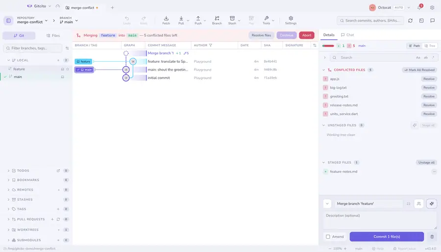
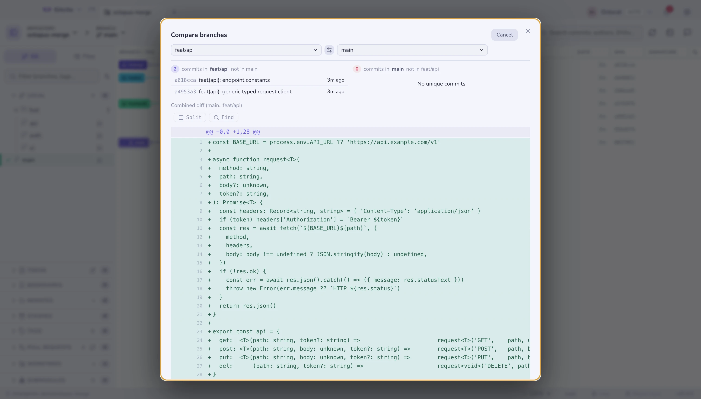
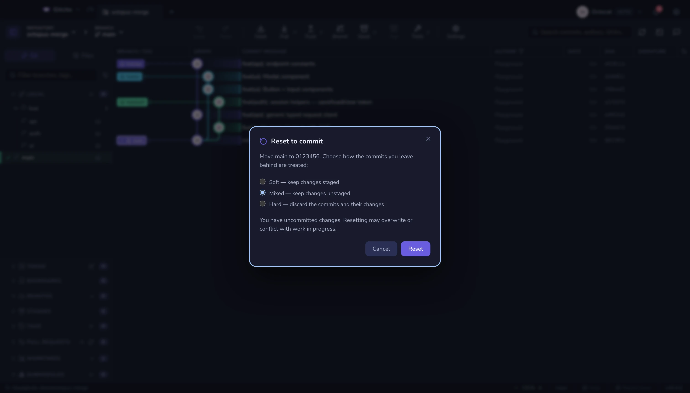

# Fusion et rebase

## Depuis la barre latérale

Clic droit sur une branche pour **Fusionner dans la branche courante** ou
**Rebaser sur** — ou **Fusionner avec des options…** quand c'est la fusion
ordinaire qui ne cesse de mal tourner ; voir [les options de
fusion](merge-options.md).

## Glisser une référence sur une autre

Le geste le plus rapide de l'application : attrapez une branche et déposez-la sur
une autre. Gitcito ouvre un petit menu de ce que ce dépôt pourrait signifier, et
ne fait rien tant que vous n'avez pas choisi.

Cela fonctionne aux **deux** endroits où les références sont affichées : les
lignes de branches, de distants et d'étiquettes de la barre latérale, et les
**badges de références colorés dans le graphe** lui-même. Glissez entre eux dans
n'importe quelle combinaison ; la cible se met en surbrillance pendant que vous
la survolez.

| Dépôt | Signifie |
|------|-------|
| **Avance rapide de {target} jusqu'à {source}** | Avance la cible jusqu'à la source sans l'extraire — proposé seulement si la cible est une branche locale en retard sur la source, et qu'elle n'est extraite ni ici ni dans un autre [arbre de travail](worktrees.md) |
| **Fusionner {source} → {cible}** | Extrait la cible et y fusionne la source |
| **Rebaser {source} sur {cible}** | Rejoue les commits de la source par-dessus la cible |
| **Rebase interactif de {source} sur {target}…** | Ouvre le planificateur de [rebase interactif](rebase.md) — proposé quand la source est la branche extraite |
| **Pousser {source} vers {target}** | Pousse la source vers la branche distante de la cible (`origin/main`) — jamais forcé, le dépôt distant refuse donc tout ce qui n'est pas une avance rapide ; demande d'abord confirmation, et applique les mêmes contrôles de secrets que pour tout push |
| **Réinitialiser {source} sur {target}…** | Ouvre la boîte de réinitialisation — soft, mixed ou hard, avec ce que chacun garde — quand la source est la branche extraite |
| **Créer une pull request {source} → {target}…** | Ouvre le formulaire de [pull request](hosting.md) avec les deux branches — proposé quand le dépôt distant est chez un hébergeur pris en charge |
| **Pousser {source} et ouvrir une pull request vers {target}…** | Remplace *Créer une pull request* quand la source n'est pas encore sur le dépôt distant : la pousse, puis ouvre le formulaire |
| **Comparer** | Ouvre la [comparaison](#comparer-deux-références-quelconques) — ne change rien |

**Le menu ne propose que ce que git sait faire.** Fusionner valide un commit sur
la cible : la cible doit donc être une branche locale — on ne peut pas fusionner
dans une étiquette ni dans une référence de suivi distant. Rebaser réécrit la
source : la source doit donc être une branche locale. Déposez une étiquette sur
une branche distante et tout ce qu'on vous propose est *Comparer*, parce que
c'est sincèrement tout ce qui existe.

Le rebase demande d'abord confirmation : il donne un nouveau hash à chaque commit
rejoué, ce qui signifie un push forcé si la branche est déjà publiée. Le push
demande aussi : tous ceux qui tirent la cible reçoivent ses commits, et un push
ne peut pas être annulé depuis Gitcito. La fusion, elle, ne demande rien — elle
ne fait qu'ajouter. Fusion et rebase se défont d'un seul **Annuler**.

## Glisser un commit sur une branche

Glissez une ligne de commit du graphe sur le badge d’une **branche locale** :

| Déposé sur | Propose |
|------------|---------|
| La branche courante | **Cherry-pick** du commit ici ; **Reset** de la branche sur lui (la boîte de reset, qui dit ce que garde chaque mode) |
| Une autre branche locale | **L’extraire et faire le cherry-pick** ; **Déplacer la branche** sur le commit (`git branch -f`) |

Déplacer une branche demande confirmation : les commits que seule cette branche
atteignait ne sont plus sur aucune branche ensuite. Annuler la remet en place.
Les branches de suivi distantes et les tags n’acceptent pas de commit, git ne les
déplaçant pas ainsi, et une branche pointant déjà sur le commit ne propose rien.
Le même glisser sur le chat IA ajoute toujours le commit comme contexte.

## Fusion

Avance rapide quand c'est possible, ou commit de fusion forcé quand vous voulez
que la topologie soit enregistrée. En cas de conflit, vous atterrissez dans [le
résolveur](conflicts.md).

## Comparer deux références quelconques

Choisissez une base et une référence à comparer — branche, étiquette ou SHA brut,
avec un bouton d'échange — et vous obtenez les compteurs d'avance/retard, les
commits propres à chaque côté, le diff combiné complet, et un passage de relais
en un clic vers **ouvrir une pull request**.

Accessible depuis la barre latérale (comparer avec la branche courante), depuis
le menu Outils, ou par <kbd>⌘K</kbd>.

## Cherry-pick, revert, réinitialisation

Le cherry-pick et le revert vivent dans le menu contextuel du graphe, comme ils
l'ont toujours fait. **La réinitialisation** est une seule entrée —
**Réinitialiser au commit…** — au lieu de trois éléments soft/mixed/hard bruts
qui se contredisaient.

Amender, annuler et réinitialiser sont en haut du menu de commit unique et
restent **visibles quand ils sont risqués** : ils se désactivent, avec une
info-bulle qui dit pourquoi. Annuler n'existe que pour un HEAD non poussé ;
amender est aussi permis sur un HEAD publié, mais prévient qu'un push forcé
sera nécessaire. La réinitialisation n'atteint que les ancêtres locaux plus le
premier commit publié — pas un historique plus ancien arbitraire.

La boîte de dialogue de réinitialisation rend le mode explicite :

| Mode | Résultat |
|------|----------|
| **Soft** | Garder les changements indexés |
| **Mixed** | Garder les changements non indexés |
| **Hard** | Jeter les commits et leurs changements |

Hard n'est jamais présélectionné. Un arbre de travail sale reçoit un
avertissement supplémentaire, parce que réinitialiser peut écraser du travail en
cours ou entrer en conflit avec lui. **Voir sur GitHub** vit avec les actions de
copie et ne s'ouvre que pour les commits publiés sur un distant github.com.

Sélectionnez d'abord plusieurs commits et le cherry-pick applique toute la
sélection, dans l'ordre.

## Avant de fusionner quoi que ce soit

Le [radar de conflits](conflict-radar.md) balaye chaque branche contre une base
et vous dit lesquelles vont se battre, sans rien extraire.

**Voir aussi :** [Rebase interactif](rebase.md) · [Branches empilées](stacks.md) · [Radar de conflits](conflict-radar.md)
