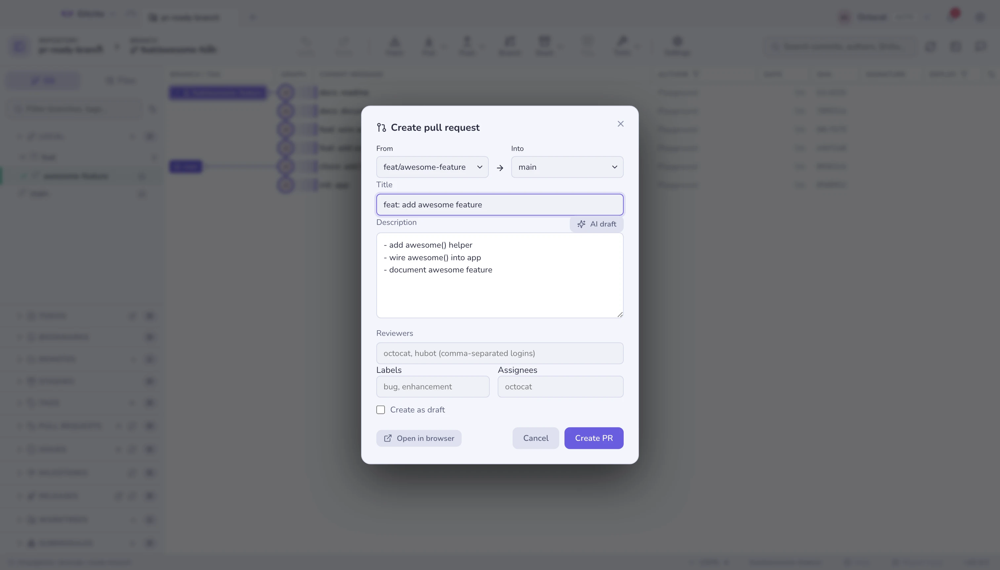
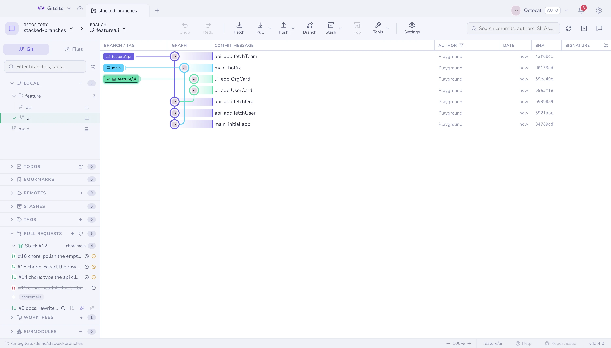
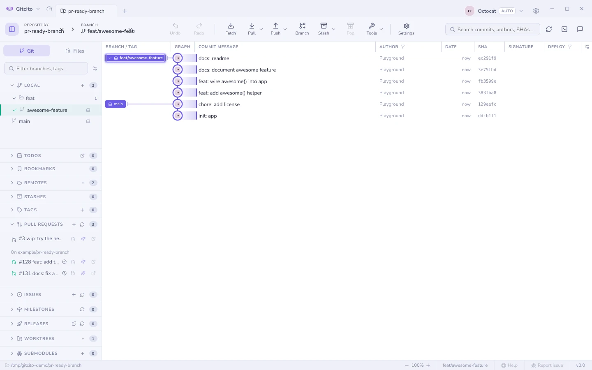

# Hosting & pull requests

## Creating

Create a pull (or merge) request without leaving the app: branch dropdowns,
title and body prefilled from the branch's commits, a draft toggle, and — on
GitHub — reviewers, labels and assignees applied on create.

Works on **GitHub, GitLab, Bitbucket and Azure DevOps**. Open PRs/MRs for all
four are listed in the sidebar.

Start one from branch-compare, the graph, the `+` in the PR panel, or from an
issue (which fills in `Closes #N`).

## Stacks in the list

Pull requests that sit on each other collapse into one row with a stack icon,
the branch the chain lands on, and how many are in it. Expand it to see the
chain in reading order — leaf first, down to the base — with a small arrow under
each one naming what it merges into, so the direction is on screen rather than
inferred from four base branches.

Two things put a group there: GitHub's own stack number, when the pull requests
belong to a [native stack](stacks.md), and otherwise the refs themselves — a
pull request whose base is another's head sits on it. The second rule is why
this also works on GitLab, Bitbucket and Azure DevOps, and for chains opened
before any of that existed.

Each row carries the state of its head's **checks** — hover for the counts —
and, on GitHub, the levels that are already closed or merged, which a list of
open pull requests would otherwise hide. A level above a **closed** one is
marked blocked: its own checks may be green, but the branch it targets is never
going to land. The row's actions appear on hover, so the title keeps the width.

Reading the checks costs one request per pull request, and only when the list is
refreshed.

## Your pull requests on the parent of a fork

In a fork, the pull requests that matter are usually the ones you opened on the
repository you forked from, and those live there, not on your fork. So when a
repository has an `upstream` remote that points at a different GitHub repository
than `origin`, the list also asks `upstream` for its open pull requests and keeps
**only the ones whose branch comes from your fork**. They appear under a caption
naming the parent, **On owner/repo**, below your fork's own. A click opens the
same detail view, with its checks and review, on the parent.

*Limits:* GitHub only, and only a remote named `upstream`. The parent's other
pull requests are left out on purpose: that is the parent's queue, not your
work. Stacks and branch lookups still act on `origin`'s list alone. Listing the
parent costs one more request per refresh.

## Reviewing — GitHub and GitLab

| | |
|---|---|
| **Conversation** | Comments and review state |
| **Checks** | CI check-runs (GitHub) or pipeline jobs (GitLab) with pass/fail/pending and view-logs links |
| **Files viewed** | A per-file ✓ checklist with progress |
| **Inline threads** | Line comments grouped by `file:line`, and replies |
| **Actions** | Comment, approve, request changes, and merge / squash |

If someone force-pushes mid-review, [what changed since](range-diff.md) shows
you exactly what moved.

GitLab differences, stated plainly: GitLab has no single "submit review" call,
so **approve** uses its approval endpoint and **request changes** removes your
approval and posts your comment. **Rebase-merge** is not offered — GitLab
decides merge-commit vs fast-forward from the project's settings, so the merge
menu shows merge and squash only. Inline threads show the file and line but not
the surrounding diff hunk, which GitLab's API does not return. Review/merge
works for projects on **gitlab.com**; self-hosted instances are not supported
yet. Bitbucket and Azure DevOps still open in the browser for review.

## Issues, milestones, releases — GitHub

Browse issues and open a full issue tab: body, comments, labels, assignees,
milestone, Projects v2 fields, close/reopen, and **create a branch for this
issue** (with AI naming). Milestones show progress and their issues. Releases
are browsable with a changelog page.

## Notifications — GitHub

Your whole inbox — review requests, mentions, CI activity — across every
repository, with unread/all filters and mark-as-read. The toolbar bell carries
an unread badge, and optional desktop notifications fire when a review is
requested or CI finishes.

## Tokens

Per-profile tokens for multiple accounts or orgs, stored with your OS keychain.
Gitcito can also borrow whatever your **git credential helper** already holds,
so an org you have already authenticated for often needs no setup at all. See
[Security & secrets](security.md).

**See also:** [Stacked branches](stacks.md) · [AI features](ai.md)
