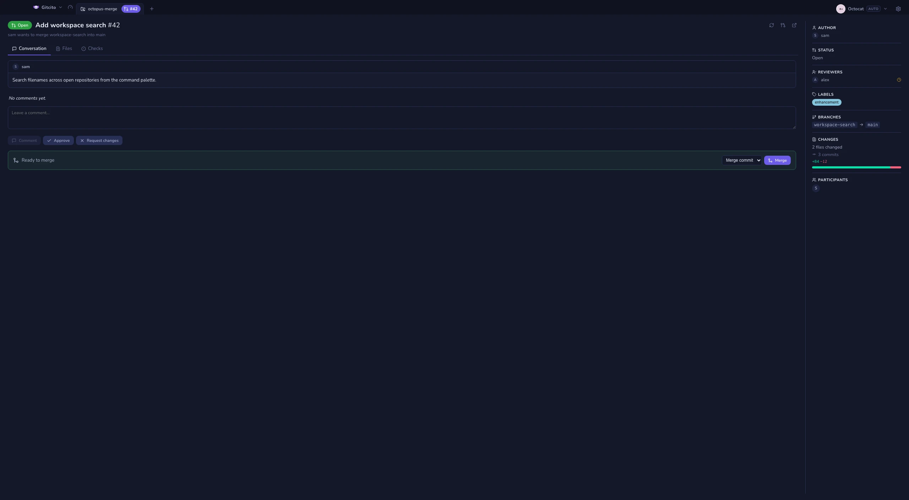

# Hosting e pull request

## Creare

Crea una pull request (o merge request) senza uscire dall'app: menu a tendina per
i branch, titolo e corpo precompilati dai commit del branch, un interruttore per
la bozza e — su GitHub — revisori, etichette e assegnatari applicati alla
creazione.

Funziona su **GitHub, GitLab, Bitbucket e Azure DevOps**. Le PR/MR aperte di
tutti e quattro sono elencate nella barra laterale.

Puoi partire dal confronto fra branch, dal grafo, dal `+` nel pannello delle PR,
oppure da una issue (che compila `Closes #N`).

## Le pile nell’elenco

Le pull request appoggiate una sull’altra si richiudono in una sola riga con
un’icona di pila, il ramo su cui atterra la catena e quante sono. Espandila per
vedere la catena in ordine di lettura — dalla foglia giù fino alla base — con una
freccetta sotto ognuna che dice in cosa confluisce: la direzione è a schermo,
non da dedurre da quattro rami base.

Due cose formano quel gruppo: il numero di pila di GitHub, quando le PR
appartengono a una [pila nativa](stacks.md), altrimenti le ref stesse: una pull
request la cui base è la testa di un’altra si appoggia su di essa. La seconda
regola è ciò che lo fa funzionare anche su GitLab, Bitbucket e Azure DevOps.

Ogni riga porta lo stato dei **check** della sua testa — passa sopra per i
conteggi — e, su GitHub, anche i livelli già chiusi o uniti, che un elenco di PR
aperte nasconderebbe. Un livello sopra uno **chiuso** viene segnato come
bloccato: i suoi check possono essere verdi, ma il ramo a cui punta non atterrerà
mai. Le azioni della riga compaiono al passaggio del mouse, così il titolo tiene
la larghezza.

Leggere i check costa una richiesta per pull request, e solo quando l’elenco
viene aggiornato.

## Le tue pull request sul repository d’origine di un fork

In un fork, le pull request che contano sono di solito quelle aperte sul
repository da cui hai fatto il fork, e vivono lì, non nel tuo fork. Perciò,
quando un repository ha un remote `upstream` che punta a un repository GitHub
diverso da `origin`, l’elenco chiede anche a `upstream` le sue pull request aperte
e tiene **solo quelle il cui branch viene dal tuo fork**. Compaiono sotto quelle
del tuo fork, sotto un’intestazione con il nome dell’origine, **Su owner/repo**.
Un clic apre la stessa vista di dettaglio, con check e revisione, sull’origine.

*Limiti:* solo GitHub, e solo un remote chiamato `upstream`. Le altre pull request
dell’origine restano fuori di proposito: quella è la sua coda, non il tuo lavoro.
Pile e ricerche di branch agiscono sempre solo sull’elenco di `origin`.
Interrogare l’origine costa una richiesta in più per aggiornamento.

## Revisione — GitHub e GitLab

Un clic su una pull request la apre come **pagina a sé**. Si aggancia al suo
repository come la wiki: un’icona con il numero della PR sulla scheda del
repository, o sul suo chip dentro un gruppo. Fai di nuovo clic sull’icona, o sul
nome del repository, per tornare indietro. **Apri in una nuova scheda** nel menu
contestuale della PR le dà invece una scheda propria. Se il repository non è
aperto da nessuna parte, la PR si apre in una scheda tutta sua.

Il lavoro si fa nella colonna principale, e la barra laterale dice cosa *è* la PR,
senza dover scorrere. Con l’IA attiva, il pulsante ✨ nell’intestazione revisiona
il diff della PR come lo riporta l’host, quindi funziona anche per un branch mai
scaricato (un fork, quello di qualcun altro).

La colonna principale ha tre sezioni:

| Sezione | Cosa contiene |
|---|---|
| **Conversazione** | La descrizione, i commenti e i thread di revisione in linea (`file:riga`, con risposte). Poi la casella dei commenti con commenta / approva / chiedi modifiche, e il riquadro di merge (merge, squash o rebase) |
| **File** | Ogni file modificato, e il diff di quello selezionato accanto all’elenco, con evidenziazione della sintassi e modifiche a livello di parola (file dall’aria segreta mascherati se l’impostazione è attiva). Una lista ✓ “visto” ricorda i tuoi progressi. Un file per cui l’host non invia il diff (binario o troppo grande) rimanda all’host |
| **Check** | Check-run di CI (GitHub), job di pipeline (GitLab), stati del commit (Forgejo) o stati della PR (Azure DevOps), con superato/fallito/in corso e link ai log |

La barra laterale mostra:

| Riga | Mostra |
|---|---|
| **Autore** | Chi l’ha aperta, e quando |
| **Stato** | Aperta, bozza, unita (da chi, quando) o chiusa; conflitti con la destinazione |
| **Revisori** | L’ultima decisione di ogni revisore (approvato, modifiche richieste, commentato) e chi deve ancora rivedere, team compresi |
| **Assegnatari, etichette, milestone** | Come impostati sull’host, le etichette nei loro colori |
| **Branch** | Origine → destinazione, e il fork da cui viene |
| **Modifiche** | File modificati, commit, righe aggiunte e rimosse, con una barra |
| **Check** | Superati / falliti / in corso, a un clic dalla sezione Check |
| **Partecipanti** | Chiunque abbia partecipato |
| **Attività** | Quando è stata aperta e aggiornata l’ultima volta |

GitLab non riporta i totali delle righe di una merge request; vengono sommati
dall’elenco dei file una volta caricato. Una riga che l’host non riporta viene
omessa.

Se qualcuno fa force-push a metà revisione, [cosa è cambiato da allora](range-diff.md)
ti mostra esattamente cosa si è spostato.

Differenze di GitLab, dette chiaramente: GitLab non ha una sola chiamata “invia
revisione”, quindi **approva** usa il suo endpoint di approvazione e **chiedi
modifiche** ritira la tua approvazione e pubblica il tuo commento. Il
**rebase-merge** non è offerto — GitLab sceglie tra commit di merge e fast-forward
in base alle impostazioni del progetto, quindi il menu di merge mostra solo merge
e squash. I thread in linea mostrano file e riga ma non il pezzo di diff attorno,
che l’API di GitLab non restituisce. Revisione e merge funzionano su gitlab.com e
su un [GitLab self-managed](#gitlab-self-managed). Bitbucket si apre ancora nel browser
per la revisione.

Differenze di Forgejo: i thread di commenti di riga sono mostrati ma non si può
rispondere (Forgejo non ha un’API per farlo), e i check sono gli stati del commit
di testa — di più in [Forgejo](#forgejo).

Differenze di Azure DevOps: approvare esprime il tuo voto (*Approved*); **chiedi
modifiche** vota *Waiting for author*. Completare la PR accetta merge, squash o
rebase. Azure elenca i file modificati di una PR ma non invia il diff, quindi
l’app scarica le due versioni di ogni file e calcola il diff da sola — per i
primi 200 file; un file binario, o una modifica troppo grande, rimanda all’host.
Le persone appaiono con le iniziali, perché le foto profilo di Azure richiedono un
browser con accesso effettuato.

La barra laterale elenca anche i **work item collegati alla PR** — numero,
titolo, tipo e stato —, ognuno si apre nel browser. Leggerli richiede un token
che possa leggere i work item (*Work Items: Read*); senza, la riga semplicemente
non compare.

## GitLab self-managed

Un GitLab aziendale ha il suo indirizzo. Indicalo a un profilo in
**Impostazioni → Integrazioni → GitLab → Indirizzo GitLab**, ad esempio
`git.example.org` o `https://example.net/gitlab` se è servito sotto un percorso.
Da quel momento i remote su quell’host sono GitLab: le merge request si elencano,
aprono, revisionano e uniscono, il browser di clonazione e *Crea repository*
parlano con lui, e push e fetch si autenticano con il token di quel profilo.

**Un token GitLab appartiene a una sola istanza.** Il token di un profilo viene
inviato solo all’indirizzo indicato da quel profilo. Un indirizzo vuoto significa
gitlab.com. Un token gitlab.com non raggiunge mai il server aziendale, e uno
aziendale non raggiunge mai gitlab.com. Se l’account di lavoro e quello personale
sono su istanze diverse, dai a ciascuno il suo profilo. Un repository legato a un
profilo usa l’istanza di quel profilo.

**Crea token** apre la pagina dei token della tua istanza con `api` e
`write_repository` preselezionati. Un token di sola lettura si connette senza
problemi e poi fallisce al primo push.

Limiti:

- **Solo https.** Un indirizzo `http://` viene rifiutato, perché il token
  attraverserebbe la rete in chiaro.
- **Un’istanza GitLab per profilo.** Aggiungi un secondo profilo per una seconda
  istanza.
- Via ssh si confronta l’host, non il percorso, quindi due istanze sullo stesso
  host con percorsi diversi non si distinguono per un remote ssh.
- Gli avatar dei remote si mostrano solo per gitlab.com e github.com. Un remote
  self-managed riceve l’icona semplice, così i nomi dei suoi gruppi non vengono mai
  inviati a un host pubblico.

## Forgejo

Imposta l’indirizzo dell’istanza prima di inserirne il token. Cambiare l’indirizzo cancella l’accesso precedente.

Forgejo — e Gitea, che ne condivide l’API — gira sempre a un indirizzo scelto dal
suo proprietario: il tuo server, o uno pubblico come codeberg.org. Indica quell’indirizzo
a un profilo in **Impostazioni → Integrazioni → Forgejo**, insieme a un token di
accesso. **Crea token** apre la pagina dei token di quel server. Dai al token permessi di lettura e scrittura su *repository*, *issue* e
*notification*, e di lettura su *user* e *organization*. I permessi di un token
non si cambiano dopo: uno creato senza *issue* o *notification* non elenca issue
né notifiche, e la soluzione è crearne uno nuovo.

Da quel momento i remote su quel server sono Forgejo:

| Funziona | Come |
|----------|------|
| Push e fetch | Autenticati con il token del profilo |
| Pull request aperte | Elencate nella barra laterale, e aperte nella [pagina della pull request](#revisione--github-e-gitlab): conversazione, diff di ogni file, check (stati del commit, Forgejo Actions inclusi), commentare, approvare, chiedere modifiche, e merge / squash / rebase |
| Creare una pull request | Dall’app; una bozza riceve il prefisso `WIP:` usato da Forgejo |
| Browser di clonazione, crea repository | Su quel server, sotto il tuo account o un’organizzazione |

Un check che è un job di **Forgejo Actions** mostra il suo log sotto la riga,
con i colori, partendo dalla fine, dove c’è l’errore. Forgejo non ha un’API per i
log dei job, quindi l’app chiede la stessa pagina che scarica il visualizzatore
web, e invia il token solo quando il link è un job di questo stesso server; uno
stato di una CI esterna non lo riceve mai. Un server che dà i log solo a un
browser con accesso risponde con la pagina di login, e la riga lo dice e propone
il browser. I log molto lunghi mostrano le ultime migliaia di righe.

Come per GitLab, **un token Forgejo va solo al server che l’ha emesso**. Un
profilo senza indirizzo Forgejo non ha alcuna credenziale Forgejo. Non esiste un
server predefinito di ripiego.

Limiti:

- I thread di commenti di riga sono mostrati ma non si può rispondere dall’app:
  Forgejo non ha un’API per rispondere dentro un thread esistente. Rispondi sul
  server.
- Solo https, un server Forgejo per profilo.
- Gli elenchi si fermano dopo venti richieste: 1.000 pull request o repository con la dimensione di pagina predefinita del server.

## Issue, milestone, release — GitHub e Forgejo

Sfoglia le issue e apri una scheda completa per una di esse: corpo, commenti,
etichette, assegnatari, milestone, campi dei Projects v2, chiusura e riapertura,
e **crea un branch per questa issue** (con la denominazione affidata all'AI). Le
milestone mostrano l'avanzamento e le proprie issue. Le release sono sfogliabili
con una pagina di changelog.

Su un server [Forgejo](#forgejo) funzionano gli stessi elenchi e le stesse
pagine, con il token Forgejo del profilo. Due cose sono solo di GitHub e lì
restano vuote: i campi di Projects v2 e le pull request collegate a una issue. Le
release elencano le più recenti, non tutta la storia.

## In attesa della tua revisione

Nell’elenco delle pull request della barra laterale, un 👁 segna le PR in cui
**tu** sei revisore e non hai ancora risposto — su GitHub, GitLab e Forgejo allo
stesso modo. Chi sei «tu» viene chiesto all’host con la credenziale del profilo e
ricordato per dieci minuti. Un token che non può leggere il proprio utente (senza
`read:user` su Forgejo, ad esempio) non segna nulla.

Con **Impostazioni → Notifiche di sistema** attivo, una pull request di GitLab o
Forgejo che *inizia* ad attenderti ne genera una; un clic apre la pagina della PR.
Il primo sguardo a un repository prende solo nota di ciò che già attende, quindi
aprire l’app non ripropone l’arretrato. Le richieste di revisione di GitHub sono
lasciate alla sua casella delle notifiche, più sotto, che le annuncia già.

## Notifiche — GitHub e Forgejo

Tutta la tua posta in arrivo — richieste di revisione, menzioni, attività della
CI — su ogni repository, con i filtri non letti/tutte e la marcatura come letto.
La campanella nella barra degli strumenti porta un badge dei non letti, e
notifiche desktop opzionali scattano quando ti viene chiesta una revisione o la
CI finisce.

Se il profilo attivo ha un server Forgejo, le sue notifiche entrano nello stesso
elenco, dalle più recenti, e vengono segnate come lette su quel server. Forgejo
non dice *perché* sei stato notificato, quindi quelle righe non hanno un motivo e
non generano mai una notifica di sistema — la decide il motivo.

## Token

Token per profilo per più account o organizzazioni, conservati nel portachiavi
del tuo sistema operativo. Gitcito può anche prendere in prestito quello che il
tuo **credential helper di git** già custodisce, quindi un'organizzazione per cui
ti sei già autenticato spesso non richiede alcuna configurazione. Vedi
[Sicurezza e segreti](security.md).

Ogni profilo **collega il proprio account**. In Impostazioni → Integrazioni,
**Accedi con git** cerca un accesso già presente sulla macchina — il credential
helper di git, poi l'account attivo di **GitHub CLI**, poi la finestra di
accesso dell'helper — e collega quell'account al profilo. Nulla è condiviso
implicitamente: un nuovo profilo parte disconnesso, e un account che un altro
profilo ha già collegato viene rifiutato. Per collegare un secondo account
GitHub, aggiungilo a gh (`gh auth login`), rendilo attivo (`gh auth switch`) e
accedi dall'altro profilo — oppure incolla il token di quell'account. Git non
chiede mai nome utente e password in un terminale.

La pagina indica se la connessione è il token del profilo, il suo collegamento
all'helper di git o a GitHub CLI, e **Disconnetti** la annulla solo per questo
profilo: un token viene cancellato (resta valido sul servizio finché non lo
revochi lì), un collegamento viene rimosso (l'accesso resta in gh o nell'helper).

L'API del servizio — pull request, issue, CI — e fetch, pull e push di git via
https usano il token o l'account collegato del profilo. La credenziale arriva a
git solo per quel comando, limitata all'host del remoto, e non viene mai scritta
in `.git/config`. Un profilo senza nessuno dei due lascia git al suo credential
helper. Azure DevOps, GitLab e Bitbucket si collegano tramite il credential
helper di git — Git Credential Manager conserva più account per servizio — o
usano un token per profilo. Un collegamento indica un account per servizio,
quindi organizzazioni che richiedono account diversi vogliono un profilo
ciascuna.

**Vedi anche:** [Branch impilate](stacks.md) · [Funzioni AI](ai.md)
