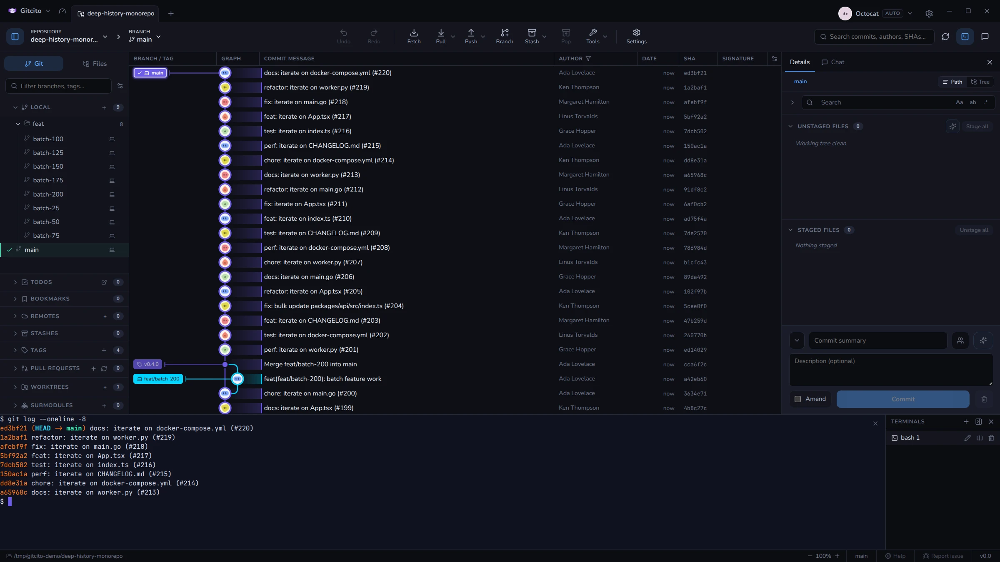

# Terminale integrato

Una vera PTY (xterm + node-pty), non un esecutore di comandi. La tua shell, il
tuo prompt, i tuoi alias.

- **Più schede per repository**, ognuna che parte dalla cartella di quel
  repository.
- Agganciato **sotto** il grafo oppure come **colonna di destra**; il pannello
  ricorda la propria dimensione.
- La visibilità del terminale è per repository: passando a una scheda che non ne
  ha mai aperto uno, resta chiuso.
- Le schede si danno il nome in base a ciò che vi sta girando.
- Richiudere l'elenco dei terminali lo riduce a una **guida laterale**:
  un'icona per terminale (i terminali divisi mostrano una mini mappa dei
  pannelli), clic per passare da uno all'altro, clic destro per il solito menu
  rinomina/dividi/termina.
- **Trascina un terminale su un altro** nell'elenco per fonderli in un gruppo
  diviso. Ogni terminale conserva il suo nome come riquadro; il gruppo fuso
  riceve un nuovo nome numerato.

## Tasti

| Tasti | Cosa fa |
|---|---|
| <kbd>⌃`</kbd> | Mostra o nasconde il terminale — il tasto Control fisico, su ogni piattaforma |
| <kbd>⌘T</kbd> / <kbd>Ctrl+T</kbd> | Nuovo terminale, mentre il terminale ha il focus |
| <kbd>⌘W</kbd> / <kbd>Ctrl+W</kbd> | Chiude il terminale attivo; chiudere l’ultimo nasconde il pannello |
| <kbd>Ctrl+Shift+C</kbd> | Copia la selezione; un semplice <kbd>Ctrl+C</kbd> copia anch’esso finché c’è una selezione, e resta SIGINT quando non c’è |
| <kbd>Ctrl+V</kbd> / <kbd>Ctrl+Shift+V</kbd> / <kbd>Shift+Ins</kbd> | Incolla dagli appunti |
| Clic destro | Copia la selezione, o incolla se non c’è nulla di selezionato |

I primi due valgono solo nel terminale, di proposito: fuori da esso continuano ad
aprire e chiudere le [schede dello spazio di lavoro](workspaces.md). Su macOS,
Copia/Incolla del menu Modifica funzionano allo stesso modo.

## Suggerimenti di script

Digita `npm run ` (o `pnpm`, `yarn`, `bun run`) e al cursore compare l’elenco degli
script del progetto, filtrato mentre scrivi: `npm run loc` trova `LOCAL_SERVER`.
Ogni nome mostra il comando che esegue.

| Tasto | Cosa fa |
|-------|---------|
| **Tab** | Completa lo script selezionato |
| **↑ / ↓** | Sceglie un altro |
| **Esc** | Chiude l’elenco finché non digiti di nuovo |

Altri comandi hanno un elenco proprio:

| Digitato | Elenca | Letto da |
|--------|------|--------|
| `composer run ` | Script di Composer | il `composer.json` più vicino |
| `make ` | Target del Makefile, con il `## testo` dopo il target come descrizione | il `Makefile` della directory corrente, come lo legge `make` |
| `git checkout `, `switch`, `merge`, `rebase` | Branch locali, poi quelli remoti con il nome breve | il repository in cui si trova la shell |

Un target del Makefile costruito da variabili o da un pattern (`%.o`) non compare,
e `git checkout -b` non ha elenco: dà il nome a un nuovo branch.

Gli script vengono dal `package.json` più vicino alla directory **corrente** della
shell, quindi dopo `cd frontend` vedi quelli del frontend. Prima i nomi che
iniziano con ciò che hai digitato, poi quelli che lo contengono.

L’elenco conosce solo i tasti digitati dall’ultimo Invio. Richiamare un comando
con ↑, spostare il cursore o usare il Tab della shell cambia la riga fuori dalla
sua vista, quindi resta in silenzio fino al prossimo Invio invece di completare
la cosa sbagliata. Su Windows la directory corrente non si può leggere, perciò
l’elenco segue la cartella in cui il terminale è stato aperto.

## Il tuo PATH

La shell parte come **shell di login**, come in Terminal.app o iTerm, quindi
`~/.zprofile`, `~/.zlogin` e `~/.bash_profile` vengono eseguiti. Conta perché i
gestori di versioni e `brew shellenv` di solito si installano lì: uno strumento
come `fvm`, `nvm` o `pyenv` che funziona nel tuo terminale funziona anche qui.

Gitcito chiede inoltre alla tua shell di login il suo `PATH` reale all'avvio e
lo unisce a tutto ciò che lancia, perché un'app grafica aperta dal Dock non
eredita quasi nulla. Se un comando resta introvabile, verifica che sia nel
`PATH` di una shell di login e non solo di una interattiva.

Tutto quello che esegui qui è invisibile al meccanismo di lock di Gitcito, quindi
un lungo `git rebase` digitato a mano e un clic nell'interfaccia possono ancora
scontrarsi — l'app si aggiorna da disco quando il terminale cambia qualcosa.

## Shell, tema e Oh My Posh

Su Windows, Impostazioni → Layout sceglie la shell avviata da ogni nuovo
terminale — PowerShell, PowerShell Core (`pwsh`), `cmd`, Git Bash, WSL o un
eseguibile personalizzato. L’aspetto del terminale (tema, dimensione e famiglia
del carattere) sta in Impostazioni → Temi → Tema del terminale e si applica
subito a tutte le sessioni.

Se [Oh My Posh](https://ohmyposh.dev) è installato, la sezione elenca anche ogni
`*.omp.json` in `%POSH_THEMES_PATH%` con anteprima dal vivo — sceglierne uno lo
inietta come `POSH_THEME` nei nuovi terminali, così un semplice
`oh-my-posh init pwsh` nel tuo profilo lo usa. Funziona anche un percorso
`.omp.json` personalizzato; lasciare il campo su Predefinito mantiene quello che
la tua shell/profilo o un `POSH_THEME` globale impostano già. Le sessioni aperte
tengono il loro tema — chiudi e riapri un terminale per applicarne uno nuovo. I
glifi del prompt richiedono una Nerd Font nella famiglia del carattere del
terminale (ad esempio `CaskaydiaMono Nerd Font`), altrimenti le icone appaiono
come quadratini.

Sulla velocità: Oh My Posh esegue il suo binario una volta per prompt — circa
100–200 ms su Windows, di più con temi che hanno un segmento git in un repository
grande — e si avverte come una breve pausa prima di ogni prompt, non come lentezza
di Gitcito. I temi senza segmento git sono i più rapidi. Conta anche lo stile di
previsione di PowerShell: `-PredictionViewStyle InlineView` ridisegna una piccola
area a ogni tasto, mentre `ListView` ridisegna un blocco intero.

**Vedi anche:** [Esecuzione e debug](launch.md) · [Hook](hooks.md)
