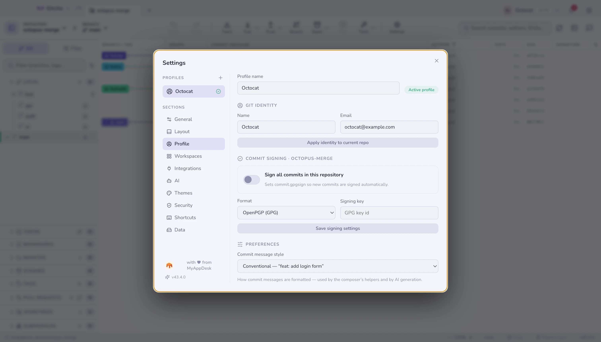

# 프로필

프로필은 **Git 신원**(이름과 이메일)을 그에 딸린 **연동 토큰**과 함께 묶어요.
프로필을 전환하면 둘이 같이 바뀌어요 — 커밋은 올바른 작성자로 기록되고 API 호출은
맞는 계정을 써요.

한 컴퓨터로 업무용 저장소와 개인 저장소를 모두 다루거나, GitHub 계정이 두 개일 때
유용해요.

## 프로필마다 자기 계정

프로필은 토큰 외에도, 컴퓨터에 이미 있는 로그인(git의 credential helper나
GitHub CLI)을 설정 → 통합에서 **연결**할 수 있습니다. 연결은 한 프로필에만
속합니다. 새 프로필은 연결되지 않은 상태로 시작하고, 다른 프로필이 이미 가진
계정은 거부되므로, 두 프로필이 두 GitHub(또는 Azure DevOps) 계정을 나란히 가질
수 있습니다. [호스팅](hosting.md)을 참고하세요.

## 저장소별 연결

저장소를 **프로필에 연결**해 두면, 다른 프로필에 속한 저장소를 보고 있는 동안에도 그
저장소에 대한 백그라운드 페치가 항상 올바른 계정으로 인증해요.

토큰은 설정 파일이 아니라 [OS 키체인](security.md)에 저장돼요.

**함께 보기:** [보안과 비밀](security.md) · [호스팅](hosting.md)
