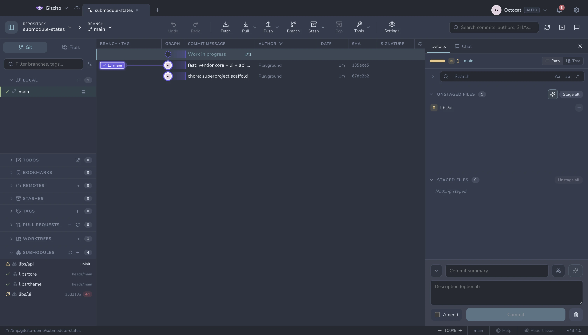

# Worktree i podmoduły

## Worktree

Worktree to drugie wypakowanie tego samego repozytorium, we własnym katalogu —
możesz więc popatrzeć na `main`, a `feature/x` zostaje dokładnie tak, jak je
zostawiłeś, bez stashowania.

- Twórz i usuwaj worktree z panelu bocznego. **Dwuklik** otwiera dany worktree
  jako własną kartę; prawy przycisk daje *Otwórz worktree*, *Pokaż w folderze*
  i usunięcie.
- Kliknij dowolną lokalną gałąź prawym przyciskiem → **Otwórz w worktree**, żeby
  postawić je w katalogu obok i otworzyć jako kartę.
- Gałąź mieszka naraz tylko w jednym worktree, więc przełączenie się na gałąź,
  którą trzyma inny worktree, nie może się udać — git odmawia komunikatem
  *already used by worktree at …*. Gitcito zamiast tego cię tam zabiera: menu
  gałęzi mówi *Przejdź do `x` w jej worktree*, a dwuklik na wierszu otwiera kartę
  tego worktree, zamiast się wywalić.

### Dbanie o worktree

O worktree z zeszłego miesiąca łatwo zapomnieć, a pytania pojawiają się przy sprzątaniu: czy jest w nim praca? Czy ten folder jeszcze istnieje? Każdy wiersz odpowiada, zanim musisz zapytać.

| W wierszu | Oznacza |
|---|---|
| **●3** | Trzy pliki z niezatwierdzonymi zmianami w tym worktree |
| **↑2 ↓1** | Jego gałąź ma dwa commity przewagi i jeden zaległości względem upstreamu |
| 🔒 | Zablokowane — najedź, aby zobaczyć powód podany przy blokowaniu |
| **brak**, nazwa przekreślona | Folderu już nie ma; git ma tylko jego wpis |

Liczby są odczytywane przy otwarciu sekcji, gdy zmienia się commit tego worktree i gdy okno odzyskuje fokus — nie przy każdym odświeżeniu, bo każda to `git status` w innym folderze.

Kliknij wiersz prawym przyciskiem, aby:

| Akcja | Co robi |
|---|---|
| **Zablokuj worktree** | Nie pozwala git (ani żadnemu innemu klientowi) go wyczyścić, przenieść ani usunąć. Podaj powód — *na dysku zewnętrznym* — a pojawi się przy kłódce. Dla worktree na nośnikach, które nie zawsze są podłączone. |
| **Odblokuj worktree** | Odwrotność. Cofnięcie blokuje je ponownie z tym samym powodem. |
| **Przenieś worktree…** | Przenosi folder i aktualizuje powiązania git w obie strony. Niedostępne, gdy jest zablokowane lub otwarte w karcie: karty i ich układ są zapamiętywane po ścieżce, więc karta wskazywałaby na nic. Najpierw ją zamknij. Cofnięcie przenosi je z powrotem. |
| **Usuń worktree** | Najpierw pyta git, co zostałoby utracone. Czyste worktree dostaje zwykłe potwierdzenie, a cofnięcie odtwarza je na tej samej gałęzi w tym samym folderze. Takie z niezatwierdzonymi zmianami dostaje osobne potwierdzenie, *Odrzuć i usuń*, z liczbą plików, bez cofania. |
| **Połącz ponownie przeniesiony folder…** | Tylko w wierszu z *brak*: wskaż, gdzie trafił folder (przeniesiony menedżerem plików), a git połączy go ponownie przez `git worktree repair`. |
| **Zapomnij brakujące worktree** | To także przycisk gumki w nagłówku sekcji, widoczny, gdy któregoś wiersza brakuje. Uruchamia `git worktree prune`. |

Czego te akcje **nie** robią:

- **Usunięcie worktree kasuje też jego ignorowane pliki** — `.env`, `node_modules`, wyniki builda. Git nie liczy ich jako zmian, więc nawet „czyste” potwierdzenie o tym mówi, a cofnięcie ich nie przywraca.
- **Zapominanie usuwa tylko wpis w git.** Nie ma plików do usunięcia — folderu już nie ma — a zablokowane worktree są pomijane, bo zablokowane na odłączonym dysku wygląda dokładnie jak usunięte.
- Blokada to umowa między klientami git, a nie ochrona plików: nie powstrzyma niczego spoza git przed usunięciem folderu.
- Głównego worktree — samego repozytorium — nie można zablokować, przenieść ani usunąć.
- Usunięcie worktree nigdy nie usuwa jego gałęzi. Usuń ją z listy gałęzi, jeśli skończyłeś.

## Podmoduły

Dodawaj, aktualizuj (init i checkout), synchronizuj adresy i usuwaj podmoduły,
z żywym statusem dla każdego:

| Status | Oznacza |
|---|---|
| **Zsynchronizowany** | Wypakowany na commicie, który zapisuje rodzic |
| **Zmodyfikowany** | Wypakowany gdzie indziej albo brudny |
| **Niezainicjowany** | Zapisany, ale nigdy niewypakowany |

**Zobacz też:** [LFS i sparse-checkout](lfs-sparse.md) · [Fetch, pull i push](syncing.md)
