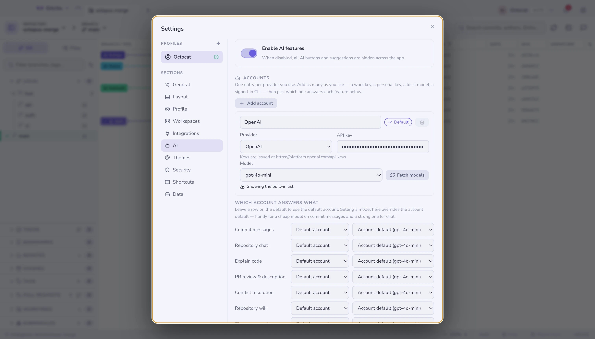
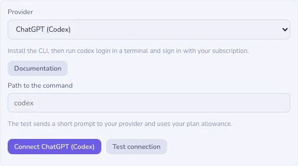
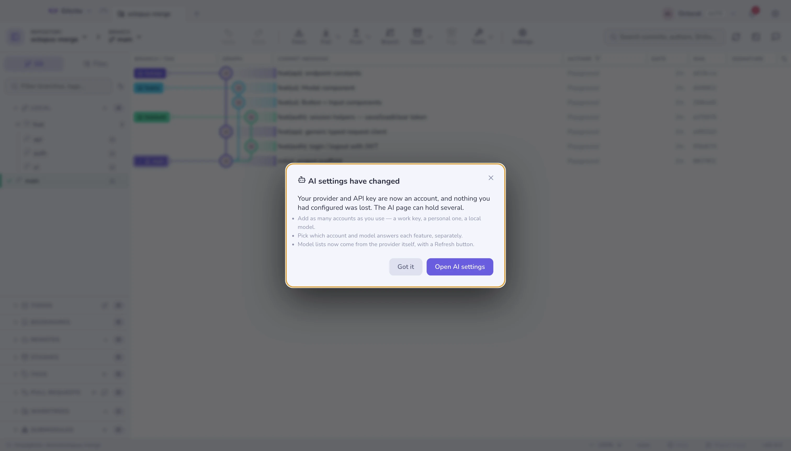

# Recursos de IA

Todo recurso de IA é **opcional** e fica desligado até você configurar um provedor.
Nada é enviado para lugar nenhum até você pedir algo específico.

## Contas

Uma **conta** é um jeito de alcançar um modelo: um provedor, onde encontrá-lo e
como ele se autentica. Você pode configurar várias e elas convivem — uma chave
do trabalho, uma pessoal, um modelo local, uma CLI em que você já entrou.

As predefinições cobrem **OpenAI, Anthropic, Google Gemini, OpenRouter, Groq,
Mistral** e **Ollama** (inteiramente local), além de qualquer endpoint
compatível com OpenAI.

**Uma chave nunca sai desta máquina sem criptografia.** Uma conta com chave
chega ao endpoint por `https://`, ou por `http://` simples só neste computador
(`localhost`, `127.x`, `::1`). Uma chamada que mandaria a chave por `http://`
para outro host é recusada antes de qualquer envio, com o motivo. Um endpoint
sem chave — o Ollama em outra máquina da sua rede — continua funcionando por
`http://`.

A Anthropic usa a própria API `/v1/messages` em vez de uma chamada no formato
OpenAI, então os modelos Claude funcionam de fato em vez de apenas parecer.
O Gemini é alcançado pelo endpoint compatível com OpenAI do Google.

### Usar uma assinatura em vez de uma chave de API

Na configuração inicial ou em Configurações → IA, escolha **Usar minha assinatura**. Selecione ChatGPT ou Claude e entre pelo terminal com o comando correspondente. Teste a conexão e adicione a conta após a confirmação.

Depois de instalar a CLI, clique em Conectar para abrir a página de login do provedor. Você pode cancelar a conexão pendente.

- ChatGPT (Codex) — `codex login`
- Claude (Claude Code) — `claude auth login`

O teste envia uma mensagem curta ao provedor e consome a cota do plano. Limite atingido. Tente novamente quando a cota for renovada.

Escolha o provedor **CLI local** para responder com uma CLI de agente já
instalada e autenticada nesta máquina — `claude`, `gemini` ou `codex`. O Gitcito
executa o binário com o seu prompt e lê a resposta; não há chave de API para
colar nem token guardado.

O Gitcito só executa um comando que você configurou como conta, e sempre com uma
lista de argumentos em vez de um shell, de modo que nada em um diff ou em um nome
de branch pode ser interpretado como comando.

> **Isso não é mais privado que uma chave de API.** Seus prompts continuam
> chegando ao mesmo fornecedor, na sua própria conta, exatamente como
> chegariam com uma chave. O que muda é a cobrança e a configuração, não para
> onde o texto vai.

Se o comando não estiver no seu `PATH`, digite o caminho completo na conta.

### Qual conta responde o quê

Em **Qual conta responde o quê**, cada recurso — mensagens de commit, chat,
explicar, revisão de PR, resolução de conflitos, wiki, temas — pode apontar para
a própria conta e o próprio modelo. Deixe uma linha no padrão para seguir a
conta padrão. Modelo barato para mensagens de commit e um forte para o chat é a
divisão mais comum.

### Aviso de atualização

Ao atualizar de uma versão anterior às contas, isto aparece uma vez. O provedor e a chave que você tinha viram a primeira conta; nada precisa ser reconfigurado à mão.

## Modelos

As listas de modelos vêm do próprio provedor e ficam em cache por um dia;
**Buscar modelos** atualiza uma na hora. Abaixo da lista o Gitcito diz de onde
ela veio — ao vivo, do cache (com a data) ou da lista embutida de reserva, e por
quê.

A lista é filtrada para modelos capazes de responder a um pedido de chat, então
embeddings, fala e imagem ficam de fora. Todo campo de modelo também aceita texto
livre, de modo que um modelo em prévia, uma implantação privada ou uma tag do
Ollama recém-baixada continua utilizável mesmo que o provedor não a liste.

Um provedor a quem você ainda não deu uma chave, ou que esteja inacessível,
recorre a uma pequena lista embutida em vez de a um menu vazio.

Nenhum provedor publica uma lista ordenada ou curada, então o recorte é do Gitcito: instantâneos datados se dobram no modelo do qual são um instantâneo (`gpt-4o` cobre `gpt-4o-2024-08-06`), e o que sobra vem do mais novo para o mais antigo em vez de alfabético. **Mostrar todos os modelos**, no fim da lista, traz de volta tudo o que o provedor devolveu.

## O que ela consegue fazer

| Recurso | O que você ganha |
|---|---|
| **Mensagem de commit** | Resumo (e corpo opcional) a partir do seu diff preparado, no estilo que você escolheu |
| **Explicar este arquivo** | Explicação em linguagem simples num painel lateral — Normal, Conciso, Para leigos… até Pirata |
| **Passar o mouse para explicar** | Segure <kbd>⇧</kbd> e aponte para um identificador para uma explicação de uma linha, mais as linhas em que ela se baseou |
| **Editar seleção com IA** | Selecione linhas num arquivo, descreva a mudança, e o modelo reescreve só aquelas linhas no rascunho do editor |
| **Resolução de conflitos** | Propõe um merge na saída editável — nunca aplica sozinha |
| **Revisão de PR** | Resume um diff e aponta riscos, cada um ancorado num `caminho:linha` real |
| **Descrição de PR** · **nomes de branch** | Rascunhados a partir dos commits e do diff da branch |
| **Temas** · **paletas do grafo** | Gerados a partir de um prompt |
| **Staging inteligente** | Sugestões do que pertence a este commit |
| **[Chat do repositório](repo-chat.md)** | Perguntas ancoradas no código, mais mudanças de arquivo revisadas seguidas de ações Git validadas |
| **Assistente de configuração de IA** | Gera arquivos de configuração de assistente (instruções, agentes, hooks) para o repositório — o botão de varinha no cabeçalho do painel de chat |

### Edite só as linhas que você selecionar

Na visão de arquivo, arraste sobre as linhas que quer mudar e aperte **Editar
com IA…** (ou clique com o botão direito numa linha e escolha no menu). Uma
barra embaixo mostra o intervalo selecionado e recebe a sua instrução —
"renomeie esta variável", "adicione verificações de nulo", "traduza estas
strings". O modelo vê as linhas selecionadas e um pouco do contexto em volta, e
devolve só a substituição daquele intervalo, que vai para o **rascunho do
editor**, não para o disco. Você revisa ali e salva ou descarta pelo fluxo normal
de edição, então nada é gravado até você mandar. Funciona em todos os backends
configurados, não só nas CLIs de agente, porque a resposta é texto, não uma
chamada de ferramenta. Os limites: reescreve um intervalo contínuo por vez, não
cria nem apaga arquivos inteiros, e uma seleção que atravessa hunks de diff é
recusada — selecione na visão de arquivo.

## Ancorada, não chutando

A revisão vê o diff como **hunks rotulados** e só pode citar esses rótulos; o
Gitcito então resolve cada rótulo num arquivo e numa linha reais. Um modelo que
inventa uma localização é **rejeitado e consultado de novo**, então os achados
sempre apontam para código que existe.

O passar o mouse para explicar lê só uma janela numerada em volta do token —
num diff, só os hunks visíveis na tela —, então quando uma definição mora em
outro lugar ele diz isso em vez de inventar. As respostas ficam em cache por
versão do arquivo.

O [chat do repositório](repo-chat.md) funciona do mesmo jeito: só pode citar os
trechos que recebeu, e a requisição em duas etapas escolhe esses trechos a partir
da lista de arquivos rastreados do próprio Git, não de algo que o modelo escreve.
Quando ele propõe uma mudança, o Gitcito valida as ações exatas de arquivo,
calcula os diffs localmente, e depois roda as ações Git seguintes sob a política
de aprovação configurada.

**Arquivos secretos mascarados nunca são enviados.** Nem arquivos cobertos pelas
regras de mascaramento de segredos — inclusive um arquivo que você fixa no chat à
mão, que é recusado com um motivo em vez de lido.

## Limites

- As listas de reserva ficam desatualizadas entre versões. É para isso que serve
  a busca ao vivo; a reserva só cobre o caso em que buscar não é possível.
- Filtrar a lista de um provedor para modelos de chat é feito pelo nome, então um
  modelo de chat com nome incomum pode ficar de fora. Digite-o você mesmo.
- Uma conta de CLI não consegue informar o uso de tokens a menos que a CLI o
  faça, então os números de uso e custo nas configurações vão subestimar essas
  chamadas.
- Respostas por CLI são mais lentas que uma chamada direta à API: o binário
  inicia uma sessão inteira a cada pedido.
- As chaves ficam guardadas por conta no chaveiro do seu sistema. Excluir uma
  conta exclui a chave dela.

**Veja também:** [Wiki do repo](repo-wiki.md) · [Segurança e segredos](security.md)
