# Diffs e pré-visualizações

## Lendo um diff

| Opção | O que faz |
|---|---|
| **Unificado ↔ lado a lado** | Lado a lado quando você quer comparar, empilhado quando quer ler |
| **Nível de palavra** | Destaca só os trechos alterados dentro de uma linha editada — vermelho no antigo, verde no novo |
| **Ignorar espaços** | Esconde reindentação para a mudança real aparecer |
| **Código movido** (ligado por padrão) | Pinta de azul blocos que só foram movidos, não alterados — aparece quando o diff tem algum |
| **Quebrar linhas** | Dobra linhas longas em vez de rolar para o lado — dentro do painel na visão unificada, dentro da coluna na lado a lado |
| **Vinculado** (lado a lado, sem quebra) | Rola as duas metades juntas, na vertical e na horizontal — desligado, cada coluna rola sozinha |
| <kbd>⌘F</kbd> | Busca dentro do diff, com próximo/anterior |

A quebra de linhas vem desligada, então uma linha fica numa fileira só e os dois
lados continuam comparáveis fileira por fileira; cada metade tem a própria barra
de rolagem horizontal. Ligue quando preferir ler uma linha longa a ficar
correndo atrás dela — o custo é que uma linha que ocupa três fileiras de um lado
deixa de ficar de frente para a correspondente. Cada opção lembra o estado entre
arquivos e sessões.

As marcas por palavra continuam leves em linhas muito longas, como HTML
minificado ou um script empacotado: o que as duas linhas têm em comum no começo
e no fim é casado primeiro, então a edição de uma palavra numa linha de 100.000
caracteres é marcada com exatidão e o diff abre na hora. O limite: quando uma
linha enorme muda em pontos distantes, tudo entre a primeira e a última mudança é
marcado como um bloco só, em vez de comparado trecho a trecho.

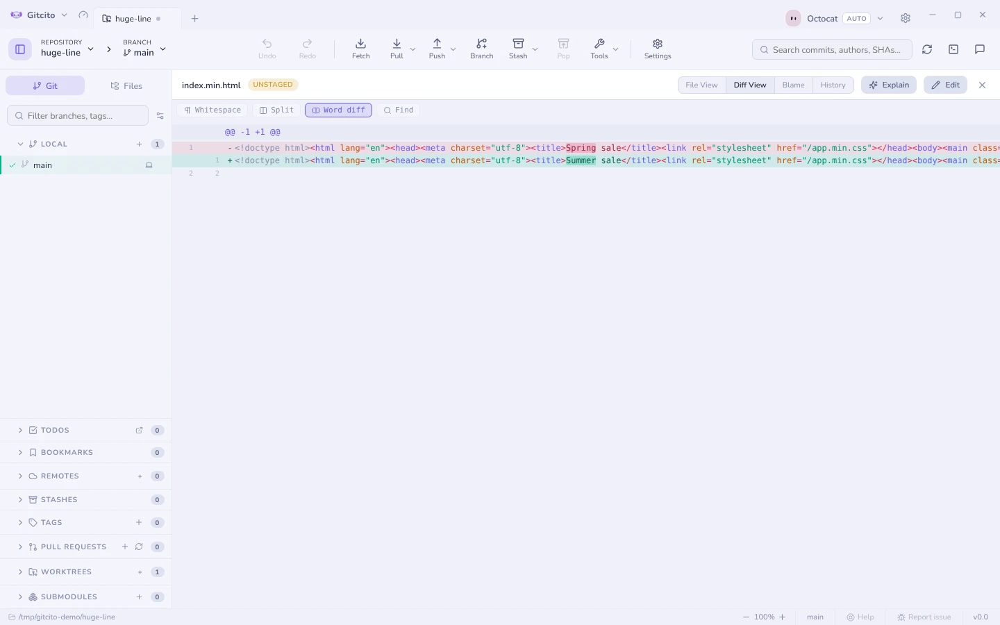

Sem quebra, as duas metades rolam **vinculadas** por padrão — na vertical, o que
mantém as fileiras frente a frente, e na horizontal, para a coluna 90 da
esquerda ficar sobre a coluna 90 da direita. Desvincule quando os lados se
desalinharem — um bloco indentado contra um não indentado, uma renomeação que
deslocou todas as linhas — ou quando quiser comparar duas regiões distantes do
mesmo arquivo, deixando cada metade onde está o próprio conteúdo.

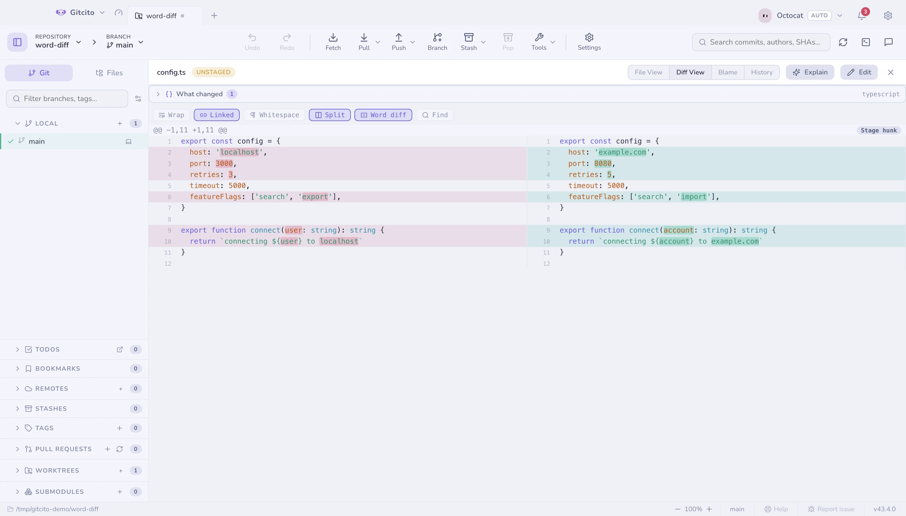

Uma linha em que o arquivo termina sem quebra de linha final ganha uma pequena
seta de retorno riscada, onde o git imprime `\ No newline at end of file`. É uma
nota naquela linha, não uma linha do arquivo, então não tem número próprio.

Um **arquivo apagado** não tem mais nada do próprio lado, então Arquivo,
Pré-visualização e Blame mostram como ele era logo antes de ser apagado — o
commit pai, o índice ou o `HEAD` — sob um selo **Apagado**. Não dá para editá-lo
ali: restaurá-lo é um descarte ou um revert, não um salvamento.

Um diff em que dá para agir — mudanças de trabalho, um commit, um stash — tem
botões em cada hunk e deixa você selecionar linhas; veja
[ações de hunk e de linha](staging.md#ações-de-hunk-e-de-linha) para o que cada
um faz.

### Código movido

Um bloco recortado de um lugar e colado em outro aparece no diff como uma
remoção e uma adição sem relação aparente, e nada diz que os dois são o mesmo
código — você lê duas vezes para descobrir que nada mudou. **Código movido**
reconhece o par, como o `--color-moved` do próprio git: uma sequência de linhas
removidas que reaparece, linha por linha, como uma sequência de linhas
adicionadas em outro ponto do diff do mesmo arquivo. As duas pontas ganham um
tom azul, e a margem mostra uma seta apontando para a outra ponta — passe o
mouse para ver o número da linha. Blocos movidos vizinhos alternam entre dois
tons de azul para você ver onde um termina. Funciona nas visões unificada e lado
a lado.

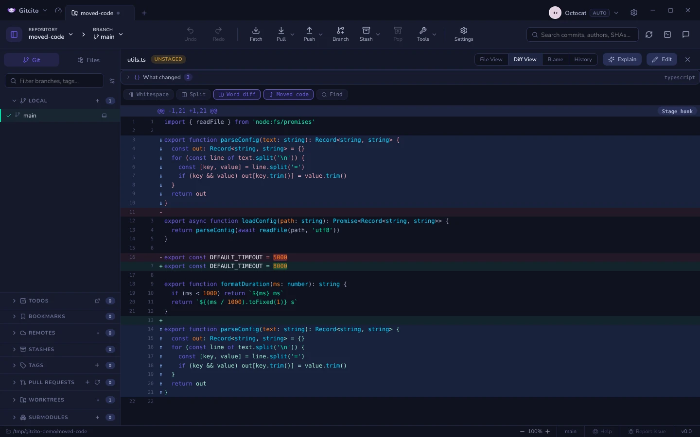

As linhas são comparadas sem os espaços do começo e do fim, então um bloco
movido para uma indentação mais funda ainda conta. Linhas movidas não ganham
marcas por palavra, que as comparariam com qualquer linha que estivesse de
frente, e não com a cópia de onde vieram. O staging funciona como antes: por
baixo, uma linha movida continua sendo uma linha − ou + comum.

Limites:

- como no git, um bloco precisa de pelo menos 20 letras e dígitos para contar,
  então um `}` ou `return` embaralhado não é marcado;
- ele só olha dentro de um arquivo, então código movido para outro arquivo é
  uma remoção num diff e uma adição no outro;
- um bloco movido *e* editado não é marcado — só as sequências inalteradas em
  volta da edição, se forem longas o bastante;
- reindentar linhas no lugar não é mover, e linhas em branco nunca são casadas.

A opção só aparece quando o diff contém um movimento, e lembra o estado como as
outras.

Acima de cada diff fica o [resumo semântico](semantic-diff.md) — o que mudou,
símbolo por símbolo, e não linha por linha.

## Quando o arquivo muda por baixo de você

Um arquivo da árvore de trabalho continua aberto enquanto outra coisa mexe nele
— um terminal, um editor, ou um agente de código a quem você pediu para
commitar. A origem dele era fixada quando abria, então o painel continuava
comparando o lado que o arquivo já tinha deixado: preparado em outro lugar,
dizia "Nenhuma mudança para exibir" sob um selo **Não preparado**; commitado,
ficava em branco. Agora o visualizador acompanha, e o selo no cabeçalho — Não
preparado, Preparado, ou um commit — diz onde o arquivo está agora:

| O que acontece fora do Gitcito | O que o arquivo aberto faz |
|--------------------------------|----------------------------|
| O arquivo é preparado | Passa para o diff **Preparado** |
| O arquivo é despreparado | Volta para o diff **Não preparado** |
| Parte do arquivo é preparada | Fica no lado que você escolheu; os dois existem |
| O arquivo é commitado | Acompanha para o commit novo, e o diff continua na tela |
| A mudança é descartada ou guardada em stash | Fecha, porque não sobra nada para mostrar |
| O commit que você está lendo é desfeito | Volta para o diff **Preparado** ou **Não preparado**, onde a mudança caiu |
| …e as mudanças dele são jogadas fora (`reset --hard`) | Fecha — a mudança não existe mais em lugar nenhum, e o commit de baixo é outro |
| Aquele commit era o `HEAD` e foi corrigido (amend) ou teve a mensagem trocada | Passa para o commit reescrito |

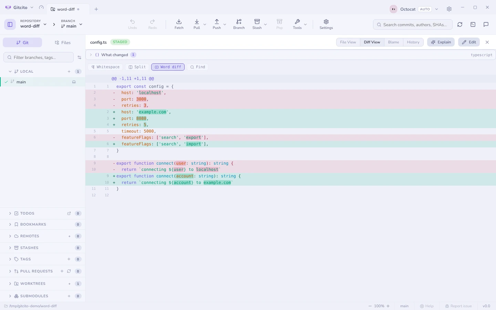

Commitar pelo próprio compositor do Gitcito continua fechando o arquivo, como
antes: quando é você quem commita, o que você quer ver é o resultado no grafo.

Um commit que sai do histórico de outro jeito — removido por um rebase mais
atrás, por exemplo — mantém a visão: o conteúdo dele ainda existe, e adivinhar
para onde ele foi é que seria a surpresa.

*Limites:* o visualizador percebe essas mudanças quando o repositório é relido —
na hora com o observador de arquivos, senão na próxima atualização. Enquanto você
edita o arquivo ali mesmo, ele fica parado, então um rascunho não salvo nunca é
jogado fora. Ele só acompanha para o commit para onde o `HEAD` aponta agora: se
vários commits chegam de uma vez e o arquivo não está no mais novo, a visão
fecha. Um arquivo em conflito fica com o resolvedor de conflitos.

## Diff de imagens

Imagens alteradas ganham uma comparação de verdade: lado a lado, ou uma alça de
deslizar para arrastar entre antes e depois.

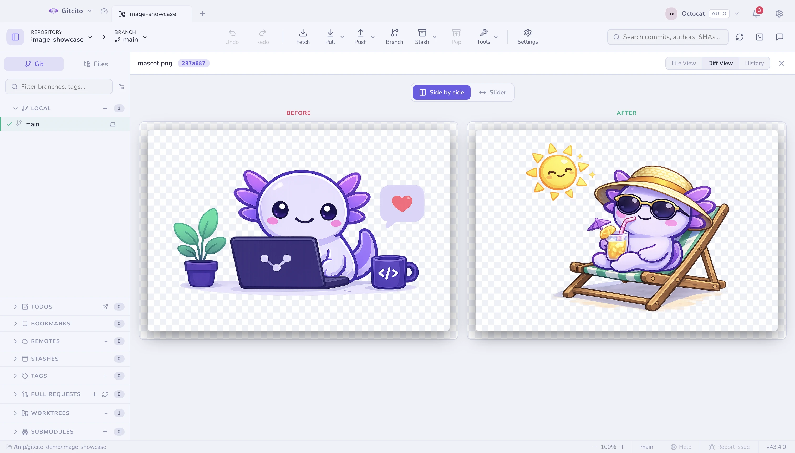

## Barra de alterações e minimapa

A **visão de arquivo** de um arquivo da árvore de trabalho — preparado ou não,
rastreado ou novinho — tem uma barra colorida ao lado de cada linha mexida desde
o HEAD (ou desde o índice, para arquivos preparados): verde para inserção, azul
para modificação, uma pequena cunha vermelha onde linhas foram removidas sem
substituição. Clique numa barra para ver aquela mudança sem sair do arquivo — o
popup mostra as linhas removidas e adicionadas, com próximo/anterior para passar
por todas as mudanças do arquivo.

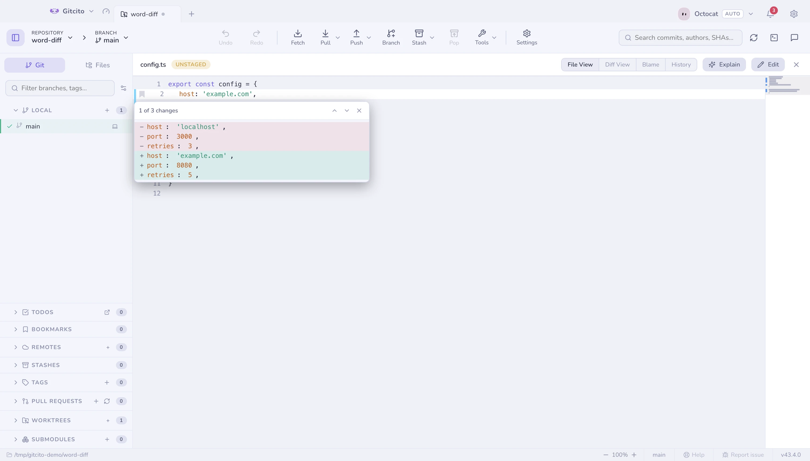

O **minimapa**, desligado por padrão, acrescenta uma visão geral reduzida do
arquivo inteiro na borda direita — clique ou arraste para pular, do jeito que
uma barra de rolagem faria se também mostrasse o formato do arquivo. Os dois são
opções por máquina em **Configurações → Geral → Visualizador de arquivos**.

Nenhum dos dois lê o histórico: troque para Diff, Blame ou um commit mais antigo
e a barra some — essas visões já mostram cada mudança diretamente.

## Pré-visualize qualquer coisa

O modo **Pré-visualização** renderiza o arquivo em vez de mostrar o código-fonte:
Markdown, Word (`.docx`), Excel (`.xlsx`), PDF, vídeo, áudio, imagens, e código
com destaque de sintaxe para todo o resto.

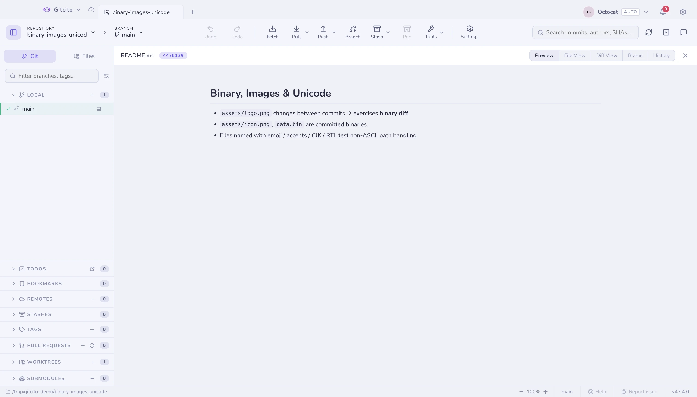

### Listas de propriedades da Apple

`Info.plist` e `*.entitlements` são XML, e XML não é o que alguém quer ler. A
pré-visualização mostra a estrutura de chave/valor — o formato que o próprio
editor de plist do Xcode mostra — com o aninhamento intacto e o tipo de cada
valor ao lado.

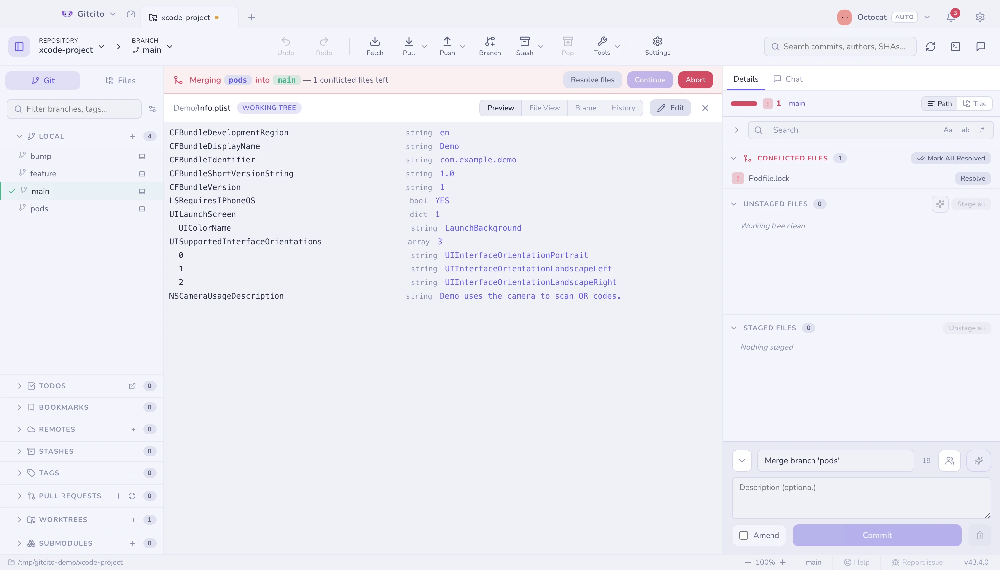

Dois limites. Um plist **binário** (`bplist00`) é reconhecido e identificado, não
decodificado — rode `plutil -convert xml1` nele se quiser vê-lo aqui, embora um
plist binário num repositório costume ser um artefato de build que não deveria
ser commitado. E valores `<data>` aparecem como contagem de bytes, não como
base64: um blob não diz nada a você, e um perfil de provisionamento renderizado
num painel que você talvez esteja compartilhando diz demais a todo mundo.

### Projetos do Xcode

Um `project.pbxproj` é um dicionário plano de objetos que apontam uns para os
outros por id, então lê-lo em ordem não diz quase nada sobre o projeto. A
pré-visualização percorre essas referências e reconstrói as três coisas que você
realmente veio ver: os **targets** com suas fases de build, a **árvore de
grupos** como o navegador do Xcode a desenha, e as **build settings** por
configuração.

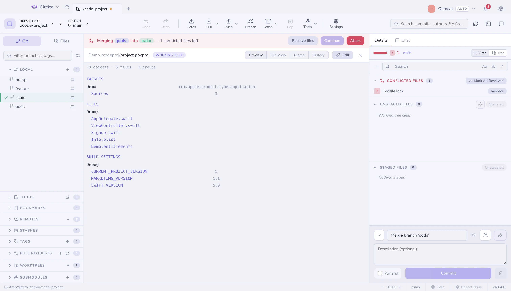

É um leitor, não um editor — nada aqui grava no projeto. Para o que acontece
quando duas branches editam o mesmo projeto, veja
[resolvendo conflitos](conflicts.md).

## Arquivos muito grandes

As pré-visualizações e a visão de arquivo carregam o arquivo inteiro na memória,
então as duas recusam arquivos acima de um limite (32 MB para pré-visualizações,
16 MB para texto) e dizem o tamanho do arquivo em vez disso. **Carregar mesmo
assim** ignora o limite para aquele arquivo — nada é proibido, cargas grandes só
precisam de confirmação. Arquivos e diffs com milhares de linhas continuam sendo
renderizados por completo, mas as linhas fora da área visível deixam de ser
diagramadas e pintadas, então o diff de um lockfile gigante para de custar a
memória de um notebook.

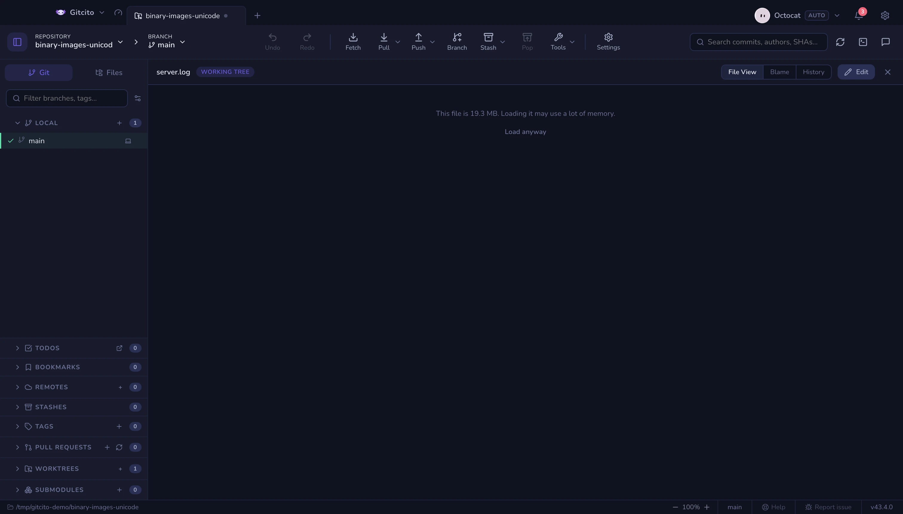

## Aba de arquivos

A aba **Arquivos** da barra lateral esquerda navega pela própria árvore de
trabalho, com selos de status nas pastas (adicionado / modificado / apagado) que
somam o que está dentro delas.

A caixa de busca acima filtra por nome de arquivo ou procura no conteúdo dos
arquivos. Uma busca por conteúdo começa quando você para de digitar, e cada letra
nova interrompe a busca anterior, então digitar continua fluido num repositório
grande. Texto simples passa pelo `git grep` sobre arquivos rastreados e não
rastreados. *Limites:* uma busca por regex pula arquivos acima de 4 MB, e os
resultados param em 2.000 linhas (100 por arquivo).

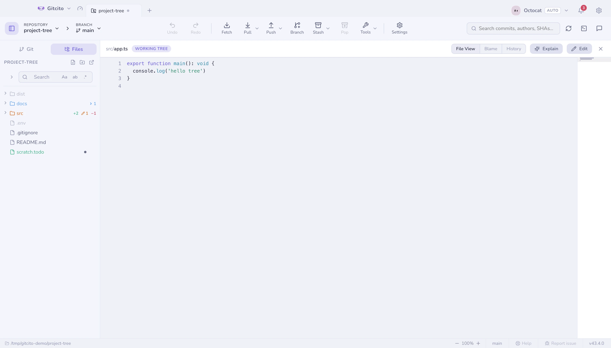

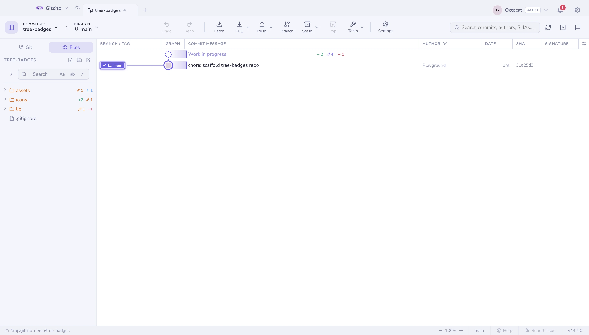

**Veja também:** [Diff semântico](semantic-diff.md) · [Staging](staging.md)
