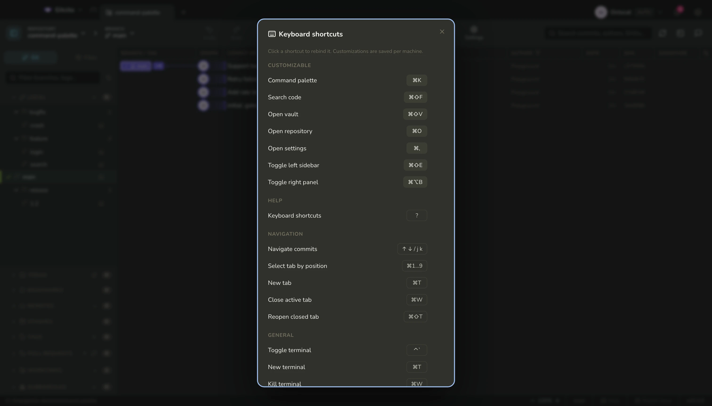
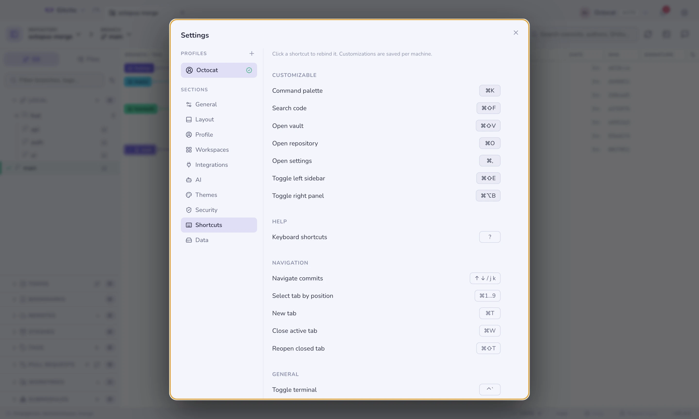

# Teclado e atalhos

Aperte <kbd>?</kbd> em qualquer lugar para ver a colinha de atalhos.

## Os que valem a pena aprender

| Teclas | Faz |
|---|---|
| <kbd>⌘K</kbd> | [Paleta de comandos](search.md) — branches, commits, arquivos, ações |
| <kbd>⌘⇧F</kbd> | [Busca no código](search.md) pela árvore de trabalho |
| <kbd>⌘⇧V</kbd> | [Cofre](vault.md) |
| <kbd>⌘O</kbd> / <kbd>Ctrl+O</kbd> | Abrir um repositório |
| <kbd>⌘,</kbd> / <kbd>Ctrl+,</kbd> | Abrir as Configurações |
| <kbd>⌘F</kbd> | Buscar dentro do arquivo ou diff que você está lendo |
| <kbd>⌘T</kbd> / <kbd>Ctrl+T</kbd> | Abrir o seletor de repositório ou grupo da nova aba |
| <kbd>⌘W</kbd> / <kbd>Ctrl+W</kbd> | Fechar a aba ativa — ou a janela, quando não sobra aba |
| <kbd>⌘1</kbd>–<kbd>⌘9</kbd> / <kbd>Ctrl+1</kbd>–<kbd>Ctrl+9</kbd> | Ir para uma aba pela posição |
| <kbd>⌘J</kbd> / <kbd>Ctrl+J</kbd> | [Ir para um repositório aberto](workspaces.md#indo-para-um-repositório) pelo nome, os usados mais recentemente primeiro |
| <kbd>⌘⇧T</kbd> | Reabrir a última aba fechada |
| <kbd>⌃`</kbd> | Mostrar ou esconder o [terminal integrado](terminal.md) — a tecla Control física, em todas as plataformas |
| <kbd>⌘⇧E</kbd> / <kbd>Ctrl+Shift+E</kbd> | Mostrar ou esconder a barra lateral esquerda |
| <kbd>⌘⌥B</kbd> / <kbd>Ctrl+Alt+B</kbd> | Mostrar ou esconder o painel direito — Detalhes, ou o [Chat do repositório](repo-chat.md) |
| <kbd>?</kbd> | Esta colinha |

Enquanto o terminal tem o foco, <kbd>⌘T</kbd> / <kbd>Ctrl+T</kbd> abre outro
terminal e <kbd>⌘W</kbd> / <kbd>Ctrl+W</kbd> fecha o atual, escondendo o painel
quando era o último. Em todo o resto, essas duas teclas continuam sendo das
[abas de workspace](workspaces.md).

## Andando sem o mouse

| Onde | Teclas |
|---|---|
| Grafo de commits | <kbd>↑</kbd> <kbd>↓</kbd> ou <kbd>j</kbd> <kbd>k</kbd> |
| Listas de arquivos (commit, WIP, stash) | as mesmas |
| [Máquina do tempo](time-machine.md) | <kbd>←</kbd> <kbd>→</kbd>, <kbd>⇧</kbd> para dez, <kbd>Home</kbd>/<kbd>End</kbd> |
| [Central de controle](mission-control.md) | <kbd>↑</kbd><kbd>↓</kbd>, <kbd>Enter</kbd> para abrir, <kbd>f</kbd>/<kbd>p</kbd> para fetch/pull, <kbd>/</kbd> para filtrar |
| Caixa de mensagem do commit | <kbd>↑</kbd> <kbd>↓</kbd> traz de volta suas mensagens recentes |

## Remapeando

**Configurações → Atalhos**. Os atalhos centrais de navegação (paleta, ir para
repositório, busca no código, cofre, abrir repositório, configurações e os dois
alternadores de painel) podem ser remapeados, com detecção de conflito e
restauração por atalho.

Os atalhos fixos acima não podem ser remapeados, e também são recusados como
_destino_: o app responde a <kbd>⌘T</kbd>, <kbd>⌘W</kbd>, <kbd>⌘1</kbd>–<kbd>⌘9</kbd>,
<kbd>⌘⇧T</kbd>, <kbd>⌘S</kbd>, <kbd>⌘Z</kbd>, <kbd>⌘⇧Z</kbd>, <kbd>⌘F</kbd> e
<kbd>⌃`</kbd> antes de consultar os seus mapeamentos, então um atalho atribuído a
um deles pareceria configurado e nunca dispararia. Escolha um desses e o editor
avisa em vez de aceitar.

No macOS, combinações com <kbd>⌥</kbd> são reconhecidas pela tecla física, não
pelo caractere que produzem, porque <kbd>⌥B</kbd> digita `∫`. No Windows e no
Linux, o AltGr nunca dispara um atalho, então layouts internacionais continuam
digitando.

**Veja também:** [Paleta de comandos e busca](search.md)
