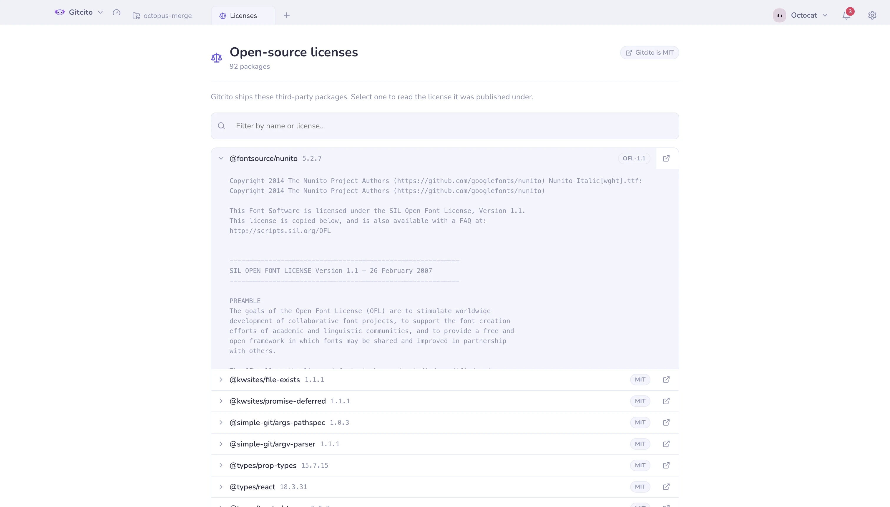

# Licenças de código aberto

O Gitcito é feito sobre umas noventa e poucas bibliotecas de código aberto, e
quase todas pedem a mesma coisa em troca: que o aviso delas acompanhe o binário.
MIT, BSD e Apache dizem isso no próprio texto. Esta página é onde esse aviso
mora, para que a obrigação seja cumprida pelo app e não por um arquivo que
alguém precisa lembrar de copiar.

É também a resposta honesta para "o que está rodando de verdade na minha
máquina".

## Como abrir

Clique no **número da versão** na barra de status — isso abre o **Novidades** —
e depois em **Licenças** no cabeçalho. Ou abra a paleta de comandos e procure
*Licenças de código aberto*. Ela abre numa aba própria, como o Novidades.

| Coluna | O que é |
|--------|---------|
| Nome | O pacote como está publicado no npm |
| Versão | A versão exata que este build resolveu |
| Selo | O identificador SPDX do manifesto do pacote |

Selecione uma linha para ler o texto completo da licença que o pacote traz. O
ícone de link abre a página do projeto no navegador. O filtro procura no nome do
pacote e no identificador da licença, então digitar `Apache` reduz a lista aos
pacotes com licença Apache.

## O que cobre, e o que não cobre

A lista é gerada no build a partir da **árvore de dependências de produção** —
tudo o que acaba dentro do app empacotado, inclusive dependências transitivas que
você nunca pediu diretamente — mais o próprio Electron. Ferramentas de build que
nunca são distribuídas ficam de fora de propósito.

Dois limites que vale saber:

- **Alguns pacotes não trazem arquivo de licença.** Eles declaram um
  identificador no manifesto e nada mais. Essas linhas dizem isso em vez de
  inventar um texto, porque uma licença que você não consegue ler não é uma
  licença em que dá para confiar.
- **O identificador é o que o pacote afirma.** O Gitcito o mostra; não o audita.
  Se o manifesto de um pacote estiver errado, esta página erra junto.

A licença do próprio Gitcito é MIT, e o selo no canto superior direito a abre no
GitHub.

**Veja também:** [Idiomas e da direita para a esquerda](languages.md) · [Temas e aparência](themes.md)
