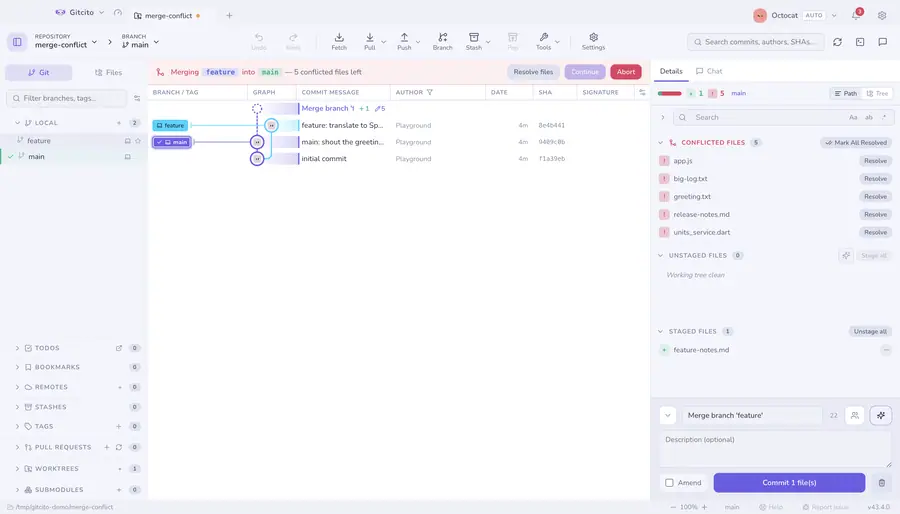
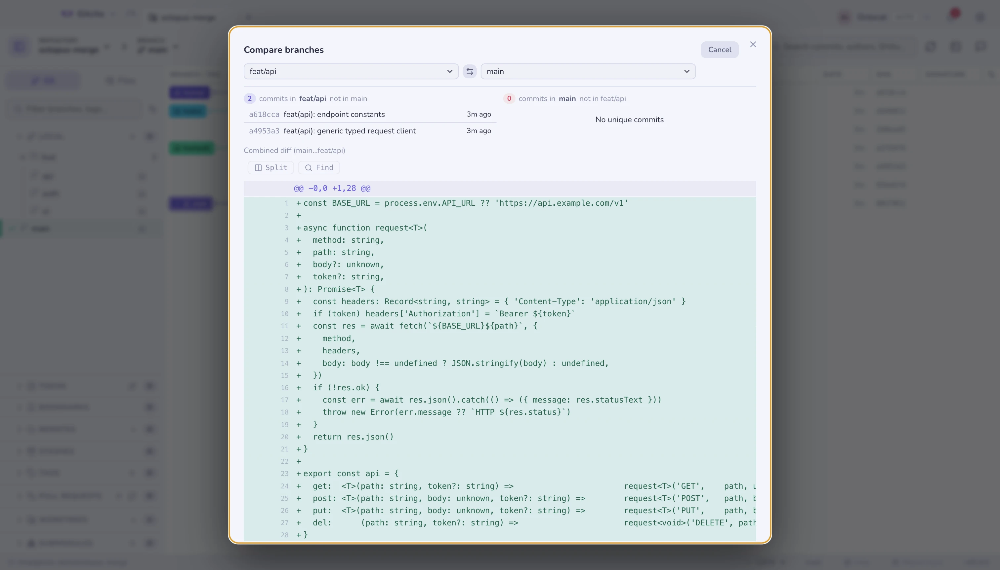
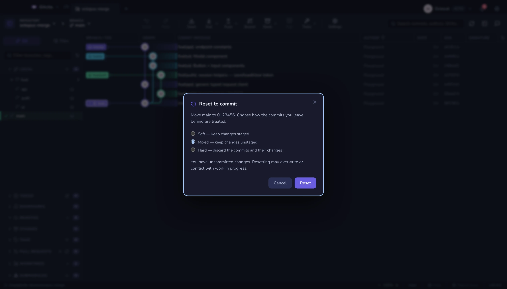

# Merge e rebase

## Pela barra lateral

Clique com o botão direito numa branch para **Fazer merge na atual** ou **Rebase
sobre** — ou **Merge com opções…** quando o merge simples é justamente o que dá
errado sempre; veja [opções de merge](merge-options.md).

## Arraste uma ref sobre outra

O gesto mais rápido do app: pegue uma branch e solte em cima de outra. O Gitcito
abre um menuzinho com o que aquele drop poderia significar, e não faz nada até
você escolher.

Funciona nos **dois** lugares em que refs aparecem — as linhas de branch, remote e
tag da barra lateral, e os **selos coloridos de ref no próprio grafo**. Arraste
entre eles em qualquer combinação; o alvo do drop se destaca enquanto você passa
por cima.

| Drop | Significa |
|------|-------|
| **Fast-forward de {target} até {source}** | Avança o alvo até a origem sem fazer checkout — aparece só quando o alvo é uma branch local atrás da origem, e não está em uso nem aqui nem em outro [worktree](worktrees.md) |
| **Merge {origem} → {destino}** | Faz checkout do destino e faz merge da origem nele |
| **Rebase {origem} sobre {destino}** | Reaplica os commits da origem em cima do destino |
| **Rebase interativo de {source} sobre {target}…** | Abre o planejador de [rebase interativo](rebase.md) — aparece quando a origem é a branch em uso |
| **Push de {source} para {target}** | Envia a origem para a branch remota do alvo (`origin/main`) — nunca forçado, então o remoto recusa o que não for fast-forward; pergunta antes e faz as mesmas verificações de segredo de qualquer push |
| **Reset de {source} para {target}…** | Abre o diálogo de reset — soft, mixed ou hard, com o que cada um mantém — aparece quando a origem é a branch em uso |
| **Criar pull request {source} → {target}…** | Abre o formulário de [pull request](hosting.md) com as duas branches preenchidas — aparece quando o remote está num serviço suportado |
| **Push de {source} e abrir pull request para {target}…** | Substitui *Criar pull request* quando a origem ainda não está no remoto: envia e depois abre o formulário |
| **Comparar** | Abre a [comparação](#compare-duas-refs-quaisquer) — não muda nada |

**O menu só oferece o que o git consegue fazer.** O merge commita no destino,
então o destino precisa ser uma branch local — você não pode fazer merge dentro de
uma tag ou de uma ref de rastreamento remoto. O rebase reescreve a origem, então a
origem precisa ser uma branch local. Solte uma tag sobre uma branch remota e tudo
que você recebe é *Comparar*, porque é genuinamente tudo que existe ali.

O rebase pede confirmação antes: ele dá um hash novo a cada commit reaplicado, o
que significa um force push se a branch já foi publicada. O push também
pergunta: todo mundo que fizer pull do alvo recebe os commits dele, e um push não
pode ser desfeito pelo Gitcito. O merge não pergunta — ele só acrescenta. Merge e
rebase voltam com um **Desfazer**.

## Merge

Fast-forward quando possível, ou forçar um commit de merge quando você quer a
topologia registrada. Se conflitar, você cai n[o resolvedor](conflicts.md).

## Compare duas refs quaisquer

Escolha uma base e uma ref de comparação — branch, tag ou SHA cru, com um botão de
troca — e você recebe as contagens à frente/atrás, os commits exclusivos de cada
lado, o diff combinado completo, e um repasse em um clique para **abrir um PR**.

Acessível pela barra lateral (comparar com a branch atual), pelo menu Ferramentas,
ou por <kbd>⌘K</kbd>.

## Cherry-pick, revert, reset

Cherry-pick e revert moram no menu de contexto do grafo, como sempre moraram.
**Reset** é uma entrada só — **Resetar para o commit…** — em vez de três itens
crus soft/mixed/hard que se contradiziam.

Amend, desfazer e reset ficam no topo do menu de commit único e continuam
**visíveis quando são inseguros**: eles se desabilitam, com um tooltip dizendo
por quê. Desfazer é só para um HEAD não enviado; amend também é permitido num
HEAD publicado, mas avisa que um force push será necessário. Reset só alcança
ancestrais locais mais o primeiro commit publicado — não histórico antigo
arbitrário.

O diálogo de reset deixa o modo explícito:

| Modo | Resultado |
|------|--------|
| **Soft** | Manter as mudanças no stage |
| **Mixed** | Manter as mudanças fora do stage |
| **Hard** | Descartar os commits e as mudanças |

Hard nunca vem pré-selecionado. Uma árvore de trabalho suja recebe um aviso
extra, porque resetar pode sobrescrever ou conflitar com trabalho em andamento.
**Ver no GitHub** mora junto das ações de cópia e só abre para commits
publicados num remoto github.com.

Selecione vários commits primeiro e o cherry-pick aplica a seleção inteira, em
ordem.

## Antes de fazer merge de qualquer coisa

O [radar de conflitos](conflict-radar.md) varre cada branch contra uma base e diz
quais delas vão brigar, sem fazer checkout de nada.

**Veja também:** [Rebase interativo](rebase.md) · [Branches empilhadas](stacks.md) · [Radar de conflitos](conflict-radar.md)
