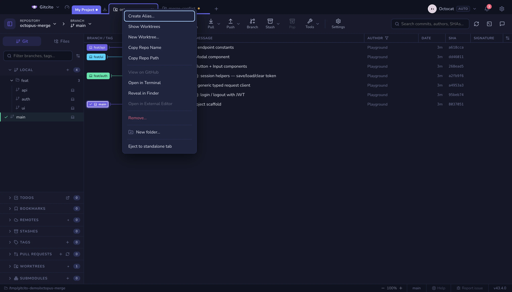
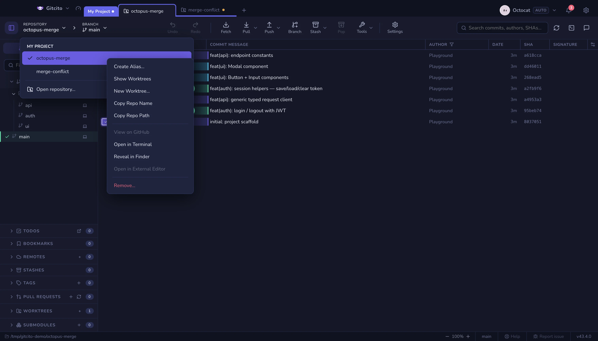
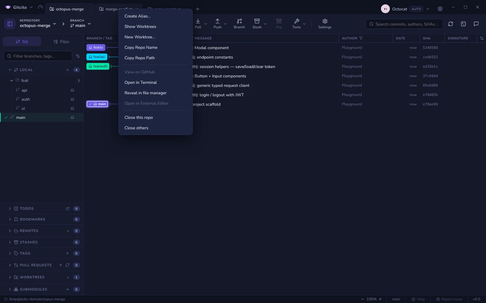

# Menu de contexto do repositório

Clique com o botão direito num repositório — uma aba avulsa, um chip dentro de
um grupo, um chip dentro de uma pasta aninhada, uma linha na lista de
boas-vindas/launcher, ou uma linha no dropdown de repositórios da barra de
ferramentas — e você recebe o mesmo menu com escopo de repositório. O chip do
grupo em si ainda abre o menu do grupo; o clique precisa cair no repositório.

O dropdown de repositórios na barra de ferramentas lista todos os repositórios
abertos, do mesmo jeito que o dropdown de branches lista as branches. Clique
numa linha com o botão esquerdo para alternar para ela. Clique com o botão
direito numa linha (ou na própria pílula do repositório atual) para alias,
worktrees, GitHub, terminal, mostrar no gerenciador de arquivos, editor e
remoção. **Abrir repositório…** no rodapé abre o launcher.

## O que cada ação faz

| Ação | Efeito |
|---|---|
| **Criar apelido…** / **Alterar apelido…** | Só um nome de exibição. O Gitcito nunca renomeia nem move a pasta no disco. O mesmo apelido acompanha o repositório em abas, grupos e workspaces. |
| **Remover apelido** | Aparece quando existe um apelido. Volta ao nome da pasta. |
| **Mostrar worktrees** | Foca este repositório e abre a seção de worktrees da barra lateral. |
| **Novo worktree…** | A mesma janela de criar worktree usada a partir de uma branch. Desabilitado enquanto o caminho não existe ou há um merge/rebase/cherry-pick/revert em andamento. |
| **Copiar nome do repo** | Copia o nome canônico da pasta, não o apelido. |
| **Copiar caminho do repo** | Copia o caminho absoluto. |
| **Ver no GitHub** | O origin, se for github.com; senão, o primeiro remote do GitHub que der para interpretar. Desabilitado quando não dá para descobrir nenhum. |
| **Abrir no terminal** | Abre o terminal do Gitcito com este repositório como pasta de trabalho. |
| **Revelar no Finder / Explorer** | Destaca a pasta do repositório no gerenciador de arquivos do sistema. |
| **Abrir no editor externo** | O editor configurado em Configurações. Visível, mas desabilitado até um ser definido. |
| **Remover…** | Tira o chip do grupo, ou a linha da lista. Usa o mesmo aviso de trabalho não commitado do **×** do chip. Nunca apaga arquivos do disco. |
| **Fechar este repo** | Numa aba de repositório avulsa, no lugar de Remover. Fecha a aba, exatamente como o **×** dela, com o mesmo aviso. |
| **Fechar os outros** | Numa aba de repositório avulsa. Fecha todas as outras abas da faixa, grupos e páginas inclusive, e deixa esta ativa. Desabilitado quando não há outra aba aberta. |

Um caminho ausente ou inválido mantém copiar, apelido e remover disponíveis, e
deixa cinza tudo o que abriria ou examinaria a pasta.

### Fechando as outras abas

Uma faixa que cresceu para uma dúzia de repositórios fica difícil de usar, e
fechar um **×** de cada vez é cansativo. **Fechar os outros** limpa a faixa até a
aba em que você clicou com o botão direito. Ele segue a configuração **Avisar ao
fechar**: com *Sempre*, pergunta uma vez pelo lote inteiro; com *Quando há
mudanças*, só pergunta quando uma das outras abas tem mudanças não commitadas ou
conflitos de merge (e diz qual dos dois); com *Nunca*, só fecha. Com uma única
outra aba, você recebe o aviso comum de fechamento daquela aba.

Nada é apagado: os repositórios ficam no disco, e <kbd>⌘⇧T</kbd> /
<kbd>Ctrl+Shift+T</kbd> reabre as abas fechadas uma de cada vez, nos lugares
antigos, quantas forem. *Limites:* abas de página e grupos também fecham; o menu
de um chip dentro de um grupo, e as outras listas de repositórios, continuam
oferecendo Remover em vez dessas duas linhas.

**Veja também:** [Workspaces, abas e grupos](workspaces.md) · [Worktrees e submódulos](worktrees.md) · [Editor externo](editor.md) · [Terminal integrado](terminal.md)
