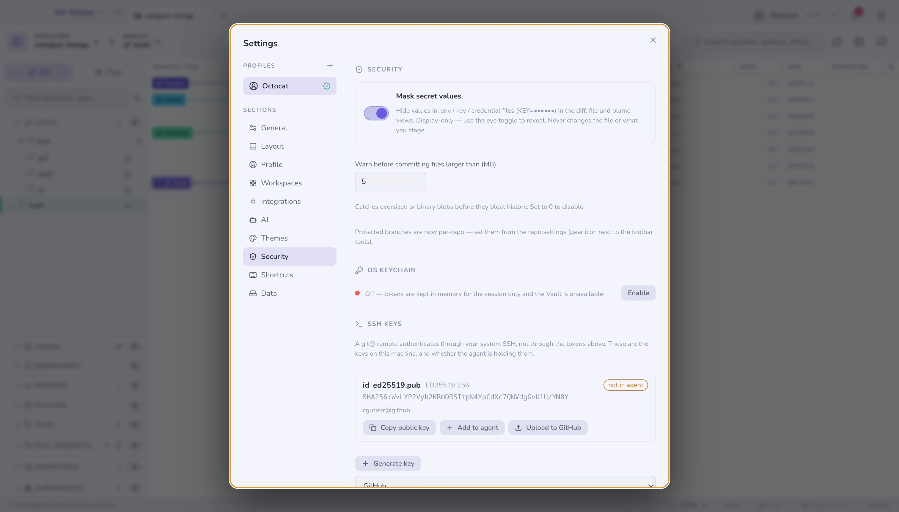
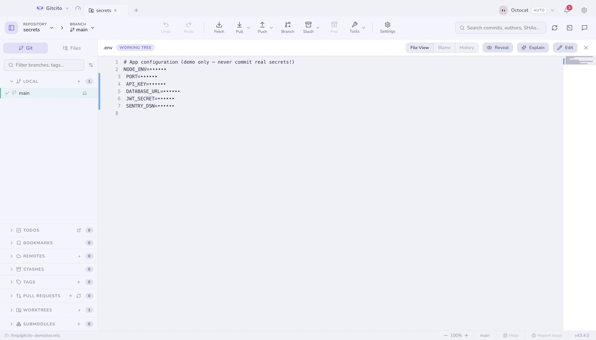

# Segurança e segredos

O Gitcito **não tem backend**. As únicas chamadas de rede são para o seu host Git e,
se você ligar, para o seu provedor de IA.

## Mascaramento de segredos

Valores em `.env*`, `*.pem`, `*.key`, `id_rsa`, `credentials.*` e companhia são
renderizados como `KEY=••••••` nas visões de diff, arquivo e blame, para que um
compartilhamento de tela ou um print não os vaze.
Material de assinatura da Apple conta: `*.mobileprovision`,
`*.provisionprofile`, `*.p12` e as chaves `*.p8` do App Store Connect. Um
`*.cer` não — um certificado é público por definição.

É **só de exibição**: nunca muda o arquivo e nunca muda o que você prepara. Um
interruptor de olho os revela por visão. `.env.example`, `.sample` e `.template` são
tratados como templates, não como segredos.

## Proteções antes de você causar dano

| Proteção | Quando |
|---|---|
| **Arquivo de segredo** | Ao commitar algo que parece uma credencial — com um *Ignorar e parar de rastrear* em um clique |
| **Arquivo grande** | Ao commitar um blob acima do tamanho (limite em Configurações → Segurança) |
| **Lixo de build** | Commitar `xcuserdata/`, `DerivedData/` ou um `.DS_Store` — com o mesmo *Ignorar e parar de rastrear* de um clique |
| **Branch protegida** | Ao commitar direto na `main`/`master`, ou dar force push numa delas |
| **Segredos rastreados** | Ao dar push num repositório que *rastreia* um arquivo de segredo — avisado uma vez por sessão |

## O keychain do sistema

Tokens e entradas do [cofre](vault.md) são criptografados com o keychain do seu
sistema (o `safeStorage` do Electron), nunca com uma chave no arquivo de
configurações.

**Nada toca no keychain até você mandar.** Antes que o diálogo de permissão do
próprio sistema possa aparecer, o Gitcito explica o que está sendo guardado, o que
ele não consegue fazer (um app só consegue ler de volta a entrada que ele mesmo
criou — as suas outras senhas são inalcançáveis), e que dizer não está tudo bem: os
tokens então vivem na memória apenas pela sessão, o cofre fica fechado, e você pode
ligar depois em **Configurações → Segurança → Keychain do sistema**.

Uma instalação nova faz **zero** chamadas ao keychain até algo de fato precisar ser
guardado.

Enquanto ele estiver desligado, o campo de token em Integrações avisa — *Guardado só até você fechar o Gitcito: o chaveiro do sistema está desligado.* — com um botão **Ativar** ao lado. Ativar, por ali ou por aqui, também guarda os tokens que você já digitou nesta sessão, então não é preciso colá-los de novo.

## Compartilhando com segurança

O [compartilhamento seguro](secure-share.md) exporta configurações, entradas do
cofre ou workspaces inteiros como um **bundle criptografado** — segredos só são
incluídos quando você marca a caixa.

## Reportar um problema

O **Report issue** de um erro abre uma issue já preenchida no GitHub — e abrir já
manda o texto ao GitHub, antes de você decidir publicar. Por isso a mensagem é
limpa antes: credenciais escritas numa URL, tokens, a sua pasta pessoal (e com
ela o seu usuário), servidores privados e caminhos de repositório, e-mails e
endereços da rede local são trocados. Hosts públicos como `github.com` ficam, e a
mensagem do próprio git continua legível. Mesmo assim, leia a issue antes de
publicar: a limpeza reconhece formatos conhecidos, não tudo o que é privado.

**Veja também:** [Cofre](vault.md) · [Compartilhamento seguro](secure-share.md)
