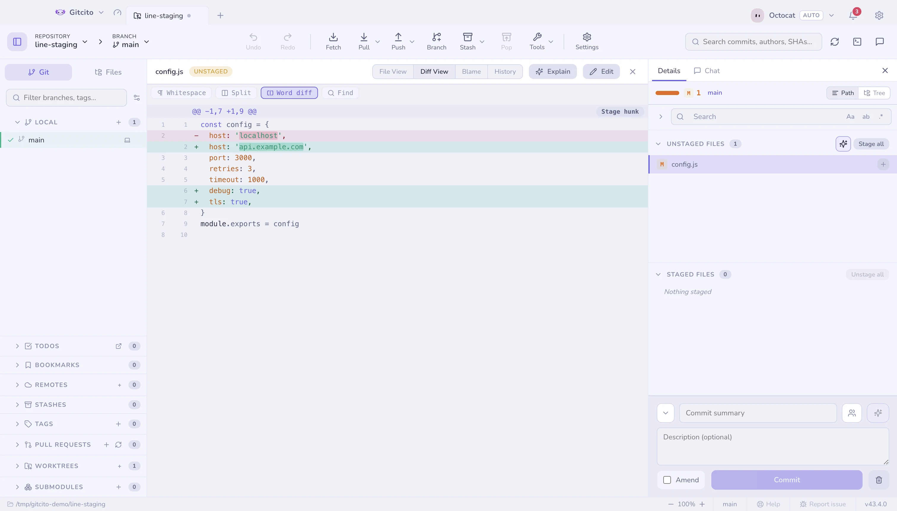
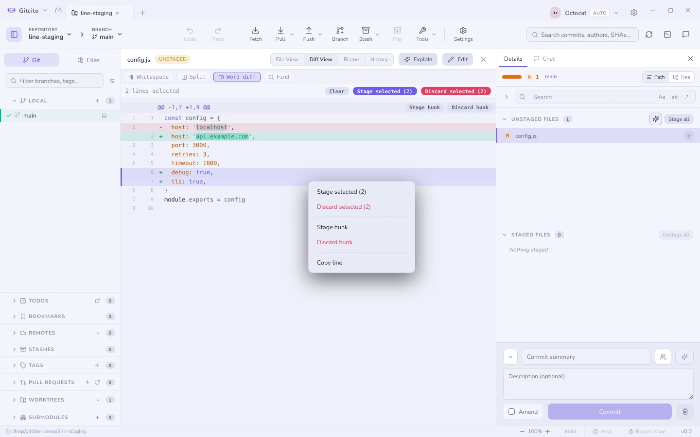
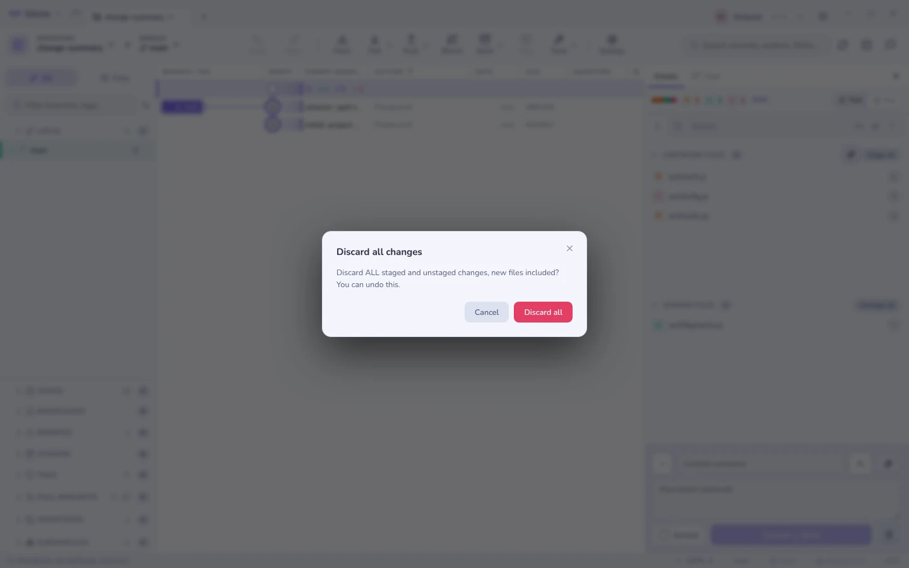

# Staging

O painel de commit tem três listas: **Em conflito**, **Não preparadas** e
**Preparadas**. Cada uma recolhe, e cada uma lembra se você a deixou aberta.

## O que mudou, por tipo

O cabeçalho acima das listas divide a contagem do mesmo jeito que as linhas de
arquivo já fazem: os mesmos blocos de status (M, +, −, →, !), um número e uma
barrinha com a proporção. Um tipo sem nada simplesmente não aparece, em vez de
aparecer como zero. Passe o mouse para ver o total.

Arquivos não rastreados contam como adicionados. É o único ponto em que o resumo
do staging discorda do de um commit, porque um commit não tem arquivos não
rastreados.

## Três níveis de precisão

| Nível | Como |
|---|---|
| **Arquivo** | Clique no ✚ da linha, ou selecione várias linhas e prepare todas |
| **Hunk** | Abra o diff e use o botão no cabeçalho do hunk |
| **Linha** | Selecione linhas dentro do diff (ou clique com o botão direito numa) e prepare exatamente essas |

O staging por linha é o que torna prático deixar um `console.log` de depuração
fora do commit sem precisar apagá-lo antes.

## Ações de hunk e de linha

Preparar só uma parte é metade do trabalho. A mesma precisão é necessária para
jogar fora um experimento mantendo o resto do arquivo, tirar um hunk do índice,
desfazer uma parte de um commit antigo ou trazer de volta um pedaço de um stash.
Os botões de cada hunk (e de uma seleção de linhas) dependem do diff que você
está vendo:

| Diff | Ações | O que acontece |
|---|---|---|
| Mudanças não preparadas | **Preparar hunk**, **Descartar hunk** | Preparar copia a mudança para o índice. Descartar devolve as linhas ao estado preparado (ou commitado) |
| Mudanças preparadas | **Despreparar hunk** | Tira a mudança do índice. O arquivo no disco não é tocado |
| Um commit | **Reverter hunk** | Desfaz aquela parte do commit na sua árvore de trabalho, como mudança não commitada. Nenhum commit é feito |
| Um stash | **Aplicar hunk** | Traz só aquela parte do stash para a sua árvore de trabalho. O stash é mantido |

Clique nas linhas alteradas para selecioná-las; uma barra acima do diff passa a
oferecer as mesmas ações só para essas linhas ("Preparar selecionadas (3)",
"Descartar selecionadas (3)").

**Clique com o botão direito numa linha** para ter as mesmas ações sem selecionar
antes: *Preparar esta linha* ou *Descartar esta linha* (ou Despreparar,
Reverter, Aplicar, conforme o diff), o hunk inteiro, e *Copiar linha*. Clique com
o botão direito numa linha que faz parte de uma seleção e o menu age sobre a
seleção inteira. Com texto destacado no diff, *Copiar* copia só esse texto.

Todas entram na pilha de desfazer (<kbd>⌘</kbd>/<kbd>Ctrl</kbd>+<kbd>Z</kbd>).
Descartar ainda pergunta antes, porque joga trabalho fora, e antes dele (e antes
de reverter e aplicar) o Gitcito também tira um [snapshot WIP](recovery.md).
Enquanto uma ação está sendo aplicada, os botões continuam no lugar mas ficam
desligados, para nada ser apertado duas vezes em linhas que já sumiram.

Os limites:

- **Com espaços em branco ignorados**, as ações fazem o que o diff visível
  mostra. Uma mudança só de espaço escondida dessa visão fica exatamente onde
  está, então preparar um hunk não prepara junto uma reindentação que você não
  via.
- **Quando o arquivo já mudou.** Reverter e aplicar recortam o patch do
  histórico, e o arquivo pode ter mudado desde então, por um commit posterior ou
  por edições que você não commitou. O Gitcito então mescla o hunk em três vias,
  do jeito que o git mescla um commit inteiro. Mudanças que não se sobrepõem se
  combinam limpas. Linhas que você mesmo editou ganham marcadores de conflito
  (`<<<<<<< working copy` … `>>>>>>> hunk`) e um aviso diz isso. O resultado é
  uma mudança não preparada, nunca preparada, para você revisar antes de ela ir
  para qualquer lugar. Se o git não tem mais a versão de onde o hunk veio, ou o
  hunk já está desfeito, nada muda e você é avisado.
- **A seleção de linhas funciona nas duas visões.** Clique em linhas alteradas na
  visão unificada ou lado a lado; uma seleção continua valendo se você trocar. Na
  visão lado a lado, uma linha editada é uma edição só: clicar (ou clicar com o
  botão direito) no lado antigo ou no novo pega os dois, então preparar nunca
  deixa metade da edição para trás. Só sequências que pareiam uma a uma se juntam
  (três linhas trocadas por cinco ficam separadas). A visão unificada mantém cada
  linha −/+ separada, para a rara vez em que você quer só uma metade.
- **Desfazer é exato, não mágica.** Ele aplica o mesmo patch ao contrário, então
  funciona enquanto aquelas linhas não tiverem sido editadas de novo.
- **Arquivos novos não rastreados** não têm hunks para escolher. Prepare ou
  descarte o arquivo inteiro. (Os arquivos não rastreados de um stash são a
  exceção: Aplicar hunk os cria.)
- **Arquivos em conflito** mostram o diff combinado do git, que as ações de hunk
  não conseguem ler. Resolva-os na visão de conflitos.

## Descartando

Descartar funciona nos mesmos níveis, e sempre pergunta. Arquivos não rastreados
são apagados; os rastreados voltam ao estado preparado (ou commitado).

**Descartar tudo** (a lixeira ao lado do botão de commit) joga fora todas as
mudanças, preparadas e não preparadas, inclusive arquivos recém-adicionados: um
arquivo que você deu `git add` mas nunca commitou é removido, não deixado para
trás como não rastreado.

### Desfazendo um descarte

Descartar um arquivo, uma pasta ou tudo pode ser desfeito. Logo antes de rodar,
o Gitcito salva o que estava preparado e o que estava no disco como duas árvores
do git, e o descarte entra na pilha de desfazer. **Desfazer** (o botão da barra
de ferramentas, ou *Repositório → Desfazer última operação*) devolve os arquivos
descartados exatamente como estavam: a parte preparada preparada, a não preparada
no disco, arquivos novos e não rastreados recriados. A confirmação diz se o
descarte pode ser desfeito.

Desfazer só mexe nos arquivos que foram descartados. O que você mudou em outros
lugares desde então fica como está; um arquivo descartado que você editou de novo
desde então é sobrescrito com a versão salva.

**Limites.** Enquanto um merge ainda tem conflitos, o índice não pode ser salvo
como árvore, então esse descarte não ganha entrada de desfazer e a confirmação
avisa que ele não pode ser desfeito. Arquivos ignorados nunca são descartados,
então também nunca são salvos. As árvores salvas são objetos comuns do git, sem
nenhuma ref apontando para elas: duram tanto quanto a entrada de desfazer, e o
`git gc` pode apagá-las depois do período de carência (duas semanas, por
padrão). Para uma rede de segurança que sobrevive à sessão, veja os
[snapshots de proteção](recovery.md).

## Teclado

<kbd>↑</kbd> <kbd>↓</kbd> (ou <kbd>j</kbd> <kbd>k</kbd>) percorrem as listas de
arquivos. <kbd>⇧</kbd>+<kbd>↑</kbd>/<kbd>↓</kbd> aumenta a seleção a partir da
última linha clicada, <kbd>⇧</kbd>-clique pega um intervalo, e
<kbd>⌘</kbd>/<kbd>Ctrl</kbd>-clique marca ou desmarca arquivos individuais.
Clique com o botão direito na seleção para preparar, despreparar, guardar em
stash ou descartar tudo de uma vez.

## Copiar caminhos

Clique com o botão direito num arquivo não commitado para **Copiar caminho do
arquivo** (absoluto, com os separadores da plataforma) e **Copiar caminho
relativo** (`src/index.ts`, sem `./` na frente). Vários arquivos selecionados
copiam um caminho por linha, na ordem da lista. Arquivos apagados continuam
habilitados — essas ações só copiam texto. Pastas continuam copiando o caminho
da pasta.

## Antes de você commitar

O Gitcito confere algumas coisas e pergunta uma vez, nunca em silêncio:

- um arquivo que parece um **segredo** (`.env`, `*.pem`, `id_rsa`…),
- um blob **muito grande** (limite em Configurações → Segurança),
- commitar **direto numa branch protegida** (`main`/`master` por padrão).

Cada um oferece um *Ignorar e parar de rastrear* com um clique. Veja
[Segurança e segredos](security.md).

**Veja também:** [Commitando](committing.md) · [Diffs](diffs.md) · [Absorb](absorb.md)
