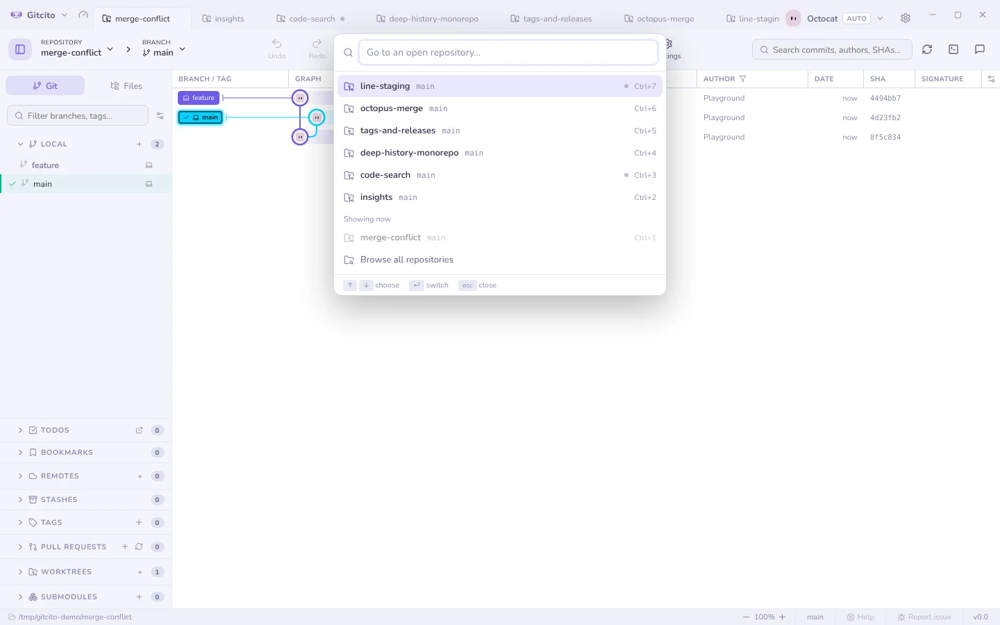
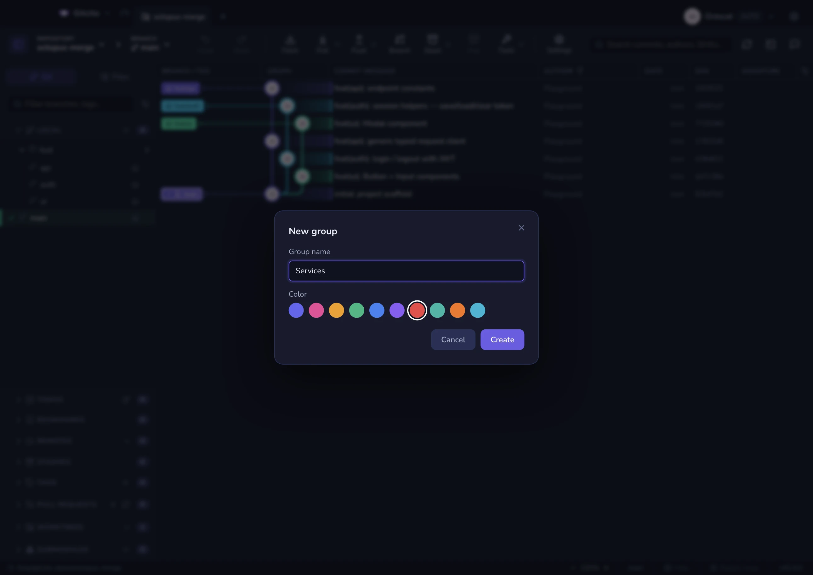
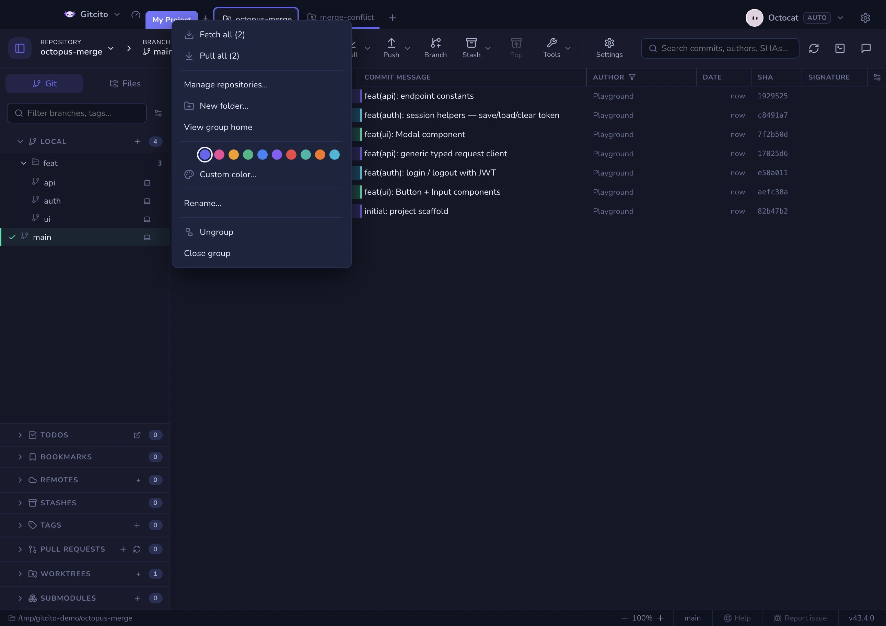
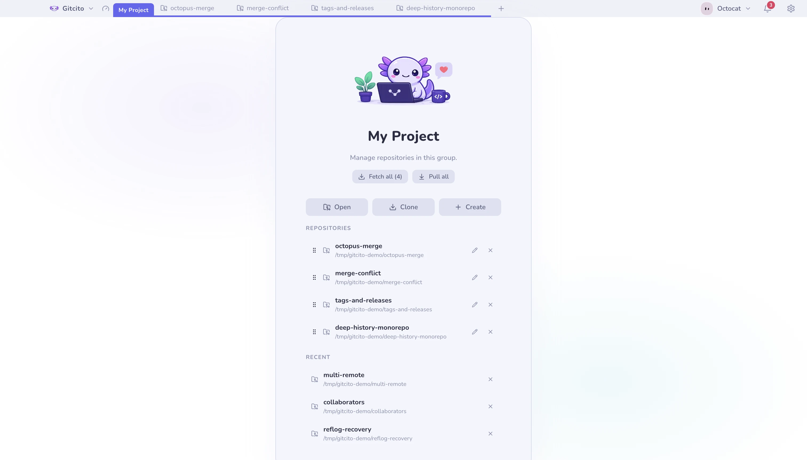
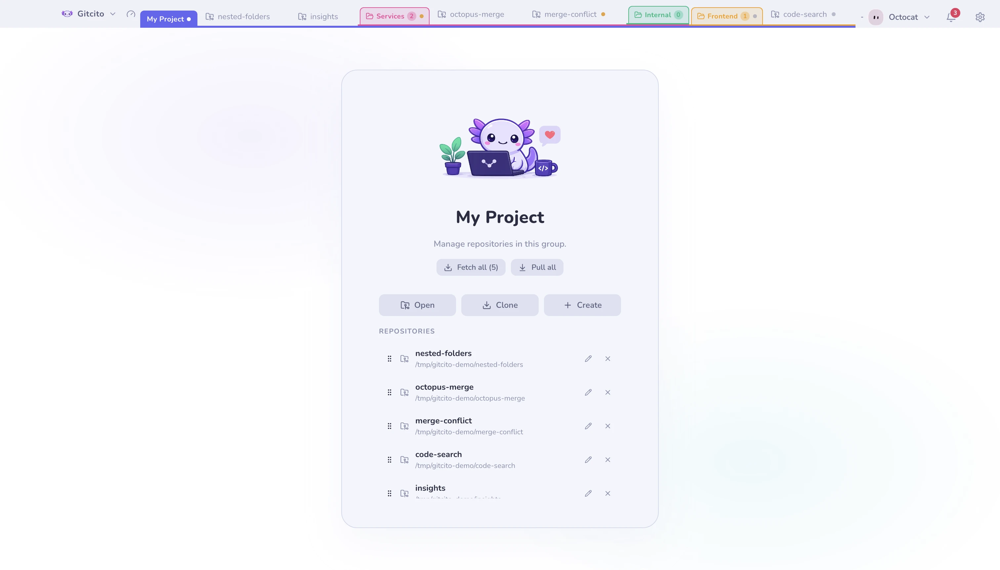

# Workspaces, abas e grupos

Três níveis, do mais solto ao mais apertado.

## Abas

Um repositório, uma aba. Use <kbd>⌘T</kbd> / <kbd>Ctrl+T</kbd> para abrir o
seletor de nova aba e <kbd>⌘W</kbd> / <kbd>Ctrl+W</kbd> para fechar a aba ativa.
Você também pode arrastar para reordenar, clicar com o botão do meio para fechar,
ou apertar <kbd>⌘⇧T</kbd> para reabrir a última que fechou. Clique com o botão
direito numa aba de repositório (ou num chip dentro de um [grupo](#grupos)) para
o [menu de contexto do repositório](repo-menu.md) — apelido, worktrees, GitHub,
terminal, revelar, editor, e **Fechar este repo** e **Fechar os outros** no fim
(um chip num grupo oferece remover em vez disso). Feche a última aba e
<kbd>⌘W</kbd> fecha a janela. Um ponto na aba indica trabalho não commitado; um
ponto diferente indica conflitos.

Se aparecer um aviso de fechamento, <kbd>Escape</kbd> sempre cancela.
<kbd>Enter</kbd> só confirma quando a aba está limpa — com mudanças não
commitadas ou conflitos, o aviso faz você ir até o botão de propósito, para que
um toque perdido depois do <kbd>⌘W</kbd> não feche trabalho que você ainda
tinha nas mãos.

### Tamanho das abas

Por padrão (**Configurações → Layout → Tamanho das abas → Ajustar**) as abas se
comportam como as de um navegador: quando a faixa fica sem espaço, elas encolhem
por igual até uma largura mínima, e só rolam quando até esse piso é atingido.
**Fixo** volta ao comportamento clássico — cada aba mantém a largura do conteúdo
e a faixa rola assim que nem todas cabem.

### Indo para um repositório

Com dez ou mais repositórios abertos, achar um na faixa exige rolar,
<kbd>⌘1</kbd>–<kbd>⌘9</kbd> param na nona aba, e a [paleta de
comandos](search.md) mistura os repositórios abertos com todas as ações. Aperte
<kbd>⌘J</kbd> / <kbd>Ctrl+J</kbd> (ou **Exibir → Ir para repositório…**) e
digite algumas letras do nome, da pasta ou da branch, depois <kbd>Enter</kbd>.

A lista tem só os repositórios abertos, inclusive os de grupos, na ordem em que
você os viu por último. O que você acabou de deixar vem primeiro, então
<kbd>⌘J</kbd> <kbd>Enter</kbd> leva você de volta a ele. Cada linha traz o que a
aba mostra: a branch, o ponto de trabalho não commitado ou de conflito, o grupo
em que ele está, e a tecla <kbd>⌘1</kbd>–<kbd>⌘9</kbd> quando tiver uma. O
repositório na tela fica esmaecido no fim. Nada escurece por trás do seletor; um
clique fora ou <kbd>Esc</kbd> o fecha.

Quando nada aberto combina, a última linha, **Procurar em todos os
repositórios**, leva a busca para a página [Repositórios](repositories.md). O
atalho pode ser remapeado em **Configurações → Atalhos**.

*Limites:* a ordem é lembrada só nesta sessão, então depois de reabrir o app ela
começa pela ordem das abas. Um repositório aberto em duas abas aparece uma vez,
na primeira. Repositórios de outros [workspaces](#workspaces) não aparecem —
troque de workspace antes, ou use a página Repositórios.

## Grupos

Junte repositórios relacionados numa **aba de grupo** com nome e cor. Dentro de
um grupo você ganha uma segunda fileira com um chip por repositório, e o próprio
grupo pode **Buscar todos** ou **Puxar todos** de uma vez.

Para começar um, clique com o botão direito numa aba de repositório → *Novo
grupo…*: a aba vira um grupo com aquele repositório, no mesmo lugar. Depois que
existe um grupo, o mesmo menu passa a dizer *Adicionar ao grupo →*, listando os
grupos abertos. Arrastar uma aba de repositório sobre um chip de grupo faz o
mesmo.

*Novo grupo…* pede um nome e uma cor juntos. A cor começa numa que nenhum grupo
aberto está usando, escolhida ao acaso, para os grupos não começarem todos iguais.

Para trocar a cor de um grupo, clique com o botão direito nele: as dez cores
ficam no menu como uma fileira de bolinhas, com um anel em volta da atual, e um
clique aplica. *Cor personalizada…* abaixo da fileira abre um seletor para
qualquer outra cor. Pastas e as seções da página Repositórios usam a mesma
fileira.

Para desfazer um grupo, clique com o botão direito nele → **Desagrupar**. Cada
repositório vira uma aba comum onde o grupo estava, mantendo as páginas que
tinha abertas. **Fechar grupo** fecha o grupo e todos os repositórios dele. As
pastas não sobrevivem a um Desagrupar: elas só existem dentro de um grupo.

Grupos podem ter **pastas, aninhadas em qualquer profundidade**: clique com o
botão direito no grupo → *Nova pasta…*, depois arraste repositórios para um chip
de pasta. Cada pasta tem uma cor, recolhe num chip com contagem, soma os pontos
de status de tudo o que tem dentro, e pode buscar ou puxar a subárvore inteira.

> Pastas só organizam. Apagar uma sobe os repositórios dela para o nível de
> cima — nunca fecha um repositório.

Para adicionar um repositório que o grupo ainda não tem, clique no **+** ao lado
do nome do grupo. Ele mostra a página do próprio grupo — abrir uma pasta, clonar,
criar, ou escolher um repositório recente — mesmo com um dos repositórios dele
aberto; clicar num chip leva você de volta.

## Páginas que pertencem a um repositório

Algumas páginas não são coisa à parte: a [wiki](repo-wiki.md) de um
repositório, os [insights](insights.md) dele, as [DevTools](devtools.md) que uma
sessão de execução anunciou. Elas não ocupam uma aba — aparecem como pequenos
ícones no próprio repositório.

- **Clique num ícone** para mostrar aquela página. **Clique de novo — ou no nome
  do repositório** — para voltar ao repositório. Enquanto uma página está à
  mostra, o nome ganha cursor de mão e uma pequena pílula ao passar o mouse: é o
  caminho de volta.
- **Passe o mouse num ícone** para ver o ✕ que fecha só aquela página.
- Dentro de um **grupo**, os ícones ficam no chip do repositório a que
  pertencem, e só enquanto aquele repositório é o selecionado. Escolher outro
  repo no grupo mostra *aquele* repositório, não a ferramenta do vizinho.
- Reabrir a mesma página acende o ícone que ela já tem, em vez de criar outro.

Um repositório que não está aberto em lugar nenhum não tem onde levar o ícone,
então uma página dele abre numa aba própria — abrir algo sempre abre algo.

## Workspaces

Um workspace é **uma faixa de abas inteira salva**. Trocar troca todas as abas
de uma vez: `Trabalho` e `Pessoal` param de pisar um no outro.

O nome do workspace fica no canto superior esquerdo, ao lado da marca do
Gitcito. Clique nele para trocar, criar, renomear, reordenar ou apagar. Ao lado
fica o medidor que abre a [Central de controle](mission-control.md) do workspace
em que você está.

**Veja também:** [Central de controle](mission-control.md) · [A linha de comando](cli.md)
