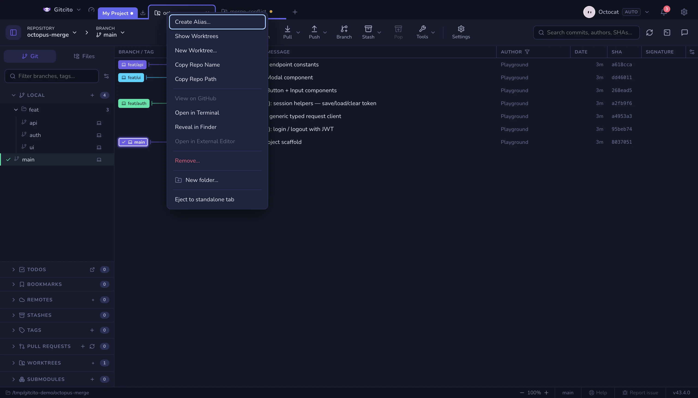
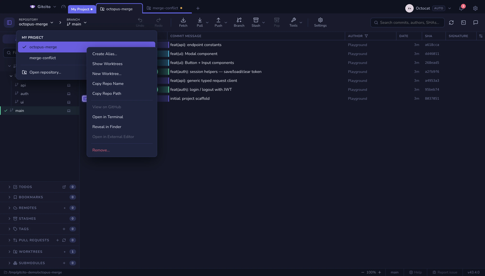
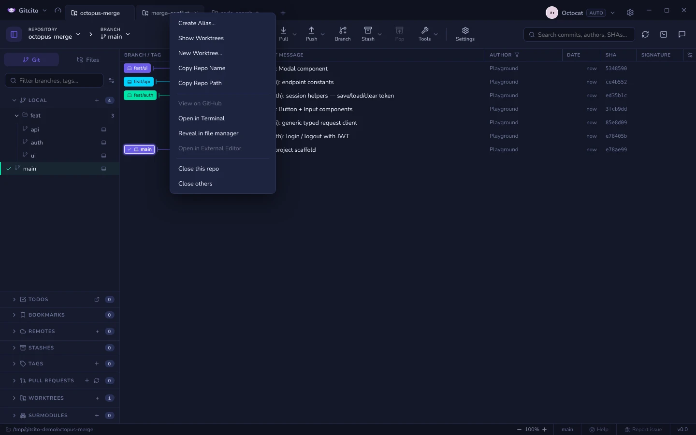

# Repository context menu

Right-click a repository — a standalone tab, a chip inside a group, a chip
inside a nested folder, a row in the welcome/launcher list, or a row in the
toolbar's repository dropdown — and you get the same repository-scoped menu.
The group chip itself still opens the group menu; the click has to land on the
repository.

The repository dropdown in the toolbar lists every open repository, the same
way the branch dropdown lists branches. Left-click a row to switch to it.
Right-click a row (or the current-repository pill itself) for alias, worktrees,
GitHub, terminal, reveal, editor and remove. **Open repository…** at the bottom
opens the launcher.

## What each action does

| Action | Effect |
|---|---|
| **Create Alias…** / **Change Alias…** | A display name only. Gitcito never renames or moves the folder on disk. The same alias follows the repository across tabs, groups and workspaces. |
| **Remove Alias** | Shown when an alias exists. Restores the folder name. |
| **Show Worktrees** | Focuses this repository and opens the sidebar's worktree section. |
| **New Worktree…** | The same create-worktree prompt used from a branch. Disabled while the path is missing or a merge/rebase/cherry-pick/revert is in progress. |
| **Copy Repo Name** | Copies the canonical folder name, not the alias. |
| **Copy Repo Path** | Copies the absolute path. |
| **View on GitHub** | Origin if it is github.com, otherwise the first parseable GitHub remote. Disabled when none can be derived. |
| **Open in Terminal** | Opens Gitcito's terminal with this repository as the working directory. |
| **Reveal in Finder / Explorer** | Highlights the repository folder in the platform file manager. |
| **Open in External Editor** | The editor configured in Settings. Visible but disabled until one is set. |
| **Remove…** | Drops the chip from its group, or the row from its list. Uses the same uncommitted-work warning as the chip's **×**. It never deletes files from disk. |
| **Close this repo** | On a standalone repository tab, in place of Remove. Closes the tab, exactly like its **×**, with the same warning. |
| **Close others** | On a standalone repository tab. Closes every other tab in the strip, groups and pages included, and makes this one active. Disabled when no other tab is open. |

A missing or invalid path keeps copy, alias and remove available, and greys out
anything that would open or inspect the directory.

### Closing the other tabs

A strip that has grown to a dozen repositories is hard to work in, and closing
them one **×** at a time is tedious. **Close others** clears the strip down to
the tab you right-clicked. It follows the **Warn when closing** setting: with
*Always* it asks once for the whole batch, with *When changes* it
asks only when one of the other tabs has uncommitted changes or merge conflicts
(and says which kind), and with *Never* it just closes. With a single other tab you
get that tab's ordinary close warning instead.

Nothing is deleted: the repositories stay on disk, and <kbd>⌘⇧T</kbd> /
<kbd>Ctrl+Shift+T</kbd> reopens the closed tabs one at a time, in their old
places, however many there were. *Limits:* page tabs and groups close too;
the menu on a chip inside a group, and the other repository lists, still offer
Remove rather than these two rows.

**See also:** [Workspaces, tabs & groups](workspaces.md) · [Worktrees & submodules](worktrees.md) · [External editor](editor.md) · [Terminal](terminal.md)
