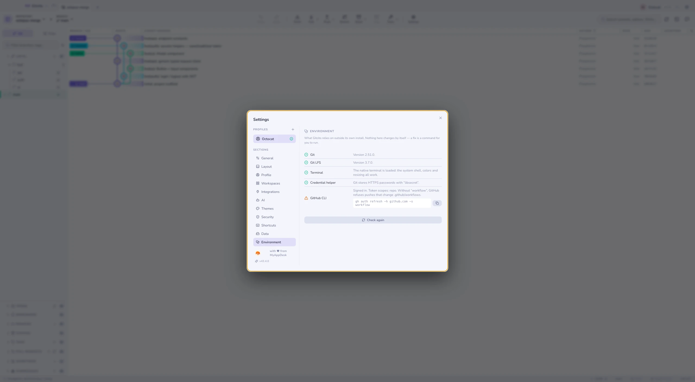

# Проверка окружения

Некоторые сбои вообще не связаны с репозиторием. Они идут от машины: git, слишком
старый для входа через профиль, терминал, молча перешедший в базовый режим, вход
GitHub CLI, который не может пушить файлы workflow. Каждый из них потом всплывает
расплывчатой ошибкой посреди чего-то другого. **Настройки → Окружение** (также
*Settings: Environment* в палитре команд) проверяет их заранее.

[Доктор репозитория](repo-settings.md) отвечает на другой вопрос: можно ли собрать
*этот репозиторий* здесь, исходя из того, что требует его `.gitcito.json`.
Проверка окружения касается самого приложения и одинакова для любого
репозитория.

## Что проверяется

| Строка | Зелёный значит | Жёлтый или красный значит |
|--------|----------------|---------------------------|
| **Git** | git 2.31 или новее есть в `PATH` | Старее 2.31: учётная запись [профиля](profiles.md) не может войти для fetch и push. Отсутствует: ничего не работает, пока git не установлен |
| **Git LFS** | `git lfs` установлен | Не установлен. Нужен только репозиториям, хранящим файлы в LFS |
| **Терминал** | Нативный терминал загрузился | [Терминал](terminal.md) работает в базовом режиме: без цветов, без изменения размера, без полноэкранных программ |
| **Credential helper** | У git есть helper для паролей HTTPS — глобально или для отдельных хостов (то, что настраивает `gh auth setup-git`) | Helper’а нет, поэтому git вне Gitcito спрашивает каждый раз. Или `store`, который хранит их открытым текстом. См. [Credential helper](credentials.md) |
| **GitHub CLI** | `gh` вошёл со scope `workflow` | Вошёл без него: GitHub отклоняет любой push, меняющий `.github/workflows` |
| **Отслеживание файлов** (Linux) | Лимит inotify не меньше 65 536 | Меньший лимит исчерпывается при нескольких больших открытых репозиториях, и новые папки перестают обновлять статус |

Неприменимая строка не показывается: GitHub CLI, если он не установлен или не
выполнен вход, и отслеживание файлов в macOS и Windows.

## Как исправить найденное

Где есть исправление, строка показывает его как команду с кнопкой копирования.
Например, `gh auth refresh -h github.com -s workflow` добавляет недостающий scope,
а строка `sysctl` поднимает лимит inotify. **Страница сама никогда ничего не
запускает.** Некоторым исправлениям нужен `sudo` или они меняют глобальную
конфигурацию — прочитайте их перед запуском. Затем нажмите **Проверить снова**.

## Ограничения

- Проверяется то, что приложение видит из собственного процесса. Профиль
  оболочки, меняющий `PATH` только в вашем терминале, может привести к
  расхождению.
- Строка GitHub CLI отражает собственный вход `gh`, а не учётные записи,
  подключённые в **Настройки → Интеграции**. Это разные учётные данные. Нехватка
  scope `workflow` там проявится как отклонённый push.
- Она сообщает, что установлено. Ничего не устанавливает и не обновляет.
