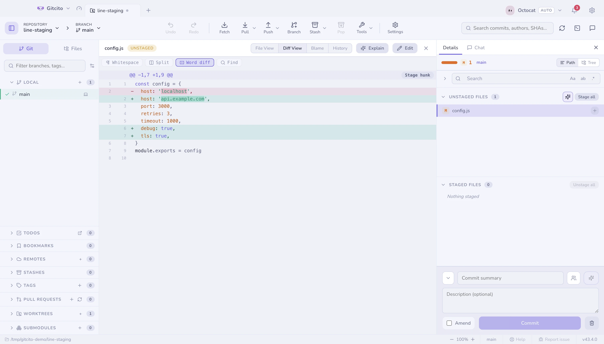
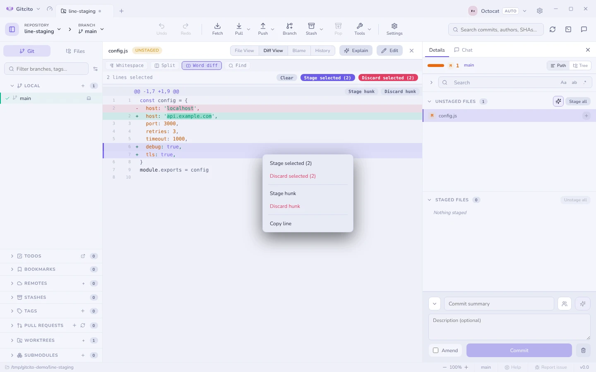
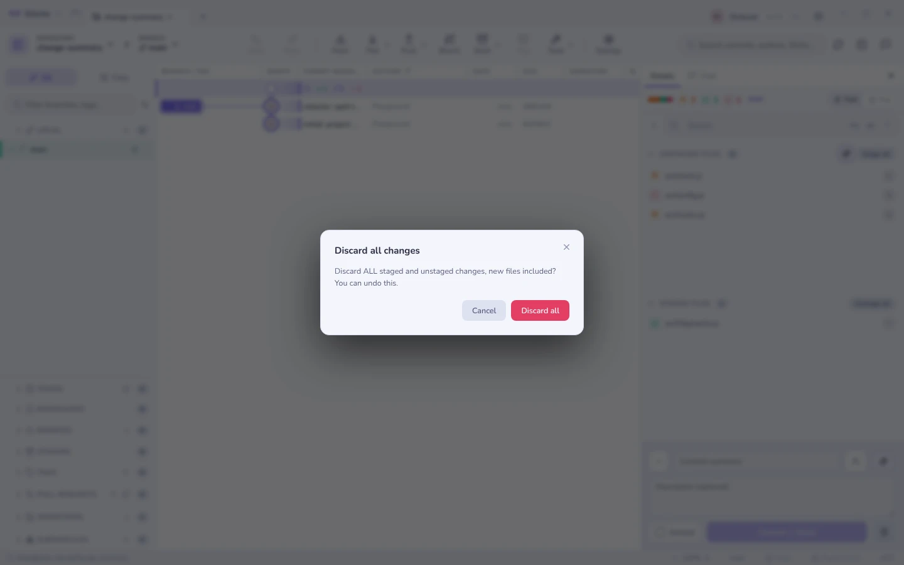

# Staging

The commit panel has three lists: **Conflicted**, **Unstaged** and **Staged**.
Each collapses, and each remembers whether you left it open.

## What changed, by kind

The header above the lists splits the count the way the file rows already
do: the same status tiles (M, +, −, →, !), a number, and a short bar for the
mix. A kind with nothing in it is simply absent, not shown as zero. Hover for
the plain total.

Untracked files count as added. That is the one place staging's summary
disagrees with a commit's, because a commit has no untracked files.

## Three levels of precision

| Level | How |
|---|---|
| **File** | Click the ✚ on the row, or select several rows and stage the lot |
| **Hunk** | Open the diff and use the button on the hunk header |
| **Line** | Select lines inside the diff (or right-click one) and stage exactly those |

Line staging is what makes it practical to keep a debug `console.log` out of a
commit without deleting it first.

## Hunk and line actions

Partial staging is only half of the job. The same precision is needed to throw
away one experiment while keeping the rest of the file, to take a hunk back out
of the index, to undo one part of an old commit, or to bring back one piece of a
stash. The buttons on each hunk (and on a line selection) depend on the diff you
are looking at:

| Diff | Actions | What happens |
|---|---|---|
| Unstaged changes | **Stage hunk**, **Discard hunk** | Stage copies the change into the index. Discard puts the lines back as they are staged (or committed) |
| Staged changes | **Unstage hunk** | Takes the change out of the index. The file on disk is untouched |
| A commit | **Revert hunk** | Undoes that part of the commit in your working tree, as an uncommitted change. No commit is made |
| A stash | **Apply hunk** | Brings just that part of the stash into your working tree. The stash is kept |

Click changed lines to select them; a bar above the diff then offers the same
actions for just those lines ("Stage selected (3)", "Discard selected (3)").

**Right-click a line** for the same actions without selecting first: *Stage
this line* or *Discard this line* (or Unstage, Revert, Apply, depending on the
diff), the whole hunk, and *Copy line*. Right-click a line that is part of a
selection and the menu acts on the whole selection instead. With text
highlighted in the diff, *Copy* copies just that text.

Every one of them is on the undo stack (<kbd>⌘</kbd>/<kbd>Ctrl</kbd>+<kbd>Z</kbd>).
Discard still asks first, because it throws work away, and before it (and
before revert and apply) Gitcito also takes a [WIP snapshot](recovery.md).
While an action is landing, the buttons stay where they are but are off, so
nothing is pressed twice on lines that are already gone.

The limits:

- **With whitespace ignored**, the actions do what the visible diff shows. A
  whitespace-only change hidden from that view is left exactly where it is, so
  staging a hunk does not also stage a re-indent you could not see.
- **When the file has moved on.** Revert and apply cut their patch from history,
  and the file may have changed since, through a later commit or edits you have
  not committed. Gitcito then merges the hunk in three ways, the way git merges
  a whole commit. Changes that do not overlap combine cleanly. Lines you have
  edited yourself get conflict markers (`<<<<<<< working copy` … `>>>>>>> hunk`)
  and a notice says so. The result is an unstaged change, never staged, so you
  review it before it goes anywhere. If git no longer has the version the hunk
  came from, or the hunk is already undone, nothing changes and you are told so.
- **Line selection works in both views.** Click changed lines in unified or
  split view; one selection carries across if you switch. In split view an
  edited line is one edit: clicking or right-clicking either its old or its new
  side takes both, so staging it never leaves half the edit behind. Only runs
  that pair one to one join up (three lines replaced by five stay separate).
  Unified view keeps every −/+ line separate, for the rare time you want just
  one half.
- **Undo is exact, not magic.** It applies the same patch the other way, so it
  works as long as those lines have not been edited again since.
- **New untracked files** have no hunks to pick from. Stage or discard the whole
  file. (A stash's untracked files are the exception: Apply hunk creates them.)
- **Conflicted files** show git's combined diff, which hunk actions cannot
  read. Resolve them in the conflict view.

## Discarding

Discard works at the same levels, and always asks. Untracked files are deleted;
tracked ones go back to their staged (or committed) state.

**Discard everything** (the bin beside the commit button) throws away every
change, staged and unstaged, newly added files included: a file you had
`git add`ed but never committed is removed, not left behind as untracked.

### Undoing a discard

Discarding a file, a folder or everything can be undone. Right before it runs,
Gitcito saves what was staged and what was on disk as two git trees, and the
discard goes on the undo stack. **Undo** (the toolbar button, or
*Repository → Undo last operation*) puts the discarded files back exactly as
they were: the staged part staged, the unstaged part on disk, new and untracked
files recreated. The confirm tells you whether the discard can be undone.

Undo touches only the files that were discarded. Anything you changed elsewhere
since is left alone; a discarded file you have edited again since is
overwritten with the saved version.

**Limits.** While a merge still has conflicts the index cannot be saved as a
tree, so that discard gets no undo entry and its confirm says it cannot be
undone. Ignored files are never discarded, so they are never saved either. The
saved trees are plain git objects with no ref pointing at them: they last as
long as the undo entry, and `git gc` may prune them after its grace period (two
weeks by default). For a safety net that outlives the session, see
[guard snapshots](recovery.md).

## Keyboard

<kbd>↑</kbd> <kbd>↓</kbd> (or <kbd>j</kbd> <kbd>k</kbd>) walk the file lists.
<kbd>⇧</kbd>+<kbd>↑</kbd>/<kbd>↓</kbd> grows a selection from the last row you
clicked, <kbd>⇧</kbd>-click takes a range, and <kbd>⌘</kbd>/<kbd>Ctrl</kbd>-click
toggles individual files. Right-click the selection to stage, unstage, stash or
discard everything in it at once.

## Copying paths

Right-click an uncommitted file for **Copy File Path** (absolute, with the
platform's separators) and **Copy Relative File Path** (`src/index.ts`, no
leading `./`). Several selected files copy one path per line, in list order.
Deleted files stay enabled — those actions only copy text. Folders still copy
the folder path.

## Before you commit

Gitcito checks a few things and asks once, never silently:

- a file that looks like a **secret** (`.env`, `*.pem`, `id_rsa`…),
- a **very large** blob (threshold in Settings → Security),
- committing **straight to a protected branch** (`main`/`master` by default).

Each of those offers a one-click *Ignore & untrack*. See
[Security & secrets](security.md).

**See also:** [Committing](committing.md) · [Diffs](diffs.md) · [Absorb](absorb.md)
