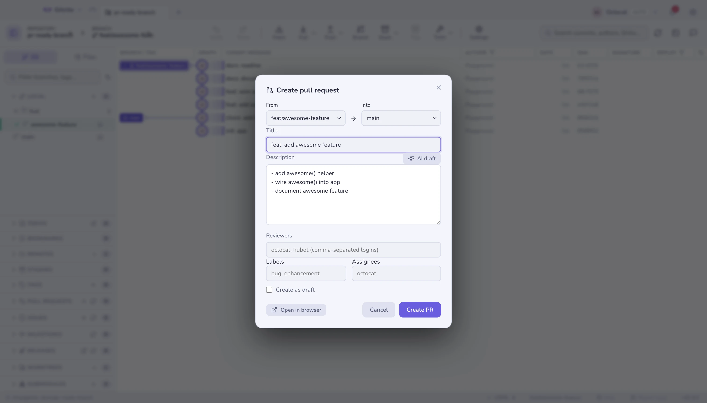

# Sunucular ve pull request'ler

## Oluşturma

Uygulamadan çıkmadan bir pull (ya da merge) request oluşturun: dal açılır
listeleri, dalın commit'lerinden önceden doldurulmuş başlık ve gövde, taslak
düğmesi ve — GitHub'da — oluştururken uygulanan inceleyiciler, etiketler ve
atananlar.

**GitHub, GitLab, Bitbucket ve Azure DevOps** üzerinde çalışır. Dördünün de açık
PR/MR'ları kenar çubuğunda listelenir.

Dal karşılaştırmasından, grafikten, PR panelindeki `+` düğmesinden ya da bir
issue'dan başlatın (issue `Closes #N` satırını sizin için doldurur).

## Listedeki yığınlar

Birbirinin üstünde duran pull request'ler tek bir satıra katlanır: yığın
simgesi, zincirin indiği dal ve kaç tane olduğu. Açtığında zinciri okuma
sırasıyla görürsün — yapraktan tabana — ve her satırın altında neye merge
olduğunu söyleyen küçük bir ok olur; yön ekranda durur, dört temele bakıp
çıkarılmaz.

O grubu iki şey oluşturur: pull request'ler bir [yerel yığına](stacks.md) aitse
GitHub'ın kendi yığın numarası; değilse ref'lerin kendisi — temeli bir başkasının
ucu olan pull request onun üstünde durur. İkinci kural, bunun GitLab, Bitbucket
ve Azure DevOps'ta da çalışmasının sebebidir.

Her satır kendi ucundaki **kontrollerin** durumunu taşır — sayılar için üzerine
gel — ve GitHub'da ayrıca çoktan kapanmış ya da merge edilmiş katmanları da; açık
PR listesi bunları gizlerdi. **Kapalı** bir katmanın üstündeki katman engellenmiş
olarak işaretlenir: kendi kontrolleri yeşil olabilir, ama hedeflediği dal asla
inmeyecektir. Satırın eylemleri üzerine gelince çıkar, başlık genişliğini korusun
diye.

Kontrolleri okumak pull request başına bir istek eder, o da yalnızca liste
yenilenince.

## Bir fork’un üst deposundaki pull request’leriniz

Bir fork’ta önemli olan pull request’ler genellikle fork aldığınız depoda
açtıklarınızdır ve onlar sizin fork’unuzda değil, orada durur. Bu yüzden bir
deponun `origin`’den farklı bir GitHub deposunu gösteren bir `upstream` uzak
deposu varsa, liste `upstream`’den de açık pull request’leri ister ve **yalnızca
dalı sizin fork’unuzdan gelenleri** tutar. Bunlar fork’unuzunkilerin altında, üst
deponun adını taşıyan bir başlık altında görünür: **owner/repo üzerinde**. Bir
tıklama, aynı ayrıntı görünümünü kontrolleri ve incelemesiyle üst depoda açar.

*Sınırlar:* yalnızca GitHub ve yalnızca `upstream` adlı bir uzak depo. Üst
deponun diğer pull request’leri bilerek dışarıda bırakılır: o, onun kuyruğudur,
sizin işiniz değil. Yığınlar ve dal aramaları hâlâ yalnızca `origin` listesiyle
çalışır. Üst depoyu listelemek her yenilemede bir istek daha demektir.

## İnceleme — GitHub ve GitLab

Bir pull request’e tıklamak onu **kendi sayfasında** açar. Sayfa, wiki gibi
deposuna bağlıdır: deponun sekmesinde ya da bir gruptaki çipinde PR numarasını
taşıyan bir simge. Geri dönmek için simgeye ya da deponun adına yeniden tıklayın.
PR’ın sağ tık menüsündeki **Yeni sekmede aç**, ona bunun yerine kendi sekmesini
verir. Depo hiçbir yerde açık değilse PR kendi sekmesinde açılır.

İş ana sütunda yapılır; kenar çubuğu, kaydırmanıza gerek kalmadan PR’ın *ne*
olduğunu söyler. Yapay zekâ açıkken başlıktaki ✨ düğmesi, PR’ın diff’ini sunucunun
bildirdiği haliyle inceler; böylece hiç çekmediğiniz bir dal için bile çalışır
(bir fork, başkasının dalı).

Ana sütunun üç bölümü vardır:

| Bölüm | İçeriği |
|---|---|
| **Konuşma** | Açıklama, yorumlar ve satır içi inceleme dizileri (`dosya:satır`, yanıtlarıyla). Ardından yorum / onay / değişiklik iste seçenekli yorum kutusu ve birleştirme kutusu (merge, squash veya rebase) |
| **Dosyalar** | Değişen her dosya ve seçilenin diff’i listenin yanında; sözdizimi vurgulama ve kelime düzeyinde değişikliklerle (o ayar açıkken gizli görünen dosyalar maskelenir). ✓ “görüldü” listesi ilerlemenizi hatırlar. Sunucunun diff göndermediği bir dosya (ikili ya da çok büyük) sunucuya bağlantı verir |
| **Kontroller** | CI check-run’ları (GitHub), pipeline işleri (GitLab), commit durumları (Forgejo) veya PR durumları (Azure DevOps); sonuç ve günlük bağlantılarıyla |

Kenar çubuğu şunları gösterir:

| Satır | Gösterir |
|---|---|
| **Yazar** | Kimin ve ne zaman açtığı |
| **Durum** | Açık, taslak, birleştirildi (kim, ne zaman) ya da kapalı; hedefle çakışmalar |
| **İnceleyiciler** | Her inceleyicinin son kararı (onaylandı, değişiklik istendi, yorumlandı) ve kimin hâlâ incelemesi gerektiği, ekipler dahil |
| **Atananlar, etiketler, kilometre taşı** | Sunucuda ayarlandığı gibi; etiketler kendi renklerinde |
| **Dallar** | Kaynak → hedef ve geldiği fork |
| **Değişiklikler** | Değişen dosyalar, commit’ler, eklenen ve silinen satırlar, bir çubukla |
| **Kontroller** | Geçti / başarısız / sürüyor; Kontroller bölümüne bir tık uzaklıkta |
| **Katılımcılar** | Katılan herkes |
| **Etkinlik** | Ne zaman açıldığı ve son güncellendiği |

GitLab bir merge request için satır toplamlarını bildirmez; dosya listesi
yüklendiğinde oradan toplanır. Sunucunun bildirmediği satır gösterilmez.

Biri inceleme ortasında force-push yaparsa, [o zamandan beri ne değişti](range-diff.md)
neyin kaydığını tam olarak gösterir.

GitLab farkları, açıkça: GitLab’ın tek bir “incelemeyi gönder” çağrısı yoktur; bu
yüzden **onay** onay uç noktasını kullanır, **değişiklik iste** onayınızı geri alıp
yorumunuzu gönderir. **Rebase-merge** sunulmaz — GitLab merge commit ile
fast-forward arasında proje ayarlarına göre karar verir, bu yüzden birleştirme
menüsü yalnızca merge ve squash gösterir. Satır içi diziler dosyayı ve satırı
gösterir, ama GitLab API’sinin döndürmediği çevredeki diff parçasını göstermez.
İnceleme ve birleştirme gitlab.com’da ve [kendi sunucunuzdaki GitLab’da](#kendi-sunucunuzdaki-gitlab)
çalışır. Bitbucket inceleme için hâlâ tarayıcıda açılır.

Forgejo farkları: satır yorumu dizileri gösterilir ama yanıtlanamaz (Forgejo’nun
bunun için API’si yoktur), kontroller de baş commit’in durumlarıdır — ayrıntılar
[Forgejo](#forgejo) bölümünde.

Azure DevOps farkları: onay vermek oyunuzu kullanır (*Approved*); **değişiklik
iste** *Waiting for author* oyu verir. PR’ı tamamlamak merge, squash veya rebase
kabul eder. Azure bir PR’ın değişen dosyalarını listeler ama diff göndermez; bu
yüzden uygulama her dosyanın iki sürümünü indirip diff’i kendisi hesaplar — ilk
200 dosya için; ikili bir dosya ya da çok büyük bir değişiklik sunucuya bağlantı
verir. Kişiler baş harfleriyle görünür, çünkü Azure’un profil resimleri oturum
açmış bir tarayıcı ister.

Kenar çubuğu ayrıca **PR’a bağlı iş öğelerini** listeler — numara, başlık, tür ve
durum; her biri tarayıcıda açılır. Onları okumak, iş öğelerini okuyabilen bir
token gerektirir (*Work Items: Read*); o olmadan satır basitçe gösterilmez.

## Kendi sunucunuzdaki GitLab

Bir şirket GitLab’ı kendi adresinde yaşar. Bu adresi bir profile **Ayarlar →
Entegrasyonlar → GitLab → GitLab adresi** altında verin; örneğin
`git.example.org` ya da bir yol altında sunuluyorsa
`https://example.net/gitlab`. Bundan sonra o sunucudaki uzak depolar GitLab’dır:
merge request’ler listelenir, açılır, incelenir ve birleştirilir, klon tarayıcısı
ve *Depo oluştur* onunla konuşur, push ve fetch o profilin token’ıyla oturum açar.

**Bir GitLab token’ı tek bir örneğe aittir.** Bir profilin token’ı yalnızca o
profilin belirttiği adrese gönderilir. Adres boşsa bu gitlab.com demektir. Bir
gitlab.com token’ı şirket sunucusuna hiç ulaşmaz, bir şirket token’ı da
gitlab.com’a. İş ve kişisel hesaplar farklı örneklerdeyse her birine kendi
profilini verin. Bir profile bağlı depo o profilin örneğini kullanır.

**Token oluştur**, örneğinizin token sayfasını `api` ve `write_repository` önceden
seçili olarak açar. Salt okunur bir token sorunsuz bağlanır, sonra ilk push’ta
başarısız olur.

Sınırlar:

- **Yalnızca https.** Düz bir `http://` adresi reddedilir; aksi halde token ağda
  açık metin olarak dolaşırdı.
- **Profil başına bir GitLab örneği.** İkinci bir örnek için ikinci bir profil
  ekleyin.
- ssh üzerinden yol değil sunucu karşılaştırılır; bu nedenle aynı sunucuda farklı
  yollardaki iki örnek, bir ssh uzak deposu için ayırt edilemez.
- Uzak depo avatarları yalnızca gitlab.com ve github.com için çizilir. Kendi
  sunucunuzdaki bir uzak depo düz simgeyi alır; böylece grup adları hiçbir zaman
  herkese açık bir sunucuya gönderilmez.

## Forgejo

Token’ı girmeden önce örneğin adresini ayarlayın. Adresi değiştirmek önceki oturumu siler.

Forgejo — ve aynı API’yi paylaşan Gitea — her zaman sahibinin seçtiği bir adreste
çalışır: kendi sunucunuz ya da codeberg.org gibi herkese açık bir sunucu. Bu
adresi bir profile **Ayarlar → Entegrasyonlar → Forgejo** altında, bir erişim
token’ıyla birlikte verin. Token’a *repository*, *issue* ve *notification* üzerinde okuma ve yazma,
*user* ve *organization* üzerinde okuma izni verin. Bir token’ın izinleri sonradan
değişmez: *issue* ya da *notification* olmadan oluşturulan token issue veya
bildirim listelemez; çözüm yeni bir token oluşturmaktır.

Bundan sonra o sunucudaki uzak depolar Forgejo’dur:

| Çalışır | Nasıl |
|---------|-------|
| Push ve fetch | Profilin token’ıyla oturum açılarak |
| Açık pull request’ler | Kenar çubuğunda listelenir ve [pull request sayfasında](#i̇nceleme--github-ve-gitlab) açılır: konuşma, her dosyanın diff’i, kontroller (Forgejo Actions dahil commit durumları), yorum, onay, değişiklik isteme ve merge / squash / rebase |
| Pull request oluşturma | Uygulamadan; taslak, Forgejo’nun kullandığı `WIP:` önekini alır |
| Klon tarayıcısı, depo oluşturma | O sunucuda, hesabınız ya da bir organizasyon altında |

**Forgejo Actions** işi olan bir kontrol, günlüğünü satırın altında renkleriyle,
hatanın bulunduğu sondan başlayarak gösterir. Forgejo’nun iş günlükleri için API’si
yoktur; bu yüzden uygulama web günlük görüntüleyicisinin indirdiği aynı sayfayı
ister ve token’ı yalnızca bağlantı bu sunucudaki bir iş olduğunda gönderir; harici
bir CI’dan gelen durum onu asla almaz. Günlükleri yalnızca oturum açmış bir
tarayıcıya veren sunucu giriş sayfasıyla yanıt verir — satır bunu söyler ve
tarayıcıyı önerir. Çok uzun günlükler son birkaç bin satırını gösterir.

GitLab’da olduğu gibi, **bir Forgejo token’ı yalnızca onu veren sunucuya gider**.
Forgejo adresi olmayan bir profilin hiçbir Forgejo kimlik bilgisi yoktur. Geri
düşülecek varsayılan bir sunucu yoktur.

Sınırlar:

- Satır yorumu dizileri gösterilir ama uygulamadan yanıtlanamaz: Forgejo’nun var
  olan bir dizinin içine yanıt için API’si yoktur. Sunucuda yanıtlayın.
- Yalnızca https, profil başına bir Forgejo sunucusu.
- Listeler yirmi istekten sonra durur: sunucunun varsayılan sayfa boyutunda 1.000 pull request veya depo.

## Issue’lar, kilometre taşları, sürümler — GitHub ve Forgejo

Issue'lara göz atın ve tam bir issue sekmesi açın: gövde, yorumlar, etiketler,
atananlar, kilometre taşı, Projects v2 alanları, kapatma/yeniden açma ve **bu
issue için bir dal oluşturma** (yapay zekâ adlandırmasıyla). Kilometre taşları
ilerlemelerini ve issue'larını gösterir. Sürümlere bir changelog sayfasıyla
göz atılabilir.

Bir [Forgejo](#forgejo) sunucusunda aynı listeler ve sayfalar, profilin Forgejo
token’ıyla çalışır. İki şey yalnızca GitHub’dadır ve orada boş kalır: Projects v2
alanları ve bir issue’ya bağlı pull request’ler. Sürümler, tüm geçmişi değil en
yenilerini listeler.

## İncelemenizi bekleyenler

Kenar çubuğundaki pull request listesinde 👁, **sizin** inceleyici olduğunuz ve
henüz yanıt vermediğiniz PR’ları işaretler — GitHub, GitLab ve Forgejo’da aynı
şekilde. “Siz”in kim olduğu, profilin kimlik bilgisiyle sunucuya sorulur ve on
dakika hatırlanır. Kendi kullanıcısını okuyamayan bir token (örneğin Forgejo’da
`read:user` olmadan) hiçbir şeyi işaretlemez.

**Ayarlar → Masaüstü bildirimleri** açıkken, sizi *beklemeye başlayan* bir GitLab
veya Forgejo pull request’i bir bildirim çıkarır; tıklamak PR sayfasını açar. Bir
depoya ilk bakış yalnızca zaten bekleyenleri not eder, bu yüzden uygulamayı açmak
birikmiş olanları yeniden oynatmaz. GitHub’ın inceleme istekleri, onları zaten
duyuran bildirim kutusuna, aşağıda, bırakılır.

## Bildirimler — GitHub ve Forgejo

Bütün gelen kutunuz — inceleme istekleri, bahsedilmeler, CI etkinliği — her
depoyu kapsayacak şekilde, okunmamış/tümü filtreleri ve okundu olarak işaretleme
ile birlikte. Araç çubuğundaki zil okunmamış rozetini taşır ve bir inceleme
istendiğinde ya da CI bittiğinde isteğe bağlı masaüstü bildirimleri düşer.

Etkin profilin bir Forgejo sunucusu varsa, onun bildirimleri aynı listeye en
yeniden başlayarak girer ve o sunucuda okundu olarak işaretlenir. Forgejo size
*neden* bildirim gittiğini söylemez; bu yüzden bu satırların nedeni yoktur ve asla
masaüstü bildirimi çıkarmaz — buna neden karar verir.

## Token'lar

Birden çok hesap veya kuruluş için profil başına token'lar, işletim sisteminizin
anahtar zincirinde saklanır. Gitcito ayrıca **git credential helper**'ınızın
zaten tuttuğu bilgileri ödünç alabilir; böylece hâlihazırda kimlik
doğruladığınız bir kuruluş çoğu zaman hiçbir kuruluma ihtiyaç duymaz.
[Güvenlik ve sırlar](security.md) sayfasına bakın.

Her profil **kendi hesabını bağlar**. Ayarlar → Entegrasyonlar'da **git ile
oturum aç**, makinede zaten bulunan bir oturumu arar — git'in credential
helper'ı, ardından **GitHub CLI**'ın etkin hesabı, ardından helper'ın kendi
oturum açma penceresi — ve o hesabı profile bağlar. Hiçbir şey örtük olarak
paylaşılmaz: yeni bir profil bağlantısız başlar ve başka bir profilin zaten
bağladığı hesap reddedilir. İkinci bir GitHub hesabı bağlamak için onu gh'ye
ekleyin (`gh auth login`), etkin yapın (`gh auth switch`) ve diğer profilden
oturum açın — ya da o hesabın belirtecini yapıştırın. git hiçbir zaman bir
terminalde kullanıcı adı ve parola sormaz.

Sayfa, bağlantının profilin belirteci mi, git helper'ına mı yoksa GitHub CLI'a mı
bağlı olduğunu gösterir; **Bağlantıyı kes** bunu yalnızca bu profil için geri
alır: belirteç silinir (siz orada iptal edene kadar sağlayıcıda geçerli kalır),
bağlantı kaldırılır (oturum gh'de ya da helper'da kalır).

Sağlayıcının API'si — pull request'ler, issue'lar, CI — ve git'in https üzerinden
kendi fetch, pull ve push işlemleri, profilin belirtecini ya da bağlı hesabını
kullanır. Kimlik bilgisi git'e yalnızca o komut için, uzak deponun ana
makinesiyle sınırlı olarak ulaşır ve asla `.git/config` dosyasına yazılmaz. İkisi
de olmayan bir profil, git'i kendi credential helper'ına bırakır. Azure DevOps,
GitLab ve Bitbucket git'in credential helper'ı üzerinden bağlanır — Git
Credential Manager sağlayıcı başına birden fazla hesap tutar — ya da profil
başına bir belirteç kullanır. Bir bağlantı sağlayıcı başına tek bir hesabı
adlandırır; farklı hesaplar gerektiren kuruluşlar her biri için ayrı bir profil
ister.

**Ayrıca bakınız:** [Yığılmış dallar](stacks.md) · [Yapay zekâ özellikleri](ai.md)
