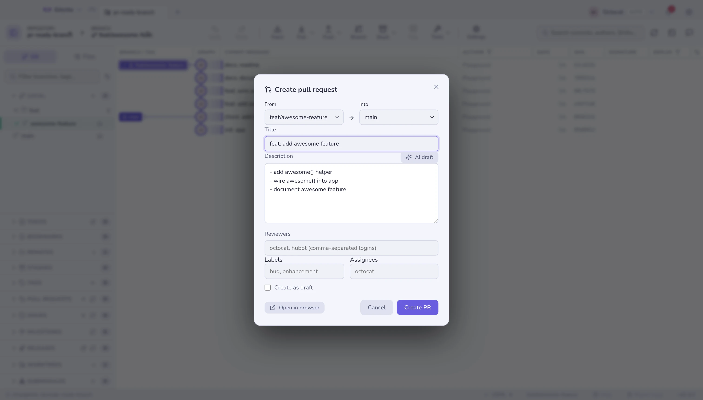
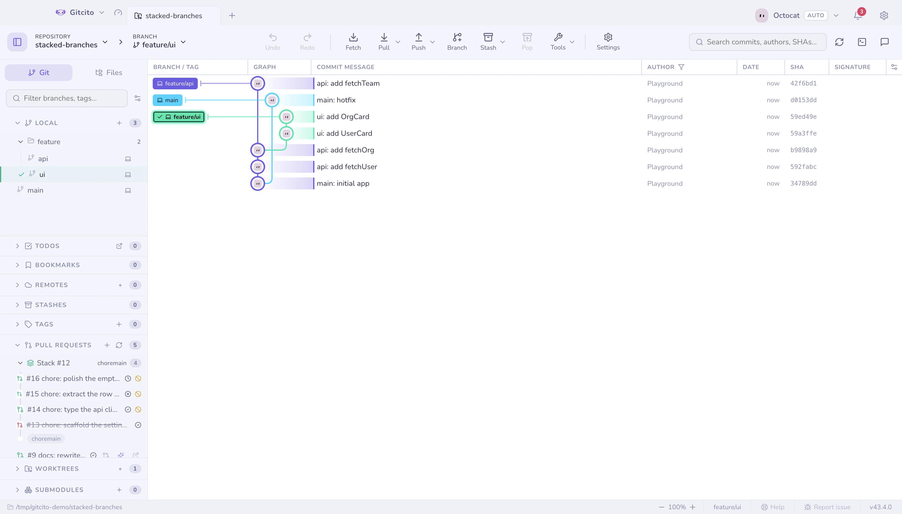

# Хостинг та pull-реквести

## Створення

Створіть pull- (або merge-) реквест, не покидаючи застосунку: випадні списки
гілок, заголовок і тіло, заздалегідь заповнені з комітів гілки, перемикач
чернетки і — на GitHub — рецензенти, мітки та виконавці, застосовані одразу під
час створення.

Працює на **GitHub, GitLab, Bitbucket і Azure DevOps**. Відкриті PR/MR для всіх
чотирьох показані на бічній панелі.

Почніть із порівняння гілок, із графа, з `+` у панелі PR або із задачі (яка
підставить `Closes #N`).

## Стеки у списку

Pull requestʼи, що стоять один на одному, згортаються в один рядок: піктограма
стека, гілка, на яку приземляється ланцюг, і скільки їх. Розгорніть — і побачите
ланцюг у порядку читання, від вершини до основи, а під кожним рядком маленьку
стрілку з тим, у що він вливається: напрям на екрані, а не виводиться з чотирьох
баз.

Групу задають дві речі: власний номер стека GitHub, якщо pull requestʼи входять
до [нативного стека](stacks.md), а інакше самі посилання — pull request, чия база
є головою іншого, стоїть на ньому. Друге правило й робить це робочим на GitLab,
Bitbucket та Azure DevOps.

У кожному рядку — стан **перевірок** його голови (наведіть, щоб побачити числа), а
на GitHub ще й рівні, вже закриті чи влиті, які список відкритих PR сховав би.
Рівень над **закритим** позначається заблокованим: його власні перевірки можуть
бути зеленими, але гілка, на яку він націлений, уже ніколи не приземлиться. Дії
рядка зʼявляються при наведенні, щоб заголовку вистачало ширини.

Читання перевірок коштує один запит на pull request і лише під час оновлення
списку.

## Рев’ю — GitHub і GitLab

| | |
|---|---|
| **Обговорення** | Коментарі та стан рев’ю |
| **Перевірки** | Прогони CI (GitHub) або завдання пайплайна (GitLab) зі статусами пройдено/провалено/очікує та посиланнями на логи |
| **Переглянуті файли** | Чек-лист із ✓ на кожен файл і прогресом |
| **Гілки коментарів** | Коментарі до рядків, згруповані за `file:line`, і відповіді |
| **Дії** | Коментувати, схвалити, запросити зміни та злити / squash |

Якщо хтось зробив примусовий пуш посеред рев’ю,
[що змінилося відтоді](range-diff.md) покаже вам, що саме зрушило.

Відмінності GitLab, названі прямо: у GitLab немає єдиного виклику «надіслати
рев’ю», тож **схвалити** використовує його ендпоінт схвалень, а **запросити
зміни** знімає ваше схвалення й публікує ваш коментар. **Rebase-merge** не
пропонується — GitLab сам обирає між merge-комітом і fast-forward за
налаштуваннями проєкту, тому в меню злиття лише merge і squash. Гілки
коментарів показують файл і рядок, але не навколишній ханк діфа, якого API
GitLab не повертає. Рев’ю та злиття працюють для проєктів на **gitlab.com**;
self-hosted-інстанси поки не підтримуються. Bitbucket і Azure DevOps для рев’ю
досі відкриваються в браузері.

## Задачі, віхи, релізи — GitHub

Переглядайте задачі й відкривайте повноцінну вкладку задачі: тіло, коментарі,
мітки, виконавці, віха, поля Projects v2, закриття/перевідкриття і **створення
гілки для цієї задачі** (з назвою від ШІ). Віхи показують прогрес і свої задачі.
Релізи можна переглядати разом зі сторінкою змін.

## Сповіщення — GitHub

Уся ваша вхідна скринька — запити на рев’ю, згадки, активність CI — по всіх
репозиторіях, із фільтрами непрочитаного/усього та позначенням як прочитане.
Дзвіночок на панелі носить бейдж непрочитаного, а за бажанням спрацьовують і
системні сповіщення, коли у вас просять рев’ю або коли завершується CI.

## Токени

Окремі токени для кожного профілю — для кількох облікових записів чи організацій
— зберігаються в keychain вашої ОС. Gitcito також уміє позичити те, що вже
тримає ваш **помічник облікових даних git**, тож організація, для якої ви вже
пройшли автентифікацію, часто взагалі не потребує налаштування. Дивіться
[Безпеку та секрети](security.md).

Кожен профіль **прив'язує власний обліковий запис**. У Налаштування →
Інтеграції кнопка **Увійти через git** шукає вхід, який уже є на комп'ютері, — у
credential helper git, далі активний обліковий запис **GitHub CLI**, далі вікно
входу самого helper — і прив'язує цей обліковий запис до профілю. Нічого не
спільне неявно: новий профіль починає без підключення, а обліковий запис, уже
прив'язаний до іншого профілю, відхиляється. Щоб прив'язати другий обліковий
запис GitHub, додайте його в gh (`gh auth login`), зробіть активним
(`gh auth switch`) і увійдіть з іншого профілю — або вставте токен цього
облікового запису. Git ніколи не питає ім'я користувача й пароль у терміналі.

Сторінка показує, що використовує підключення — токен профілю, його прив'язку до
helper git чи до GitHub CLI, а **Від'єднати** скасовує це лише для цього
профілю: токен стирається (на сервісі він діє, доки ви його там не відкличете),
прив'язка знімається (вхід лишається в gh або в helper).

І API сервісу — pull request'и, issues, CI, — і fetch, pull та push самого git
через https використовують токен або прив'язаний обліковий запис профілю.
Облікові дані потрапляють у git лише для цієї однієї команди, лише для хоста
віддаленого репозиторію, і ніколи не записуються в `.git/config`. Профіль без
жодного з них лишає git його власному credential helper. Azure DevOps, GitLab і
Bitbucket прив'язуються через credential helper git — Git Credential Manager
зберігає кілька облікових записів на сервіс — або використовують токен на
профіль. Прив'язка вказує один обліковий запис на сервіс, тож організаціям із
різними обліковими записами потрібен окремий профіль для кожної.

**Дивіться також:** [Стековані гілки](stacks.md) · [Можливості ШІ](ai.md)
