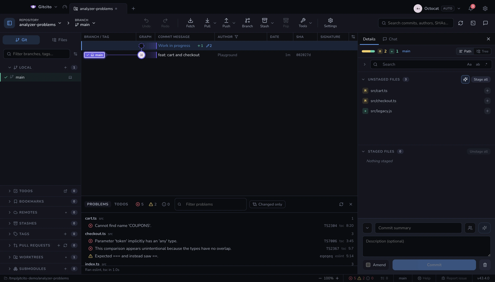

# Проблеми

У кожному проєкті вже є інструмент, який скаже, що з ним не так — `tsc`,
`dart analyze`, ESLint, Clippy, `go vet`, Ruff. Жоден з них не скаже, чи саме
**ваш** diff приніс ті сорок попереджень, які він щойно надрукував. Gitcito
знає, які файли змінені, тож той самий список відповідає на це питання одним
перемикачем.

Рядок стану несе лічильник — помилки, попередження, відомості: три числа, читати
які всіх навчив VS Code. Клац (або **Проблеми** в палітрі команд) — і панель
відкривається внизу, згрупована за файлами. Клац на рядку відкриває файл саме
там. До першого проходу він показує риски, а не нулі: ніхто ще не дивився, а три нулі стверджували б протилежне.

## Що запускається

| Якщо в репозиторії є | Gitcito запускає |
|----------------------|------------------|
| `pubspec.yaml` | `dart analyze --format=machine` |
| `tsconfig.json` | `tsc --noEmit` |
| конфігурація ESLint | `eslint -f json` |
| `Cargo.toml` | `cargo clippy --message-format=short` |
| `go.mod` | `go vet ./...` |
| `pyproject.toml` або `ruff.toml` | `ruff check --output-format=json` |

**Flutter покритий рядком про Dart:** застосунок на Flutter — це проєкт на Dart,
а `flutter analyze` викликає той самий аналізатор, що й `dart analyze`.

**Проєкт не мусить лежати в корені.** Ці маркери шукаються й на кілька рівнів
глибше, тож застосунок Flutter у `mobile/` або пакет в `apps/web` буде знайдено,
і кожен аналізатор запуститься в каталозі свого проєкту. Вкладений проєкт того
самого типу пропускається, якщо його вже покриває предок — кореневий
`tsconfig.json` каже саме це, — а прохід зупиняється на дванадцяти проєктах:
монорепозиторій не повинен піднімати п’ятдесят компіляторів.

**Налаштування → Загальні → Аналізатори коду** вирішують, наскільки він
меткий: прохід при відкритті панелі (типово), лише за кнопкою оновлення або
вимкнено — що повністю ховає половину з аналізаторами, її лічильник у рядку стану
та її команду.

Бінарник з `node_modules/.bin` перемагає той, що в PATH — так само його
знаходять скрипти самого проєкту. Усе виконується паралельно, а вивід кожного
інструмента зводиться до однієї форми, без дублікатів і відсортовано: два
аналізатори про той самий рядок дають один запис.

**Ніщо не запускається саме.** `tsc --noEmit` на великому репозиторії — це
десятки секунд, і ці команди належать інструментарію репозиторію, а не Gitcito.
Вони стартують, коли ви відкриваєте панель або тиснете оновлення, і ніколи
самі. Тому список — це знімок: змініть файл, і він застарів до наступного
запуску.

**Згенерований вивід відкидається.** Інструмент, спрямований на корінь проєкту,
перевіряє все, що знайде, — а знаходить він і `.next/build/chunks`, і зібраний
`dist`, і вендорну копію: сотні претензій до коду, написаного машиною, ховають
десяток претензій до вашого. Gitcito питає git, які файли ігноруються, і відкидає
їх, але ніколи — *відстежуваний* файл: закомітити згенероване це рішення, і
`git check-ignore` його поважає. `node_modules` іде в будь-якому разі.

## Лише те, що ви змінили

Перемикач у шапці відкидає всі проблеми у файлах, яких ви не торкалися. Саме цей
вигляд варто тримати відкритим: пласкій список усіх попереджень кодової бази за
тиждень стає шпалерами, а «чи додав їх цей diff» — питання, на яке варто
відповісти до коміту.

Значки серйозності теж фільтрують. Згаслі означають *показувати все*; засвітити
один — звузити до нього.

## Тести

Третя вкладка панелі запускає набір тестів проєкту й показує результат деревом: кожен файл тестів, а в ньому його тести, невдалі першими. **Запустити тести** в палітрі команд відкриває її і починає прогін; кнопка ▶ на вкладці робить те саме, а ↻ запускає знову.

| Рядок | Клік |
|---|---|
| Невдалий тест | Відкриває файл тесту на рядку, на який вказує падіння, і розгортає повідомлення під рядком |
| Пройдений або пропущений тест | Відкриває файл тесту |
| Файл, що впав до запуску будь-якого тесту (синтаксична помилка, зламаний імпорт) | Відкриває файл; його повідомлення каже, що його зупинило |

**Лише невдалі** лишає тільки падіння; пошук фільтрує за назвою тесту або за шляхом, щоб лишити файл цілком.

Читається машинний звіт самого раннера — `vitest run --reporter=json` або `jest --json`, — а не його вивід, тому назви, тривалість і повідомлення точні. Рядок береться зі стеку падіння: це перевірка, що впала, а не початок тесту.

Обмеження, прямо:

- **Лише vitest і jest**, знайдені в `package.json` у корені репозиторію; якщо вказано обидва, перемагає vitest. Набори окремих пакетів монорепозиторію по одному не запускаються.
- **Запускається лише встановлений раннер** — пакет у `node_modules`, запущений напряму через Node (без оболонки, тож жоден шлях ніколи не читається як команда). Якщо його вказано, але не встановлено, вкладка про це скаже; нічого не завантажується за вас.
- **Увесь набір щоразу.** Режиму «лише те, що я змінив» поки немає, і повільний набір триває тут стільки ж, скільки в терміналі. Через десять хвилин він зупиняється.
- Якщо раннер впаде до запису звіту, вкладка покаже, що він вивів.
- Запускається код проєкту, як це зробив би `npm test`, — на запит, ніколи сам собою.

## Обмеження

- **Жодного мовного сервера.** Це прохід, а не демон: без підкреслень під час
  набору і без результатів, доки ви не попросили.
- **Невстановлений інструмент називають, а не ховають.** У підвалі написано, що
  не вдалося запустити: порожній список без пояснення гірший за короткий із
  причиною.
- **Розуміється лише машинний вивід.** Кожен аналізатор читається з його
  задокументованого машинного формату; інструмент, налаштований друкувати інше,
  тут невидимий.
- **Стеля — п’ять тисяч проблем.** Далі панель про це каже і зупиняється: у
  репозиторію в такому стані проблема більша за смугу прокручування.

**Див. також:** [Локальний CI](local-ci.md) · [Вбудований термінал](terminal.md)
