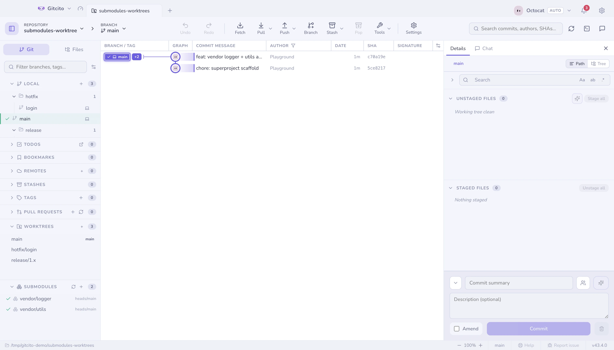

# Робочі дерева та підмодулі

## Робочі дерева

Робоче дерево — це друга робоча копія того самого репозиторію у власній теці, тож
ви можете дивитися на `main`, поки `feature/x` залишається рівно таким, яким ви
його покинули, і без жодного стешу.

- Створюйте й видаляйте робочі дерева з бічної панелі. **Подвійний клік**
  відкриває дерево власною вкладкою; права кнопка дає *Відкрити робоче дерево*,
  *Показати в теці* та видалення.
- Клацніть правою кнопкою на локальній гілці → **Відкрити в робочому дереві**,
  щоб розгорнути її в сусідній теці й відкрити як вкладку.
- Гілка живе лише в одному робочому дереві водночас, тож перейти на гілку, яку
  вже тримає інше дерево, неможливо — git відмовляє словами *already used by
  worktree at …*. Gitcito натомість веде вас туди: у меню гілки написано
  *Перейти до `x` в її робочому дереві*, а подвійний клік на рядку відкриває
  вкладку того дерева замість помилки.

### Догляд за робочими деревами

Робоче дерево, створене минулого місяця, легко забути, а питання з’являються під час прибирання: чи є в ньому робота? Чи існує ще тека? Кожен рядок відповідає на них наперед.

| У рядку | Означає |
|---|---|
| **●3** | Три файли з незакоміченими змінами в цьому робочому дереві |
| **↑2 ↓1** | Його гілка на два коміти попереду й на один позаду свого upstream |
| 🔒 | Заблоковано — наведіть, щоб побачити причину, вказану під час блокування |
| **немає теки**, назву закреслено | Теки більше немає; у git лишився тільки запис |

Числа читаються під час відкриття секції, коли змінюється коміт цього робочого дерева і коли вікно повертає фокус — не при кожному оновленні, бо кожне з них — це `git status` в іншій теці.

Клацніть рядок правою кнопкою, щоб:

| Дія | Що робить |
|---|---|
| **Заблокувати робоче дерево** | Не дає git (і будь-якому іншому клієнту) очистити, перемістити чи видалити його. Вкажіть причину — *на зовнішньому диску* — і вона з’явиться біля замка. Для робочих дерев на носіях, які підключені не завжди. |
| **Розблокувати робоче дерево** | Протилежна дія. Скасування знову блокує його з тією самою причиною. |
| **Перемістити робоче дерево…** | Переміщує теку й оновлює зв’язки git в обидва боки. Недоступно, поки дерево заблоковане або відкрите у вкладці: вкладки та їхнє розташування запам’ятовуються за шляхом, і вкладка вказувала б у нікуди. Спершу закрийте її. Скасування повертає його на місце. |
| **Видалити робоче дерево** | Спершу питає git, що буде втрачено. Чисте дерево отримує звичайне підтвердження, а скасування створює його знову на тій самій гілці в тій самій теці. Дерево з незакоміченими змінами отримує окреме підтвердження, *Відкинути й видалити*, з кількістю файлів — без скасування. |
| **Перепідключити переміщену теку…** | Лише в рядку «немає теки»: вкажіть, куди переїхала тека (ви перемістили її файловим менеджером), і git знову зв’яже її через `git worktree repair`. |
| **Забути відсутні робочі дерева** | Це також кнопка-гумка в заголовку секції, видима, коли якоїсь теки немає. Запускає `git worktree prune`. |

Чого ці дії **не** роблять:

- **Видалення робочого дерева стирає і його ігноровані файли** — `.env`, `node_modules`, результати збірки. Git не вважає їх змінами, тому про це попереджає навіть «чисте» підтвердження, а скасування їх не поверне.
- **«Забути» видаляє лише запис у git.** Видаляти нічого — теки вже немає, — а заблоковані дерева пропускаються: заблоковане дерево на від’єднаному диску виглядає точнісінько як видалене.
- Блокування — це домовленість між клієнтами git, а не захист файлів: воно не заважає нічому поза git видалити теку.
- Головне робоче дерево — сам репозиторій — не можна заблокувати, перемістити чи видалити.
- Видалення робочого дерева ніколи не видаляє його гілку. Видаліть її у списку гілок, якщо вона більше не потрібна.

## Підмодулі

Додавайте, оновлюйте (init і checkout), синхронізуйте URL та видаляйте підмодулі
— із живим статусом для кожного:

| Статус | Означає |
|---|---|
| **Синхронізовано** | Стоїть на тому коміті, який записує батьківський репозиторій |
| **Змінено** | Стоїть десь інде або має брудні зміни |
| **Не ініціалізовано** | Записаний, але жодного разу не витягнутий |

**Дивіться також:** [LFS та sparse-checkout](lfs-sparse.md) · [Фетч, пул і пуш](syncing.md)
