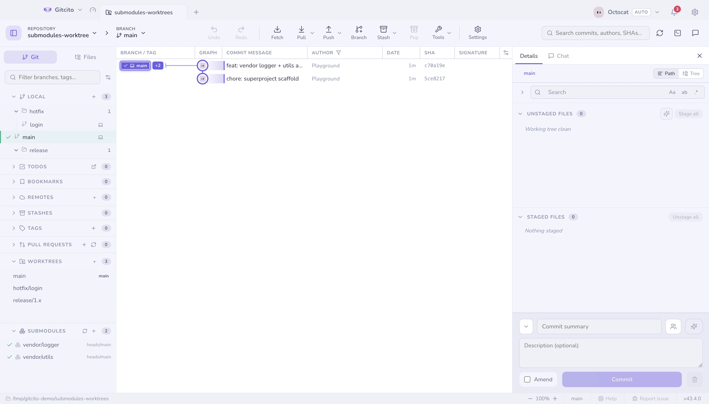
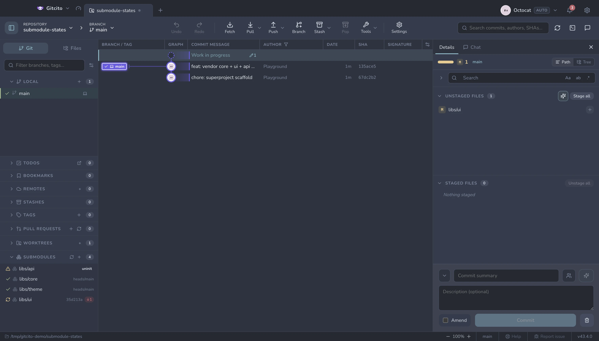

# Worktrees & submodules

## Worktrees

A worktree is a second checkout of the same repository, in its own folder — so
you can look at `main` while `feature/x` stays exactly as you left it, with no
stashing.

- Create and remove worktrees from the sidebar. **Double-click** one to open it
  as its own tab; right-click for *Open worktree*, *Reveal in folder* and
  removal.
- The WORKTREES section's **+** opens the add-worktree dialog: pick the base
  branch, optionally name a new branch to create from it (leave empty to check
  out the base itself), choose or type the folder — suggested as a sibling
  `repo--branch` — and decide whether to open the worktree as a tab right away.
- Right-click any local branch → **Open in a worktree** to spin one up in a
  sibling folder and open it as a tab.
- If you tick **Index the worktree with codegraph** in the dialog (off by
  default), the repository is indexed with codegraph (a `.codegraph/` folder)
  and the CLI is on PATH, a new worktree is indexed in the background too — agent
  sessions opened inside it get the same code intelligence without a manual
  `codegraph init`.
- Tick **Copy gitignored files (.env) into the new worktree** (off by default)
  and each new worktree starts with the source repo's ignored files already in
  place — `.env`, local overrides, credentials files — enumerated through
  git's own ignore machinery so nested .gitignore and global excludes count.
  Generated directories (`node_modules`, `dist`, `.venv`, …) and files over
  64 MB are skipped: the point is configs, not build output.
- The worktree's `.git` file is written with a relative `gitdir:` path instead
  of the absolute drive-letter path git stamps by default, so the tree keeps
  working from shells that cannot parse `E:/…` — WSL terminals and the agents
  that run in them.
- A branch can live in only one worktree at a time, so checking out a branch
  another worktree already holds cannot work — git refuses with *already used by
  worktree at …*. Gitcito takes you there instead: the branch's menu reads *Go
  to `x` in its worktree*, and double-clicking the row opens that worktree's
  tab rather than failing.

### Grouping worktrees in the header

Worktree tabs open with `root · branch` labels, which gets wide fast. Tick
**Offer to group worktrees that share a root repository** in the add-worktree
dialog (off by default, remembered like the codegraph option) and the dialog
adapts to the family: if the root or a sibling worktree already sits in a
group it says so and the new worktree joins it; if the root is open as a
standalone tab a **Group name** field appears (prefilled with the root's
folder name) and both land in a new group; with no family member open it just
says the worktree opens as its own tab. Inside the group, chips collapse to
just the leaf (`main`, `feature/x`) because the group already says which
repository they belong to — a Settings → Layout toggle keeps the full
`root · branch` name if you prefer. The offer only ever joins worktrees that
share the same root — it never merges unrelated repositories.

## Submodules

Add, update (init & checkout), sync URLs and remove submodules, with live status
for each one:

| Status | Means |
|---|---|
| **In sync** | Checked out at the commit the parent records |
| **Modified** | Checked out somewhere else, or dirty |
| **Uninitialized** | Recorded, but never checked out |

**See also:** [LFS & sparse-checkout](lfs-sparse.md) · [Fetching, pulling & pushing](syncing.md)
