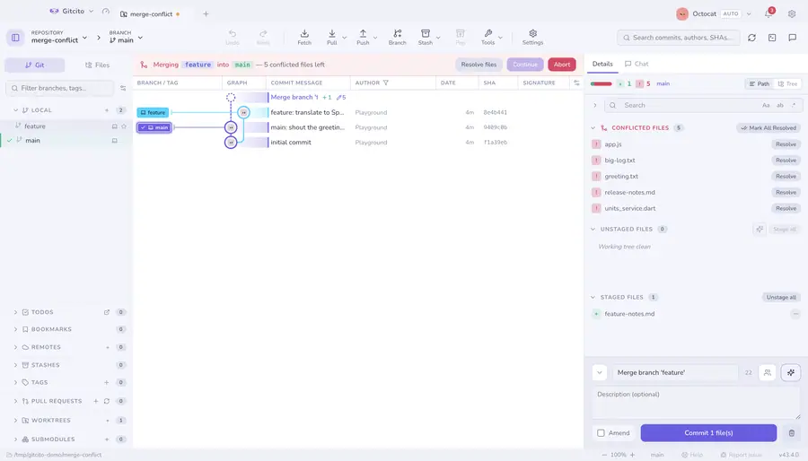
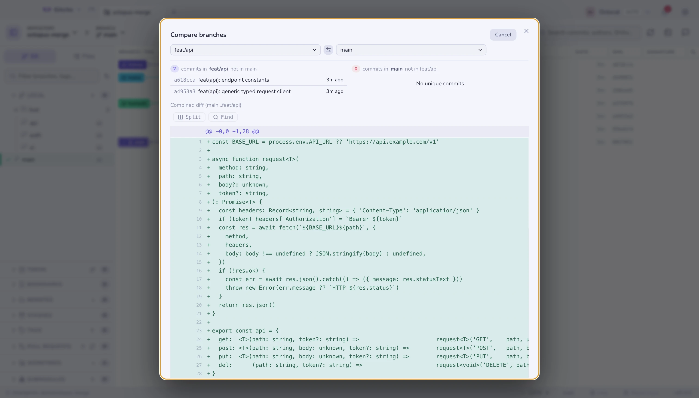
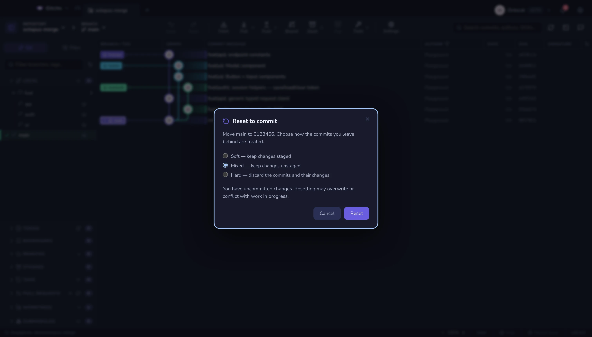

# 合并与变基

## 从侧边栏

右键点一个分支，选**合并到当前分支**或**变基到**——当普通的合并总是出岔子时，也可以选**带选项合并…**；参见[合并选项](merge-options.md)。

## 把一个引用拖到另一个上面

全 app 里最快的手势：拎起一个分支，丢到另一个上面。Gitcito 会弹出一个小菜单，列出这一放可能意味着什么，在你做出选择之前什么都不做。

它在展示引用的**两个**地方都能用——侧边栏里的分支、远程和标签行，以及提交图里那些彩色的**引用徽标**本身。在它们之间怎么拖都行；悬停时投放目标会高亮。

| 放下 | 意味着 |
|------|-------|
| **将 {target} 快进到 {source}** | 不检出目标，直接把目标移到源——仅当目标是落后于源的本地分支且不是这里或另一个[工作树](worktrees.md)的当前分支时出现 |
| **合并 {源} → {目标}** | 检出目标，并把源合并进去 |
| **把 {源} 变基到 {目标}** | 把源的提交在目标之上重放一遍 |
| **将 {source} 交互式变基到 {target}…** | 打开[交互式变基](rebase.md)规划界面——当源是当前分支时出现 |
| **将 {source} 推送到 {target}** | 把源推送到目标的远程分支（`origin/main`）——从不强制推送，因此非快进的更新会被远程拒绝；会先询问，并与任何推送一样进行敏感信息检查 |
| **将 {source} 重置到 {target}…** | 打开重置对话框——soft、mixed 或 hard，并说明各自保留什么——当源是当前分支时出现 |
| **创建拉取请求 {source} → {target}…** | 打开已填好两个分支的[拉取请求](hosting.md)表单——当远程位于受支持的托管方时出现 |
| **推送 {source} 并发起到 {target} 的拉取请求…** | 当源尚未在远程时替代*创建拉取请求*：先推送，再打开表单 |
| **比较** | 打开[比较](#比较任意两个引用)——什么都不改 |

**菜单只提供 git 做得到的事。** 合并会把提交落到目标上，所以目标必须是一个本地分支——你没法合并进一个标签或一个远程跟踪引用。变基会重写源，所以源必须是一个本地分支。把一个标签丢到远程分支上，你能拿到的只有*比较*，因为那确实就是全部可能了。

变基会先请你确认：它给每个被重放的提交一个新的哈希，这意味着如果分支已经发布出去，就得强制推送。推送也会询问：每个拉取目标的人都会拿到它的提交，而推送无法在 Gitcito 里撤销。合并不问——它只做加法。合并和变基一次**撤销**就能回来。

## 把提交拖到分支上

把图中的一行提交拖到某个**本地分支**的标签上：

| 放到 | 提供 |
|------|------|
| 当前检出的分支 | 把提交 **cherry-pick** 到这里；把分支 **reset** 到它（reset 对话框会说明每种模式保留什么） |
| 另一个本地分支 | **检出并 cherry-pick**；把分支**移动**到该提交（`git branch -f`） |

移动分支会先确认：只有该分支能到达的提交，之后将不在任何分支上。撤销会把分支放回原处。
远程跟踪分支和标签不接受提交，因为 git 不会这样移动它们；已经指向该提交的分支也不提供
任何操作。同样拖到 AI 聊天中，仍会把提交作为上下文加入。

## 合并

能快进就快进，或者在你想把拓扑结构记录下来时强制生成一个合并提交。如果冲突了，你会落到[解决器](conflicts.md)里。

## 比较任意两个引用

挑一个基准引用和一个对比引用——分支、标签或裸 SHA 都行，还有个交换按钮——你就能拿到领先/落后的计数、各自独有的提交、完整的合并差异，以及一键交接去**开一个 PR**。

从侧边栏（与当前分支比较）、工具菜单，或者 <kbd>⌘K</kbd> 都能到。

## 拣选、还原、重置

拣选和还原一如既往地待在提交图的右键菜单里。**重置**现在是单独一项——**重置到此提交…**——而不是三个彼此矛盾的裸 soft/mixed/hard 条目。

修补、撤销和重置排在单个提交菜单的最上面，并且**在不安全时保持可见**：它们会被禁用，并用提示说明原因。撤销只面向尚未推送的 HEAD；修补对已发布的 HEAD 也放行，但会警告需要一次强制推送。重置只能到达本地祖先，外加第一个已发布的提交——不能到任意更老的历史。

重置对话框把模式讲得明明白白：

| 模式 | 结果 |
|------|--------|
| **Soft** | 保留已暂存的更改 |
| **Mixed** | 保留未暂存的更改 |
| **Hard** | 丢弃这些提交及其更改 |

Hard 永远不会被预先选中。工作树不干净时还会多一道警告，因为重置可能覆盖进行中的工作，或与之冲突。**在 GitHub 上查看**和复制操作放在一起，只对 github.com 远程上已发布的提交开放。

先多选若干提交，拣选就会把整个选区按顺序全部应用。

## 在你合并任何东西之前

[冲突雷达](conflict-radar.md)会拿每个分支去和一个基准比对，告诉你哪些会打起来，而且不用检出任何东西。

**另请参阅：** [交互式变基](rebase.md) · [堆叠分支](stacks.md) · [冲突雷达](conflict-radar.md)
