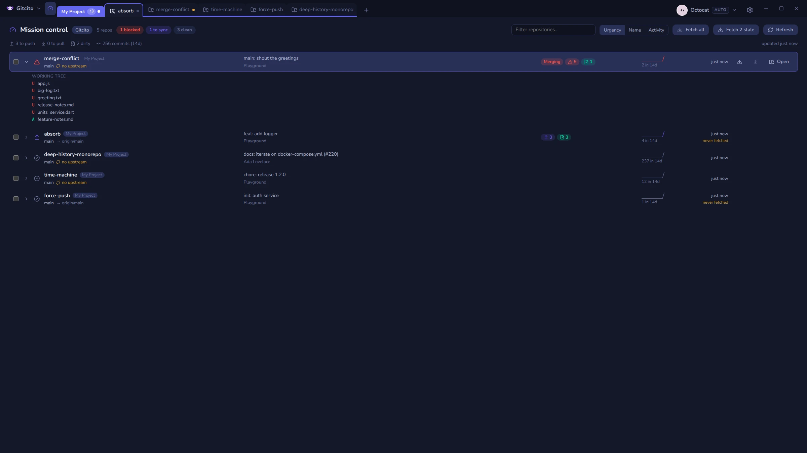

# 任务中心

二十个仓库，而问题永远是同一个：哪一个需要我？

任务中心回答它。**当前工作空间**里的每一个仓库都在同一屏上，按谁真正需要你来排序：

1. **受阻**——一次变基或合并做了一半停在那儿、有冲突、或者仓库根本读不出来。
2. **待同步**——先是要拉取的提交，然后是要推送的提交。
3. **进行中**——未提交的工作、未跟踪的文件。
4. **干净**——安静的那些，待在底部，那才是它们该在的地方。

## 一行能告诉你什么

每一行从左往右读，各列在整个列表中对齐，因此可以像表格一样比较数字：

| 列 | 显示内容 |
|---|---|
| **仓库** | 名称、分组、分支及其上游 —— 没有时以琥珀色显示**无上游**：这样的分支不会被误推送，但也永远不会同步 |
| **最近提交** | 标题和作者：不用打开就知道仓库最近在做什么 |
| **计数** | 冲突 · ↓ 待拉取 · ↑ 待推送 · 已暂存 · 已修改 · 未跟踪 · stash · 打开的 PR（仓库已加载时）。悬停可查看每个数字统计的是什么 |
| **活动** | 14 天提交的迷你折线图，以及提交数量 |
| **时间** | 距离最近一次提交和最近一次**获取（fetch）**的时间 |

悬停在状态图标上，可以看到这一行排在这里的原因 ——“2 个待推送 · 1 个未提交”。

显示获取时间，是因为读取这个页面从不执行 fetch：“待拉取”的数量只和最近一次 fetch
一样新。有上游的分支一天或更久没有 fetch，或从未 fetch 时，时间会变成琥珀色 ——
在相信一个 0 之前先 fetch。时间直接从 git 读取，所以在终端里执行的 `git fetch`
也算数。

窗口较窄时，最近提交这一列最先隐藏，计数保留。

展开一行（点箭头，或按 <kbd>space</kbd>）就能确切看到有哪些提交正等着被推送、哪些文件是脏的。

## 把这张列表用起来

- 顶部那排状态药丸是**筛选器**——点「3 个受阻」就只看那几个。
- 可以按**紧迫度**、**名称**或**活跃度**排序。
- **勾选若干仓库**去获取它们，或者只拉取那些落后的（按钮会替你数好个数）。
- 只要它开着，每 30 秒自己刷新一次。

| 按键 | 动作 |
|---|---|
| <kbd>↑</kbd> <kbd>↓</kbd> 或 <kbd>j</kbd> <kbd>k</kbd> | 在列表里走动 |
| <kbd>Enter</kbd> | 打开那个仓库 |
| <kbd>f</kbd> / <kbd>p</kbd> | 获取 / 拉取它 |
| <kbd>space</kbd> | 展开它 |
| <kbd>/</kbd> | 跳到筛选框 |

## 它是一个视图，不是一个标签页

工作空间名字旁边的那个仪表盘图标用来开关它；点任意一个标签页就回到你的工作。它从不给自己添一个标签页，而且它属于你当前所在的那个工作空间——切换工作空间，你拿到的就是那个工作空间的看板。

读取它是**纯本地**的：每个仓库一次 `git status`，不走网络，不用令牌。打开这块看板从不去任何地方做认证。获取永远是你主动要求的。

**另请参阅：** [工作空间与标签页](workspaces.md) · [工作空间、标签页与分组](workspaces.md)
