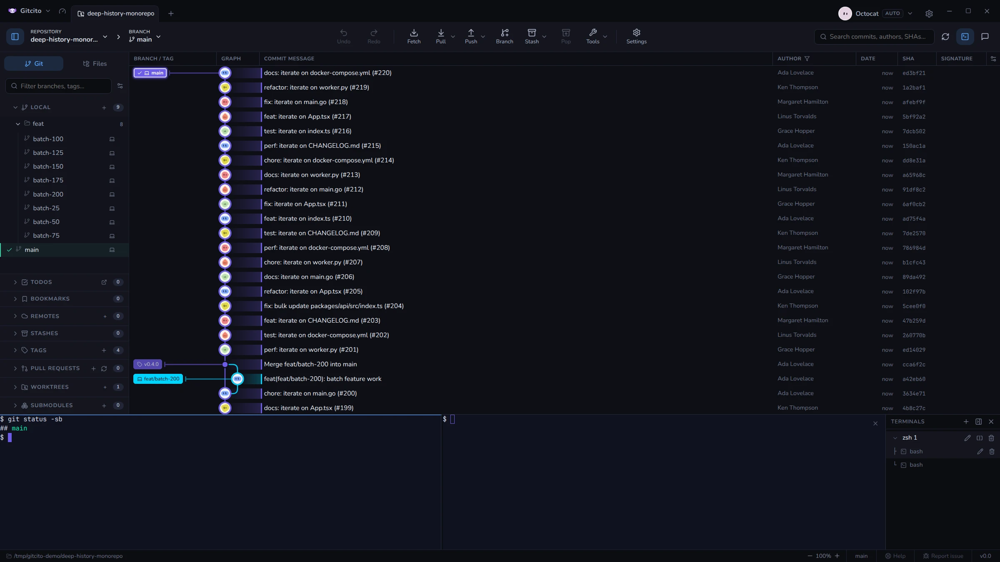

# 集成终端

一个真正的 PTY（xterm + node-pty），不是命令启动器。你的 shell，你的提示符，你的别名。

- **每个仓库可开多个标签页**，每一个都从该仓库的文件夹启动。
- 把它停靠在图谱**下方**，或作为**右侧栏**；面板会记住自己的尺寸。
- 终端的可见性是按仓库记的：切换到一个从未开过终端的标签页，它就保持关闭。
- 标签页会按其中正在运行的东西给自己命名。
- 折叠终端列表会把它收成一条**导轨**：每个终端一个图标（分屏终端会显示一张迷你面板图），点击即可切换，右键打开惯常的重命名／分屏／终止菜单。
- 在列表中**把一个终端拖到另一个上**即可合并成拆分组。每个终端作为窗格保留自己的
  名字；合并后的组会得到一个新的编号名称。

## 按键

| 按键 | 作用 |
|---|---|
| <kbd>⌃`</kbd> | 显示或隐藏终端——在所有平台上都是物理 Control 键 |
| <kbd>⌘T</kbd> / <kbd>Ctrl+T</kbd> | 终端有焦点时新建终端 |
| <kbd>⌘W</kbd> / <kbd>Ctrl+W</kbd> | 关闭当前终端；关闭最后一个会隐藏面板 |
| <kbd>Ctrl+Shift+C</kbd> | 复制选区；有选区时单独的 <kbd>Ctrl+C</kbd> 也会复制，没有选区时仍是 SIGINT |
| <kbd>Ctrl+V</kbd> / <kbd>Ctrl+Shift+V</kbd> / <kbd>Shift+Ins</kbd> | 从剪贴板粘贴 |
| 右键 | 复制选区；没有选中内容时粘贴 |

前两个快捷键有意只在终端内生效：在终端之外，它们仍然打开和关闭
[工作区标签页](workspaces.md)。在 macOS 上，“编辑”菜单的复制/粘贴也是同样的行为。

## 脚本建议

输入 `npm run `（或 `pnpm`、`yarn`、`bun run`），光标处会出现项目的脚本列表，并随输入
过滤：`npm run loc` 能找到 `LOCAL_SERVER`。每个名称旁边显示它运行的命令。

| 按键 | 作用 |
|------|------|
| **Tab** | 补全所选脚本 |
| **↑ / ↓** | 选择其他项 |
| **Esc** | 关闭列表，直到你再次输入 |

其他命令也有各自的列表：

| 输入 | 列出 | 读取自 |
|---|---|---|
| `composer run ` | Composer 脚本 | 最近的 `composer.json` |
| `make ` | Makefile 目标，目标后的 `## 文字` 作为说明 | 当前目录的 `Makefile`，与 `make` 的读取方式一致 |
| `git checkout `、`switch`、`merge`、`rebase` | 本地分支，然后是按短名称列出的远程分支 | shell 所在的仓库 |

由变量或模式（`%.o`）构成的 Makefile 目标不会列出，
`git checkout -b` 也没有列表：它是在为新分支命名。

脚本来自离 shell **当前**目录最近的 `package.json`，所以 `cd frontend` 之后看到的是前端
的脚本。以所输入内容开头的名称排在前面，包含它的名称排在后面。

列表只知道你自上次回车以来输入的按键。用 ↑ 调出历史命令、移动光标或使用 shell 自带的
Tab 补全，都会在它看不到的地方改变这一行，因此它会保持安静直到下一次回车，而不是补全
错误的内容。在 Windows 上无法读取当前目录，所以列表跟随终端打开时所在的文件夹。

## 你的 PATH

这里的 shell 以**登录 shell** 启动，和 Terminal.app、iTerm 一样，因此
`~/.zprofile`、`~/.zlogin` 和 `~/.bash_profile` 都会被加载。这一点很关键：版本
管理器和 `brew shellenv` 通常就把自己写在那里——在你终端里能用的 `fvm`、`nvm`、
`pyenv` 之类的工具，在这里同样能用。

Gitcito 还会在启动时向你的登录 shell 询问真正的 `PATH`，并把它合并进自己启动的
每一个进程，因为从 Dock 打开的图形应用几乎什么都继承不到。如果某个命令仍然找不
到，请确认它在登录 shell 的 `PATH` 里，而不是只在交互式 shell 的 `PATH` 里。

你在这里运行的任何东西对 Gitcito 自己的加锁机制都是不可见的，所以一条手敲的长 `git rebase` 和界面上的一次点击仍然可能撞车——当终端改动了什么时，应用会从磁盘重新读取。

## Shell、主题与 Oh My Posh

在 Windows 上，设置 → 布局用来选择每个新终端启动的 shell——PowerShell、PowerShell Core
（`pwsh`）、`cmd`、Git Bash、WSL 或自定义可执行文件。终端外观（主题、字号、字体族）位于
设置 → 主题 → 终端主题，并会立即应用到所有会话。

如果安装了 [Oh My Posh](https://ohmyposh.dev)，这一部分还会列出 `%POSH_THEMES_PATH%`
下的每个 `*.omp.json`，并提供实时预览——选中后会以 `POSH_THEME` 注入新终端，因此你的配置
文件里一句简单的 `oh-my-posh init pwsh` 就会使用它。自定义的 `.omp.json` 路径也可以；字段
保持“默认”则沿用你的 shell/配置文件或全局 `POSH_THEME` 已有的设置。已打开的会话保留创建
时的主题——关闭并重新打开终端即可应用新主题。提示符字形需要终端字体族中有 Nerd Font（例如
`CaskaydiaMono Nerd Font`），否则图标会显示为方块。

关于速度：Oh My Posh 每个提示符都会运行一次它的程序——在 Windows 上约 100–200 毫秒，
带 git 段的主题在大型仓库中更久——这表现为每个提示符前的短暂停顿，而不是 Gitcito 的卡顿。
不带 git 段的主题最快。PowerShell 的预测显示样式也有影响：
`-PredictionViewStyle InlineView` 每次按键重绘一小块区域，而 `ListView` 会重绘整个区块。

**另请参阅：** [运行与调试](launch.md) · [钩子](hooks.md)
